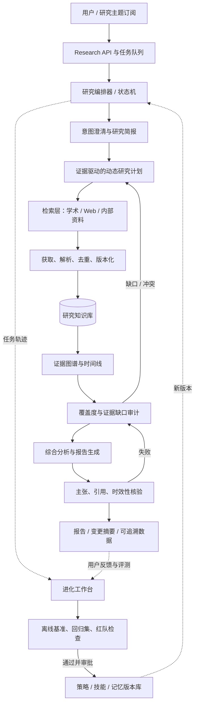

# DeepResearchRSI 总体架构设计

> 目标：围绕用户的问题和持续跟踪的研究主题，自动发现新信息、建立可追溯证据、解释工作进展，并在每次研究后改进检索与工作流。这里的 RSI 指受评测约束的系统级自我改进，不是无监督地改写自身代码或模型。

## 1. 产品定位与设计原则

DeepResearchRSI 不只是“搜网页并写摘要”，而是一个持续运行的研究工作台：

1. **研究一次**：把开放问题拆成可回答的子问题，检索文献、网页和用户资料，形成有引用的综述或技术报告。
2. **跟踪进展**：为主题、论文、作者、方法和基准建立实体关系与时间线，在新论文或新版本出现时给出增量变化，而不是重复生成整篇综述。
3. **能审计**：每个结论都回到来源片段、版本、发布时间和抓取时间；区分来源事实、作者主张、系统推断和未知项。
4. **受控进化**：从任务轨迹中找出失败模式，改进可回滚的检索策略、记忆规则和工作流；所有变化先离线评测，再灰度上线。

## 2. 总体架构



建议首版采用**模块化单体 + 后台任务队列**：模块边界清晰，部署简单；当来源抓取、解析或任务并发出现独立扩展需求后，再拆分服务。不要一开始就把每个 Agent 部署成微服务。

## 3. 一次研究任务的工作流

### 3.1 研究简报

将自然语言请求规范化为 `ResearchBrief`：

- `question`：核心问题；`scope`：主题、地区、语言、时间范围。
- `as_of`：信息截止时点；`freshness`：实时、近 30 天、历史回顾等。
- `deliverable`：论文进展表、对比综述、技术路线图、工作跟踪报告等。
- `constraints`：可信来源优先级、引用格式、深度、预算、排除项。
- `subquestions[]`：拆分后的问题；每项有预期证据类型和完成标准。

只有会实质改变检索范围或结论的问题才向用户追问；其余采用显式假设并写入报告。

### 3.2 动态规划，而非一次性写死计划

规划器先生成问题树和初始查询，再依据已发现证据补充、合并或裁剪子问题。每个子问题作为任务图节点，记录依赖、状态、预期来源和证据覆盖度。建议设置检索深度、总时长、工具调用和 token 预算；预算耗尽时返回已完成内容与未解决问题。

近期的 DAGent 提出 evidence-conditioned 的 evaluate-then-grow 规划：先基于当前证据评估，再扩展研究图，减少在尚未看到证据前提交过度固定的计划。可借鉴其控制思想，但实现时应以本项目自己的任务集验证效果。[DAGent 论文](https://huggingface.co/papers/2609.39154)

### 3.3 检索与来源适配器

用统一的 `SearchProvider` / `DocumentProvider` 接口接入：

- 学术元数据：OpenAlex、Crossref、Semantic Scholar、arXiv、PubMed 等（按领域选择）；
- 论文全文：开放仓储、出版方开放页面、用户上传 PDF；遵循站点条款与访问限制；
- 通用 Web：搜索引擎、网页读取；
- 用户/组织资料：本地文件、知识库或 MCP 连接器。

检索采用多路召回（关键词/BM25、向量、引用/实体扩展）→ 重排 → 去重。所有来源记录 URL/DOI、标题、作者、发表与更新时间、抓取时间、文档版本、来源类型、许可/可访问性、解析状态。学术元数据与网页正文分开存储，方便纠错和重新解析。

### 3.4 证据库和研究图谱

建议保留可回溯的分层数据，而不是只存 embedding：

| 对象 | 关键字段 |
|---|---|
| `Source` | 稳定 ID、URL/DOI、来源与版本、日期、可信度线索 |
| `Document` | 原文/解析文本、章节、页码、语言、解析器版本、内容哈希 |
| `Evidence` | 精确片段、页码/段落、支持/反驳/背景、定位信息 |
| `Claim` | 原子主张、主张类型、时间范围、置信度、支持与反证集合 |
| `Entity` | 论文、作者、机构、方法、数据集、指标、项目 |
| `Relation` | 提出/改进/复现/比较/引用/替代等关系及其证据 |
| `ResearchRun` | brief、计划版本、工具轨迹、预算、输出版本、评测结果 |

实现起步可用 PostgreSQL（结构化实体、JSONB、全文检索）+ pgvector（语义检索）+ 对象存储（PDF/原始快照）。图数据库不是 MVP 前提；当关系查询成为瓶颈时再迁移或加图存储。

### 3.5 综合、核验和交付

综合器围绕问题树逐项写结论，避免“按来源逐篇摘要”成为最终报告。报告应有执行摘要、范围/方法、主题综合、代表性工作比较、时间线、争议与证据缺口、下一步观察点、参考文献。

核验器把报告拆成原子主张，并检查：

- 引用是否真实存在，来源是否直接支持对应主张；
- 数字、日期、方法名称、版本是否与原文一致；
- 是否把作者的自述当成独立验证结果；
- 同一主张是否存在反证、不同定义或不同实验设置；
- “最新”是否有明确截止时间，是否漏掉新版本/撤稿/更正。

证据不足时降低措辞强度，标为推断/未确认，或触发定向补充检索。DeepResearch Bench 将报告质量与有效引用数量、引用准确率分开评测，提示架构和指标都不能只优化报告流畅度。[DeepResearch Bench 论文](https://arxiv.org/abs/2506.11763)

## 4. 多 Agent 的职责边界

Agent 是逻辑角色，可先在一个进程内运行。建议的角色：

- **Planner**：解析 brief、管理问题树、分配预算；
- **Search workers**：按来源类型或子问题并行检索；执行只读、限速工具；
- **Evidence analyst**：抽取主张、方法、结果、局限和关系；
- **Synthesizer**：形成主题级综合和报告；
- **Verifier / critic**：核验引用、时效性、覆盖度、反例；
- **Evolution manager**：离线总结失败轨迹、生成候选改进并运行评测。

用共享的结构化状态和任务队列传递结果，避免 Agent 之间传递大段无结构对话。并行 worker 应返回“证据记录 + 查询记录 + 未解决点”，而不是各自写完整报告。

## 5. RSI：受控的系统级自我改进

### 5.1 两个循环

**内循环（单次任务）**：研究 → 证据审计 → 找缺口 → 定向补搜 → 再审计 → 交付。AREX 将 Deep Research 描述为内层证据收集/回答构建和外层约束审计/定向后续研究交替运行，可借鉴这种“先审计缺口，再花预算补证据”的机制。[AREX 论文](https://arxiv.org/abs/2607.21461)

**外循环（跨任务进化）**：收集匿名化/获准使用的轨迹 → 按失败类型归因 → 生成策略、记忆或技能候选 → 在冻结评测集与新任务集上比较 → 通过门槛后灰度发布 → 监控回归并可回滚。

### 5.2 进化对象与权限

先做低风险、高可解释的对象：

1. **检索策略**：查询扩展、来源选择、重排权重、停止条件；
2. **研究技能**：例如“追踪论文版本”“横向比较实验设置”“查找反证”；
3. **记忆**：主题实体、用户偏好（需用户授权）、已见来源与研究结论及其有效期；
4. **工作流配置**：特定任务类型的步骤和预算模板。

候选改动不能直接改生产系统、凭据或安全策略。自改代码/模型权重属于更高风险阶段，需要人工审阅、隔离运行、版本控制和独立安全评测。MemSkill 的方向是让记忆操作成为可选择和改进的技能，而不是固定的提取规则；本项目可先将此用于离线记忆管线。[MemSkill 论文](https://arxiv.org/abs/2602.02474)

### 5.3 晋级门槛

候选策略必须在固定回归集上满足：事实正确性、引用准确率、问题覆盖率、时效性、可复现性不退化；同时比较检索成本、延迟和失败率。采用版本化配置、A/B 或影子评测、灰度比例和一键回滚。奖励信号不应只用 LLM 自评；混合可验证指标、人工抽检和用户反馈，并对评判模型偏差做校验。自进化 Agent 的综述也把进化对象区分到模型、记忆、工具和架构等层面，并讨论测试时与跨任务的适应方式。[Self-Evolving Agents Survey](https://arxiv.org/abs/2507.21046)

## 6. 技术模块与接口草案

```text
apps/api                 用户 API、任务状态、报告访问
services/orchestrator    状态机、预算、重试、并行度、可恢复执行
services/providers       学术 / Web / 内部文档适配器
services/ingestion       下载、解析、分段、去重、版本管理
services/evidence        Claim/Evidence 抽取、来源匹配、冲突图
services/research        规划、检索 worker、分析、综合、核验
services/evolution       轨迹归因、候选策略、离线评测、发布门禁
packages/schemas         ResearchBrief、Evidence、Claim、Report 等契约
evals/                   回归案例、基准适配器、评分报告
```

核心 API 可先收敛为：`POST /research-runs` 创建任务；`GET /research-runs/{id}` 查询状态/事件；`GET /research-runs/{id}/report` 获取报告；`POST /topics` 创建持续跟踪主题；`GET /topics/{id}/updates` 获取相对上次运行的增量变化。报告和每个 claim 都应带 evidence IDs，便于 UI 展开来源。

## 7. 运行可观测性与安全

每个任务记录结构化事件：计划变更、查询、来源、工具耗时、证据抽取、核验结果、停止原因和预算消耗。提供“为何选择此来源/为何结束研究”的审计视图。

网页和 PDF 内容是**不可信数据**，不得作为工具指令执行；工具采用 allowlist、超时、速率限制和域名策略。对用户文件执行隔离解析；避免抓取登录态或绕过访问控制；保存原文时尊重版权和删除请求。可参考 Deep Research 系统卡对多步浏览、文件处理和风险评测的描述。[OpenAI Deep Research System Card](https://openai.com/index/deep-research-system-card/)

## 8. 评测体系

按层分解评测，方便定位问题：

- **检索**：Recall@k、来源覆盖、最新版本命中、重复率；
- **证据**：片段定位准确率、主张支持/反驳判断、元数据正确率；
- **报告**：问题覆盖、事实正确、引用准确、综合质量、时效性、结构完整；
- **系统**：成功率、延迟、单任务成本、工具错误率、恢复能力；
- **进化**：改动前后配对评测、跨主题泛化、回归率、人工接受率。

每个真实任务经审核后可沉淀为回归案例，记录问题、截止日期、参考来源/关键主张和评分 rubric。对热点追踪任务加入时间切片测试，防止系统使用未来信息或把旧快照当成当前事实。

## 9. 分阶段实现路线

**阶段 1：可信单次研究**：ResearchBrief、学术/Web 检索、解析与去重、Evidence/Claim 数据模型、引用核验、Markdown 报告和完整轨迹。先支持论文进展调查这一主用例。

**阶段 2：主题持续跟踪**：主题订阅、增量检索、论文版本/引用关系、变化检测、周报与“本次新增/结论变化/待确认”视图。

**阶段 3：证据驱动的动态研究**：问题图、基于缺口的定向补搜、跨来源冲突处理、并行 worker 与预算控制。

**阶段 4：受控自进化**：建立有代表性的评测集；自动归因失败并提出检索/记忆/技能候选；仅离线跑分通过后灰度发布。最后再考虑微调模型或自动生成代码补丁。

## 10. 首版验收标准建议

首版至少做到：每个事实性结论能点回来源片段；报告明确覆盖范围和截止时间；每个子问题有“已回答/部分回答/未回答”状态；可以看到搜索轨迹和预算；遇到冲突能并列呈现而不是强行裁决；新策略在固定回归集上有可比较分数且能回滚。

这些门槛比“Agent 数量”更能决定系统是否值得信任。当前 README 的高层结构可以保留，建议用本文的模块和数据契约作为后续实现边界。
