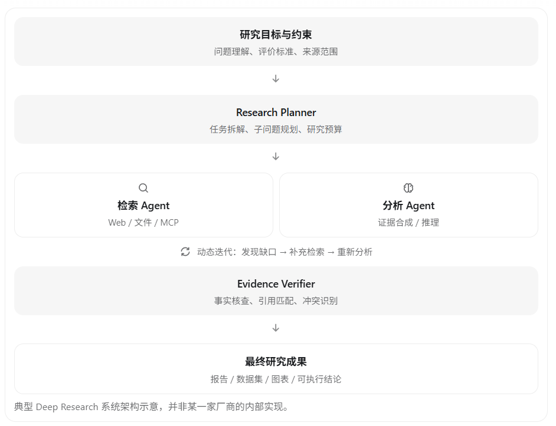

# DeepResearchRSI

自动调研的 RSI（受评测约束的系统级自我改进），辅助日常文献检索与信息收集。

整体架构：



## 这个仓库是什么

一个**持续运行的研究工作台**，不是"搜网页 + 写摘要"：

1. **研究一次** — 把开放问题拆成可回答的子问题，检索学术 / Web / 内部资料，产出带引用的报告。
2. **跟踪进展** — 为主题、论文、作者、方法、基准建立实体关系与时间线，新信息出现时给**增量变化**而不是重写综述。
3. **能审计** — 每个结论回到来源片段 + 版本 + 发布时间 + 抓取时间；区分来源事实 / 作者主张 / 系统推断 / 未知。
4. **受控进化** — 从轨迹里找失败模式，改进可回滚的检索策略、记忆规则与工作流；先离线评测，再灰度。

详细设计见 [ARCHITECTURE.md](./ARCHITECTURE.md) · [docs/](./docs/README.md) · [ADR](./docs/adr/)

## 目录一览

```text
apps/api                  用户 API、任务状态、报告访问
apps/web                  研究结果浏览（证据展开、冲突并列、轨迹审计）
services/orchestrator     状态机、预算、重试、并行度、可恢复执行
services/providers        学术 / Web / 内部文档适配器
services/ingestion        下载、解析、分段、去重、版本管理
services/evidence         Claim / Evidence 抽取、来源匹配、冲突图
services/research         规划、检索 worker、分析、综合、核验
services/evolution        轨迹归因、候选策略、离线评测、发布门禁
packages/schemas          ResearchBrief / Evidence / Claim / Source 契约（JSON + Python）
evals/                    回归案例、基准适配器、评分报告
research/                 每次真实研究任务的留档（数据目录）
docs/                     数据模型、目录职责、路线图、架构决策记录
scripts/                  校验与骨架生成工具
tests/                    契约与不变量测试
```

每个目录都有 README 说明**负责什么、不负责什么**。

## 快速开始

仓库当前处于**规范先行 + 首个研究任务已完成**阶段：Schema、校验器与流程契约可运行，服务实现待补。

```bash
# 校验研究留档的自洽性（引用闭合、字段完整、不变量）
python scripts/validate_research.py

# 生成一份新的研究任务骨架
python scripts/new_research.py --slug my-topic --question "……"

# 跑契约与不变量测试（无需 pytest）
python tests/test_schemas.py
```

## 已完成的研究任务

| 任务 | 主题 | 规模 |
|---|---|---|
| [rtx-pro-6000](./research/rtx-pro-6000/REPORT.md) | NVIDIA RTX PRO 6000 Blackwell 全系性能分析 | **439 来源 / 2804 证据 / 1999 主张（1484 高置信、9 争议）**，71 个子问题 |

该报告的几个结论值得单独一提：

- **相对 RTX 5090 的领先幅度从 -38% 到 +108%**，取决于负载与 SKU。买它是为了"装得下"（96GB），不是为了"算得快"。
- **三个 SKU 差异来自固件而非硬件**：强制 300W 时 Server 版比 Workstation 版快 38%；但 Blender 上 Server 版可能垫底。
- **渲染没有统一答案**：V-Ray 上 Server 版第一，Blender/Octane 上 Workstation 版第一，同一张卡的 Server 版 Blender 成绩两个来源相差 69%（已标 disputed）。
- **每美元渲染性能排 33 张卡的末位**：RTX 5090 的每美元性能约为它的 3 倍。
- **训练侧存在序列长度交叉点**：<4K 时比 GH200 快 1.8×，>8K 时慢 1.7–1.8×；优化器卸载在 PCIe 上基本不可用。
- **一个未被评测覆盖的运维风险**：多名用户报告在役 SW Power Cap 锁频，性能掉到 1/10–1/20，且不产生任何错误日志。
- **分辨率敏感性相差 20 倍**：同一张卡 4K 相对 FHD 的落差从 +7%（creo）到 +159%（energy），unreal 甚至反向 -10%。高分屏对可视化类负载是真实成本。
- **ISV 认证必须逐应用、逐 SKU 核对**：Dassault 已认证（WS + Max-Q），Ansys 则是 Fluent 仅 Linux、Rocky 仅 Max-Q、Speos 完全不支持。
- **官方认证 ≠ 满血运行**：NVIDIA 认证系统清单里明确写着「GPU power is capped based on system capabilities」。

## 设计红线

- 网页与 PDF 内容是**不可信数据**，不得作为工具指令执行。
- 不抓登录态、不绕过访问控制、尊重站点条款与删除请求。
- 自改代码 / 模型权重属于高风险阶段，必须人工审阅 + 隔离运行 + 独立安全评测。
- 奖励信号不只用 LLM 自评：混合可验证指标、人工抽检与用户反馈。
- **冲突不强裁决**：`confidence=disputed` 的主张必须并列呈现双方（[ADR-0003](./docs/adr/0003-conflict-presentation.md)）。
- **证据必须可回溯**：`Evidence.quote` 是原文子串，`Source.fetched_at` 必填且带时区（[ADR-0002](./docs/adr/0002-evidence-provenance.md)）。
