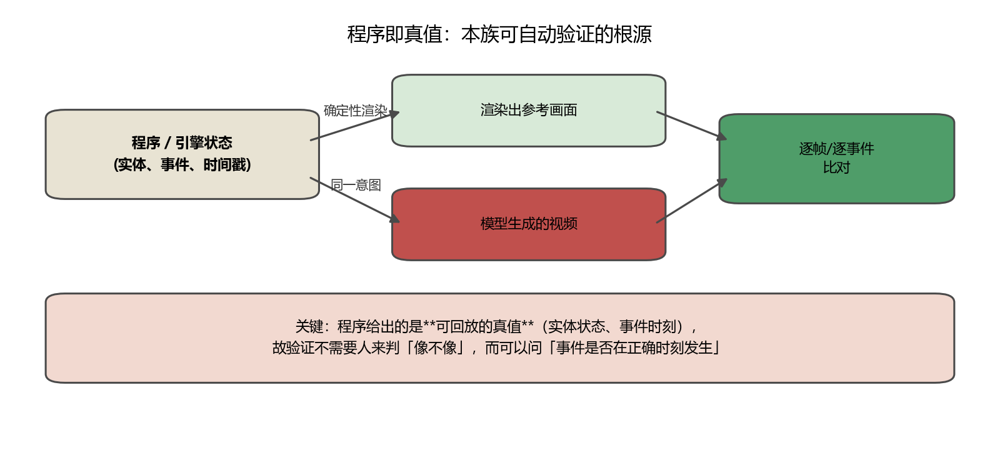
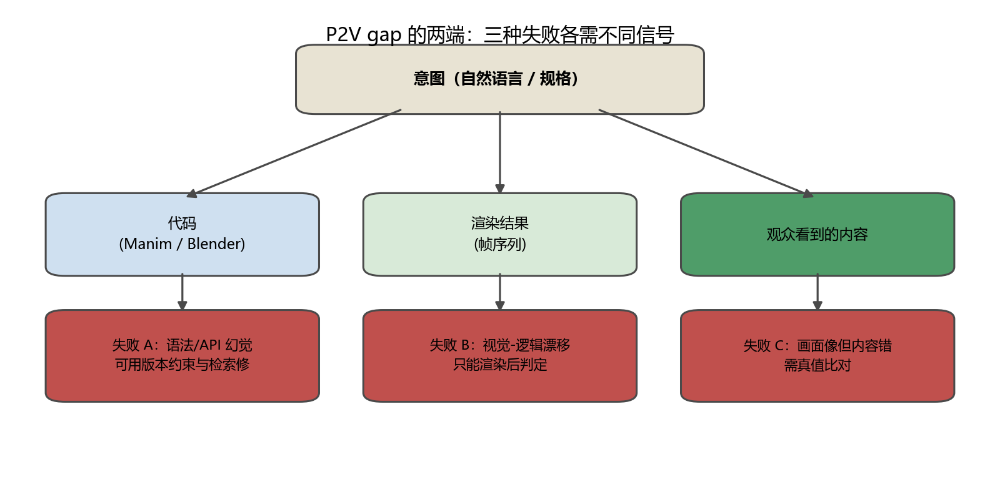
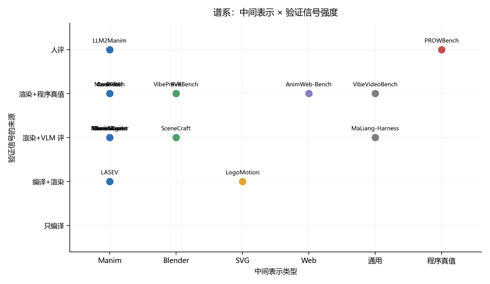
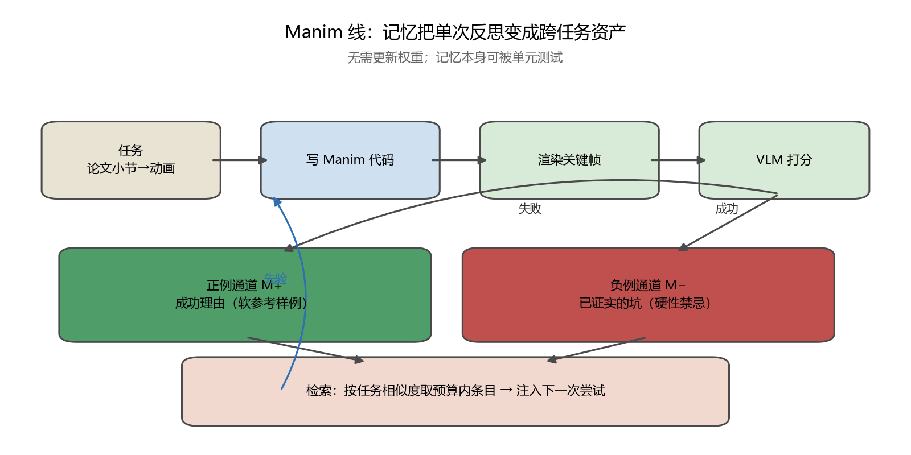
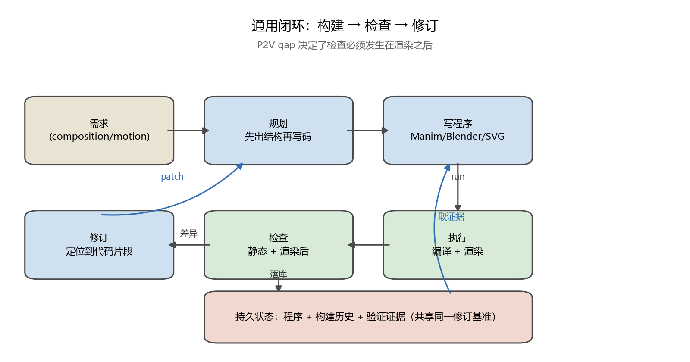
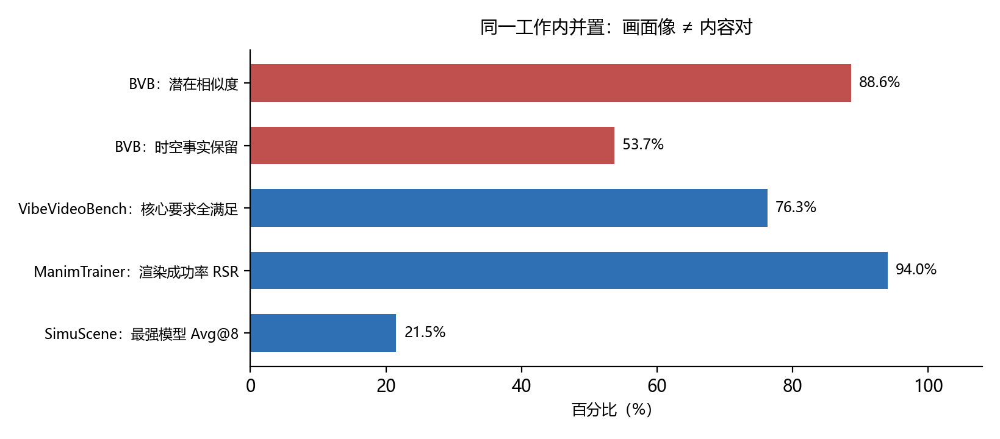
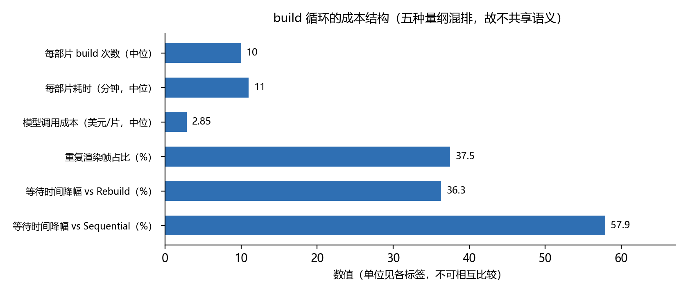
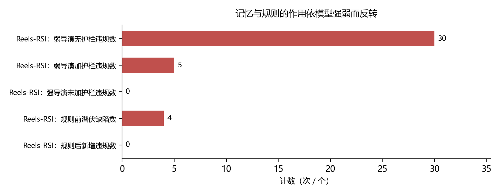

# 代码即中间表示：用程序生成视频这一族的谱系、判据与证据强度

> 综述 · 信息截止 2026-11-18
> 来源 18 ｜ 证据 35 ｜ 主张 28

## 摘要

让 AI 生成视频，主流路线是端到端扩散模型：输入文本或图像，直接输出像素。但有一类内容它系统性做不好——精确的公式、正确的图表、规则一致的交互、与画面事件严格同步的旁白。这些内容的共同点是**存在唯一正确答案**，而像素模型只能给出「看起来像」的结果。

于是出现了另一条路线：让 agent 写一段**程序**（Manim、Blender Python、SVG/CSS、图形 DSL），由确定性渲染器把它变成视频。本文系统梳理了这条路线上的 18 项代表工作，回答三个问题：这条路线为什么成立、它现在做到什么程度、它的边界在哪。

本文的核心论断是：**代码中间表示的价值不在画质，而在于它把「视频生成」转成了三个可判定的问题——可编译、可对齐、可复现。** 这三条使验证可以自动化，从而让闭环自我改进成为可能。这正是端到端像素模型难以获得的能力。

但本文同时必须指出这条路线最尖锐的两个反证。其一，MaLiang-Harness 定义的 Program-to-Visual (P2V) gap 说明：**程序可以正确执行，却完全违背用户的视觉要求**，故「编译通过」不构成验收。其二，VibePrevisBench 观测到 **agent 会查看自己的渲染，却改不对错误**——这直接反驳了「给了视觉反馈就能自我纠正」的乐观假设。

本文据此主张：这一族当前的真实瓶颈不在生成侧，而在**「把视觉差异翻译成代码修改」**这一步。谁先解决它，谁就拿到通往更高自动化的钥匙。

**关键词**：代码生成视频；程序化动画；Manim；Blender；agentic 生成；可验证性

---

## 1　引言

### 1.1 两类内容的根本差别

2026 年的视频生成模型已经能产出以假乱真的画面。但把同样的问题交给它们——「画出 y = x² 与 y = 2x 的交点」、「把这个季度的营收画成柱状图」、「让角色在第三秒推开门」——结果往往不能用。原因不是画质不够，而是这类内容**有唯一正确答案**，模型无法保证对上。

VibeVideoBench 把这个观察写成了动机：Diffusion video models produce striking clips, but they cannot reliably render an exact formula, a correct chart, a rule-consistent game or narration synchronized to on-screen events[c-why-code]。四类失败对应四种确定性要求：精确的数学、精确的数据映射、确定的规则、确定的时序。

LASEV 从另一个角度说同一件事：端到端模型在要求严格逻辑与精确知识表示的场景受限[c-why-code]。它强调的是知识正确性——教学过程不能讲错。

### 1.2 代码路线的主张

代码路线的核心主张可以用 Reels-RSI 的一句话概括：A program can be read, diffed, tested and audited; pixels can only be watched[c-auditable]。

这句话的分量在于它把问题从「生成质量」换成了「可审计性」。程序可以被 diff——所以「改了什么」是可追踪的；程序可以被测试——所以「对不对」是可自动判定的；程序可以被审计——所以「为什么错」是可定位的。像素做不到其中任何一件。

值得注意的是，Reels-RSI 进一步主张解释视频**本体上**就是程序：a program (script, storyboard and per-frame animation code) that a deterministic renderer turns into frames。这不只是工程选择，而是一个关于这类视频是什么的本体论判断。

### 1.3 本文要回答什么

- **q1** 这一族为什么选代码而不是像素？代码中间表示带来什么能力、什么代价？
- **q2** 按「中间表示的类型」与「验证信号的来源」两个轴，这一族能排成怎样的谱系？
- **q3** 每个代表工作解决什么问题、优缺点如何？
- **q4** 实验结果如何比较？各种「成功率」在什么口径下成立？
- **q5** 这条线的天花板在哪？失败有哪些典型形态？

### 1.4 主要结论

1. **代码路线的价值是可验证性，不是画质。** 程序提供可回放的真值，使「事件是否在正确时刻发生」成为可自动判定的问题，而不必依赖人评「像不像」（图 7）。
2. **P2V gap 是这一族的核心困难。** 程序正确执行 ≠ 满足视觉要求[c-p2v-gap]。这条落差把本族的全部工作分成了两类：一类在缩小它，一类在测量它。
3. **记忆机制的价值依模型强弱而反转。** 对强模型，规则起「审计」作用；对弱模型才是「护栏」[c-rule-depends]。这与「记忆越多越好」的直觉相反。
4. **benchmark 已明确指出瓶颈：agent 会看但改不对。** 这不是感知问题，而是「视觉差异 → 代码修改」的映射问题[c-blind-feedback]。
5. **指标混乱是本族当前最大的可比性障碍。** 至少三种「成功率」含义不同，感知相似度与内容保真度可以差 35 个百分点[c-look-vs-fact]。

---

## 2　P2V gap：这一族的核心困难

### 2.1 定义

MaLiang-Harness 给出了本族目前最清晰的理论表述。它先陈述现象：A program can execute correctly while violating the requested[c-p2v-gap]——程序可以正确执行，却违背请求。随后定义：We introduce and define the Program-to-Visual (P2V) gap as the discrepancy between program-level correctness and visual requirement satisfaction[c-p2v-gap]。

这个定义的价值在于它一刀切开了两个此前被混为一谈的东西：「代码对不对」与「画面对不对」。前者可以用编译器与单元测试判定，后者只能渲染后判定。

### 2.2 为什么这条 gap 必然存在

根源在于**程序是意图的一种不完备编码**。同一段程序可以满足语法、通过所有 API 检查、渲染出视频，却在语义上完全不是用户想要的。MaLiang-Harness 举的例子很具体：对象出现在错误位置、动画事件发生在错误时刻。

OmniManim 把这个困难形式化为「渲染反馈感知的约束代码生成」（render-feedback-aware constrained code generation）[c-formalization]——关键在于**约束只有在渲染之后才可判定**。它不是「写代码时小心一点」就能解决的问题，而是任务结构本身决定的。

*图 7　程序即真值：这是本族能自动验证的根源，也是 P2V gap 可以被量化的原因*

### 2.3 三种失败，三种信号

本族的失败并不均质。ManiBench 给出了一个实用的二分：Syntactic Hallucinations 与 Visual-Logic Drift[c-failure-modes]。前者是引用了不存在或已废弃的 Manim API（可靠检索与版本约束修复），后者是时序错误、缺因果（只能渲染后判定）。

本文在此基础上补出第三类，因为它在本族中被反复观测到却少被单独命名：**画面像但内容错**。BVB 的结果是这一类最锋利的证据——最好模型的潜在相似度达 88.6，却只保留 53.7% 的时空事实[c-look-vs-fact]。

*图 8　P2V gap 的两端：三种失败各需不同信号，故没有任何单一指标能覆盖全族*

---

## 3　谱系：中间表示 × 验证信号

### 3.1 为什么用这两个轴

按任务分（教育、物理、Web、3D）看似整齐，却缺乏解释力：同为 Manim 教育动画，ManimTrainer 与 Reels-RSI 的机制差异远大于 ManimTrainer 与某 Blender 工作的差异。真正的分水岭在两处：**用什么中间表示**（决定可表达的时空结构）、**拿什么信号做验证**（决定能否闭环）。

*图 1　谱系：横轴是中间表示类型，纵轴是验证信号的来源与强度。位置越高，验证越接近「有客观真值」*

### 3.2 五档验证信号

| 档 | 验证信号 | 能判定什么 | 不能判定什么 |
|---|---|---|---|
| 1 | 只编译 | 语法、API 存在性 | 一切视觉与时序 |
| 2 | 编译 + 渲染 | 能否渲出（RSR） | 内容是否正确 |
| 3 | 渲染 + VLM 评分 | 画面是否合理 | 与规格是否严格一致 |
| 4 | 渲染 + 程序真值比对 | 事件是否在正确时刻发生 | 审美与教学效果 |
| 5 | 人评 | 一切 | 无法自动化，不可扩展 |

这张表解释了一个常见误解：很多工作报告「94% 渲染成功率」，读者会以为任务解决了九成。实际上 RSR 只落在第 2 档——它只表示「能渲出视频」[c-metric-ceiling]。

### 3.3 全景

| 工作 | 解决什么问题 | 中间表示 | 验证信号 | 关键机制 |
|---|---|---|---|---|
| SceneCraft | 文本→复杂 3D 场景 | Blender Python | VLM 看渲染图迭代 | 场景图先规划 + library learning |
| LogoMotion | 设计场景的 SVG 动画 | SVG / JS | 编译 + 人评 | 代码与 GUI 控件打通 |
| LLM2Manim | STEM 教学动画 | Manim | 编译 + 专家复核 | 半自动 HITL，符号台账 |
| ManimTrainer | 训练 + 推理策略对照 | Manim | 编译 + 视觉相似度 | SFT 提代码、GRPO 提视觉 |
| ManimAgent | 跨任务累积反思 | Manim | 编译 + VLM 评关键帧 | 双通道情节记忆 |
| ManimCode | 教会小模型自我纠错 | Manim | 编译 + 无参考质量反馈 | 24,034 条反馈轨迹 + 4B 模型 |
| OmniManim | 空间布局缺陷 | Manim | 渲染后结构化诊断 | 先预测关键帧布局再写码 |
| LASEV | 教学视频的严谨性 | Manim | 质量闸门 + 编译检查 | 解题/插图/旁白三 agent |
| SimuScene | 物理动画的可执行+视觉正确 | Manim | 编译 + VLM 验证问答 | 视频视觉奖励训纯文本模型 |
| Reels-RSI | 解释视频的程序级自改进 | Manim | 静态检查 + 盲评 | 规则须带 must-fail/must-pass |
| MaLiang-Harness | P2V gap | 通用 | 持久状态 + 可追溯验证 | 程序状态/历史/验证共享基准 |
| CodeReel | build 循环太慢 | Manim | 检查判决 + 精确帧复用 | 按绘制命令做帧键 |
| VibeVideoBench | 缺通用评测 | 通用 | 程序检查 + 13k 评分项 | 沙箱禁用生成模型 |
| ManiBench | API 幻觉与时序漂移 | Manim | 四档评分 | 两类失败的命名 |
| AnimWeb-Bench | Web 动画复现 | CSS/SVG | 静态保真 + 动画保真 | 124 真实网页 |
| BVB | 视频理解的正向检验 | Blender | 双 VQA + 潜在相似度 | 用程序重建视频 |
| VibePrevisBench | 4D 场景与镜头 | Blender | 规则场景 + VLM 画面检查 | 测 agent 能否改对 |
| PROWBench | 端到端模型是否忠于程序 | 程序真值 | Logic-Render 对齐 | 程序化 episode 提供真值 |

*表 1　代表工作的定位。按中间表示分组，组内按验证信号强度排序*

---

## 4　Manim 线：教育动画与自我改进

### 4.1 为什么 Manim 成为主战场

Manim 是 3Blue1Brown 为数学解释视频开发的动画库。它被这一族大量采用，原因有三：精确的数学排版（LaTeX 内嵌）、可编程的时间轴、以及庞大的公开代码语料（ManiBench 基于其 53,000 行源码与 143 个 scene 类）。

代价也很明确：Manim 的 API 面广且版本分裂（Manim CE 与 ManimGL 不兼容），这正是 ManiBench 要专门测 Version-Conflict Error Rate 的原因。

### 4.2 从「一次写对」到「学会修」

早期工作把目标定为「一次写对」。ManimTrainer 做了 17 个 30B 以下开源模型 × 9 种训练/推理策略的系统对照，最强配置（Qwen3 Coder 30B + GRPO + RITL-DOC）达 94% 渲染成功率与 85.7% 视觉相似度[c-metric-ceiling]。它同时给出一个重要分工：SFT generally improves code quality, while GRPO enhances visual outputs[c-two-ends]——即 P2V gap 的两端需要不同信号。

但「一次写对」的天花板很快显现。ManimCode 指出关键问题：渲染成功不代表视觉正确，且 rendering does not directly identify the code changes needed to correct these visual failures。于是它转向教模型「改」：构建 24,034 条渲染验证轨迹，保存中间程序、执行错误、视觉批评、修正动作[c-feedback-astrain]，用角色条件 SFT 训一个 4B 模型，再用 RL 训 Reviser[c-small-model]。

这一步的意义超出了性能：它把「修正能力」本身变成了可训练资产，而不是只训练「一次写对」。

### 4.3 记忆：从单次反思到跨任务资产

ManimAgent 观察到多轮反思的局限：each task remains an isolated episode: lessons learned across many reflection rounds on one task are discarded before the next begins。它的解法是双通道情节记忆——正例存成功理由、负例存已证实的坑，完全从自身任务流生长，无人工种子、不更新权重[c-memory-bank]。实测中随记忆增长，盲测人评 Pass@1 上升且反思轮数下降。

Reels-RSI 把这件事推到程序层，并加了一条本族独有的纪律：记忆必须可被单元测试。一条规则要被静态检查捕获，且必须带 must-fail 与 must-pass 两个例子才允许入库[c-rsi-program]。效果是：学到的规则抓出了规则存在之前产出的 4 个潜伏缺陷，而规则之后产出的片子里零违规。

*图 6　Manim 线的记忆形态。双通道记忆 + 规则入库，无需更新权重*

### 4.4 一个反向结论

Reels-RSI 最值得注意的发现不是正面的，而是这条：that rules are an audit for a strong director (eight unguarded reels, no violation) and a guard for a weaker one (thirty violations unguarded versus five)[c-rule-depends]。

也就是说，规则对强模型只起「审计」作用（它本来就不会犯），对弱模型才是「护栏」。**记忆机制的价值依模型强弱而反转**——这与「记忆越多越好」的直觉相反，也提示我们：在强模型上评估记忆机制，可能测不出任何收益。

### 4.5 教学效果：唯一的实证

LLM2Manim 是本族唯一做了教学效果实验的工作：100 名本科生 A/B 对照，动画组后测 83% vs 幻灯片组 78%（p<0.001）[c-pedagogy]。但它同时是一条重要限制——该管线是半自动 HITL，需专家复核后才渲染。故这个效果不能归因于全自动化系统。

---

## 5　其他中间表示：Blender、Web、SVG、通用 harness

### 5.1 Blender：空间与镜头

Blender 路线的难点与 Manim 完全不同。Manim 主要受几何与排版约束，Blender 则要求空间推理与镜头调度。

SceneCraft 是本族早期代表作：先把场景建成场景图（含空间关系），再翻成数值约束写 Python 代码，用 VLM 看渲染图迭代；并用 library learning 把常用函数沉淀为可复用库[c-library-learning]——这是「不调权重也能累积能力」的早期形态。

VibePrevisBench 把这条线推到 4D 场景与镜头运动，并给出本族最尖锐的观测之一：给出 11 个前沿 coding agent 的轨迹分析后，它写道 agents inspect their own renders but fail to correct their errors[c-blind-feedback]。

这条观测的重要性在于它反驳了一个默认假设。很多系统的设计前提是「只要让 agent 看到渲染结果，它就能自我纠正」。VibePrevisBench 说：不，agent 确实看了，但改不对。缺的不是反馈，而是从反馈到修改的映射。

### 5.2 Web 动画：时序的独立难度

AnimWeb-Bench 把同一问题搬到 CSS/SVG 动画，得到一条更锐利的结论：reproducing webpage animations is substantially more difficult than reproducing static appearance[c-anim-web]。

这条结论的价值在于它把「有代码」与「有时序」分开了。静态外观正确不蕴含动画正确——这正是 P2V gap 在 Web 域的具体形态。同一工作还给出了正面证据：explicit frame inspection and render feedback improve the reconstruction quality[c-render-feedback]。

### 5.3 通用 harness：不绑后端的框架

MaLiang-Harness 不针对单一后端，而是提出一套通用机制：持久程序状态（PEG）、可追溯生成过程（TGP）、修订感知验证（REV），三者共享同一修订基准，使「改了什么」与「画面怎么变」被连起来。

它的定位是理论供给者——本族大部分工作都在解决具体后端的问题，只有它把 P2V gap 抽象出来。这也是本文第 2 章的主要依据。

*图 5　通用闭环：构建 → 检查 → 修订。P2V gap 决定了检查必须发生在渲染之后*

### 5.4 SVG 与可编辑性

LogoMotion 关注一个被本族几乎所有工作忽略的维度：**交付之后怎么改**。它把代码与 GUI 编辑控件打通，使非程序员能做有目标的局部修改[c-editability]。

这个视角值得单独提出，因为其余工作几乎都以「一次性交付」为目标。而在真实生产中，修改成本往往超过首次生成成本。

### 5.5 一个跨后端的收敛

把三条支线放在一起看，有一处模式重复出现在彼此独立的工作里：**先规划，再写码**。

SceneCraft 先把场景建成场景图（含空间关系），再翻译成数值约束写 Blender 代码[c-plan-then-code]；OmniManim 先预测关键帧的布局，再写动画代码[c-formalization]；LASEV 先由解题 agent 得到严格的解题步骤，再由插图 agent 写可视化代码[c-why-code]。

三者的后端完全不同（Blender / Manim / Manim），任务也不同（3D 场景 / 数学动画 / 教学视频），却收敛到同一架构。原因不难推：P2V gap 的失败大多发生在「意图到代码」的直接跳跃上，插入一个显式的中间结构（场景图、布局、解题步骤）等于给这段跳跃加了一次可检查的对齐点。

---

## 6　基准：把「对不对」变成可计算

### 6.1 三类基准，测三种不同的东西

本族的基准可分三类，各自测的东西不同：

**测 agent 能否写出可渲染的程序**：VibeVideoBench 是最完整的一个。它设 239 个任务、12 类、中英双语，并在沙箱内**禁用任何图像视频生成模型**，强制 agent 只能写代码[c-vibevideo]。这个限制使它能真正测「代码路线」而非「模型画质」。结果是：最强系统也只在 76.3% 的任务上满足全部核心要求。

**测端到端视频模型是否忠于程序**：PROWBench 构成这一族的**镜像**。它用程序化构造的 170 个 episode 与 600 条代理视频[c-prowbench]，把实体状态与时间戳事件记成可回放的世界记录，再用两个指标检验生成的视频是否遵守规定时间轴[c-prowbench]。程序在这里提供真值，被检验的是像素模型。

**测「程序重建视频」能否作为理解的判据**：BVB 把视频理解改写成「用 Blender 程序重建视频」[c-look-vs-fact]。

*图 2　同一工作内并置的两类指标：画面像与内容对之间的落差*

### 6.2 三个必须分开的成功率

本族的可比性障碍主要来自指标命名混乱。至少三种「成功率」含义完全不同：

| 指标 | 含义 | 典型值 | 陷阱 |
|---|---|---|---|
| RSR | 能渲出视频 | 94% | 不代表内容正确[c-metric-ceiling] |
| 核心要求全满足 | 全部要求都满足 | 76.3% | 口径严格，不可与平均分混[c-vibevideo] |
| 交付率 | 片子是否按时交出 | — | 缺片计 0 会改变排名[c-metric-sensitivity] |

第三行尤其容易被忽略。VibeVideoBench 发现：three quarters of the lost videos are final renders that started too late, ran too slowly or never started[c-delivery]。失败发生在工程而非创作——这是一个完全独立的失败轴。

### 6.3 最难的两个域

按绝对值看，本族最难的域是物理动画。SimuScene 在 7,659 个场景上测 10 个当代模型，even the strongest model achieves only a 21.5% Avg@8 accuracy[c-hardest-domain]。

这个数字远低于 Manim 教育动画（85.7% 视觉相似度）与 Web 动画。原因不难理解：物理动画要求「画面的动态」必须符合物理定律，而不只是几何排布正确——这比 P2V gap 又多了一层领域知识约束。

---

## 7　优点与局限的横向对照

把各工作的优缺点并置，能看出一件在单篇论文里看不到的事：**优点几乎都来自「把验证做得更接近客观真值」，局限几乎都来自「验证信号仍依赖人的判断」**。

| 工作 | 优点 | 缺点 |
|---|---|---|
| SceneCraft | 场景图先规划；library learning 可累积 | 只到静态场景与短镜头；无时序正确性指标 |
| LogoMotion | 唯一重视可编辑性与局部修改 | 面向设计 logo，不涉长视频与叙事 |
| LLM2Manim | 唯一有教学效果实验（100 人 A/B） | 半自动、需专家复核，不能归功于自动化 |
| ManimTrainer | 17 模型 × 9 策略的系统对照 | 94% RSR 只表示能渲出，不代表内容对 |
| ManimAgent | 记忆完全自生长，无需人工种子 | 评测是固定探针，未验证跨领域迁移 |
| ManimCode | 反馈轨迹成为可训练资产；4B 可用 | 依赖渲染验证的规模，冷启动成本高 |
| OmniManim | 把约束形式化为渲染后才可判 | 布局预测本身会引入新的失败模式 |
| LASEV | 动机论证最清晰（逻辑严谨性） | 三 agent 编排成本高；无开源复现 |
| SimuScene | 物理域最扎实的数据与人工核验 | 21.5% Avg@8 说明远未可用 |
| Reels-RSI | 规则可单元测试；能审计历史产物 | 对强模型价值有限，收益依赖模型弱 |
| MaLiang-Harness | P2V gap 的定义最清晰 | 通用框架，未针对具体后端优化 |
| CodeReel | 不牺牲质量即可提速 | 只优化执行层，不改善生成内容 |
| VibeVideoBench | 唯一通用且禁用生成模型的基准 | 排名对交付口径敏感 |
| ManiBench | 把失败类型学讲清楚 | 150–200 题规模偏小；仅 Manim |
| AnimWeb-Bench | 揭示「动画远比静态难」 | 仅 Web 域；需参考视频与静态资产 |
| BVB | 把理解任务转成可验证的程序重建 | 88.6 vs 53.7 的落差说明指标仍偏感知 |
| VibePrevisBench | 揭示 agent 会看但改不对 | 需 Blender 与灰模渲染，复现门槛高 |
| PROWBench | 程序真值使验证可自动化 | 只测端到端模型，不测代码 agent |

*表 2　优点与局限的横向对照。缺点一列全部来自各工作的自陈 limitations 或基准实测*

---

## 8　被忽略的一条轴：成本

本族几乎所有工作都以质量为唯一目标，但 CodeReel 量化了另一条轴：一部完成片的中位数是 10 次 build、$2.85 模型调用、11 分钟[c-build-cost]；其中 37.5% 的帧是重复渲染[c-build-cost]。

它的优化不改变生成内容，只改执行层：按绘制命令给帧做键做精确复用，检查先行、渲染并行，把等待时间降 36.3%（对 Rebuild）与 57.9%（对 Sequential）[c-codereel]。

这里必须强调口径纪律：这两个数字基线不同，不可混用，更不可与质量类指标相减。

*图 4　build 循环的成本结构。五项量纲不同，仅作数量级展示，不可相互比较*

*图 3　记忆与规则的作用依模型强弱而反转*

---

## 9　边界与未解问题

### 9.1 三条边界

**边界一：验证信号的上限是「程序真值」。** 第 3.2 节的五档里，只有第 4 档（渲染 + 程序真值比对）能同时做到自动化与客观。但这一档只在程序本身能提供真值时可用——教育动画的「讲得对不对」、审美、教学效果都不行，仍需第 5 档人评。

**边界二：P2V gap 的缩小依赖「视觉差异 → 代码修改」的映射。** VibePrevisBench 的观测说明这一步尚未打通[c-blind-feedback]。目前的替代方案是加大模型规模或加长反思轮数，但两者都不解决映射本身。

**边界三：领域知识的视觉化是另一层困难。** 物理动画的 21.5% 说明即使代码正确、几何正确，仍可能因为不符合物理定律而失败[c-hardest-domain]。这一层不在 P2V gap 的表述范围内。

### 9.2 本文最想强调的一条

如果把这一族的所有发现压缩成一句，本文认为应是：**「给了反馈」与「能用上反馈」是两件事。**

支持这一判断的证据来自两侧。正面：显式看帧与渲染反馈确实提升质量[c-render-feedback]，用代码生成视频的视觉奖励确实能训练出更好的模型[c-render-as-reward]。反面：agent 会看自己的渲染却改不对[c-blind-feedback]。

两者并不矛盾——问题不在反馈的有无，而在反馈到动作之间的那一步是否被显式建模。Reels-RSI 的规则库、ManimCode 的修正轨迹、MaLiang-Harness 的 TGP，都是对这一步的不同尝试。

### 9.3 未解问题

1. **如何自动构造验证器？** 目前大多数验证靠人写规则或人评。若验证器本身能成为被改进的对象，这一族才可能真正闭环。
2. **跨域迁移的边界在哪？** Manim 上的记忆能否迁到 Blender？目前无工作回答。
3. **交付工程能否标准化？** 四分之三的失败在交付，但几乎没有工作把交付当作研究对象（CodeReel 是例外）。
4. **审美与教学效果如何自动化？** 这是第 5 档人评覆盖的部分，也是最难自动化的部分。

---

## 10　结论

本文梳理了「用代码作为中间表示生成视频」这一族的 18 项代表工作。核心结论有三。

**第一，这条路线成立的理由是可验证性，而非画质。** 程序提供可回放的真值，使「事件是否在正确时刻发生」成为可自动判定的问题。这是端到端像素模型难以复制的通路，也是本族能发展出闭环自我改进的前提。

**第二，P2V gap 是全族的组织性困难。** 程序正确执行不等于满足视觉要求。这条 gap 把工作分成两类：缩小它的（记忆、规则、布局先验、修订机制）与测量它的（各基准）。两类都必要，但目前还没有一类能宣称解决了它。

**第三，瓶颈在「视觉差异 → 代码修改」的映射。** agent 会看但改不对，这一观测把问题定位得非常具体。谁先解决它，谁就拿到通往更高自动化的钥匙。

最后需要坦白本文的局限：本族工作高度分散在不同社区（教育技术、图形学、agent 系统），检索极可能仍有遗漏；且多数工作的实验口径不同，本文虽然逐项标注了判据，但跨工作的定量比较仍不成立。

---

## 参考文献

本文证据全部来自 `sources.csv` 记录的 18 个来源，逐条引文可在 `evidence.csv` 核对（E1 不变量保证每条 quote 是快照的逐字子串）。

1. VibeVideoBench: Evaluating Multimodal Agents on Code-Driven Video Generation. arXiv:2610.35864, 2026-10-26.
2. PROWBench: Do Video Models Render What the Program Specifies? arXiv:2610.02205, 2026-10-01.
3. ManiBench: A Benchmark for Testing Visual-Logic Drift and Syntactic Hallucinations in Manim Code Generation. arXiv:2603.13251, 2026-02-24.
4. AnimWeb-Bench: Benchmarking Animated Webpage Code Generation from Videos. arXiv:2611.09769, 2026-11-06.
5. VibePrevisBench: Evaluating Agentic Coding for 4D Scene Generation in Blender. arXiv:2611.15789, 2026-11-11.
6. BVB: Benchmarking Agentic Video Understanding via Programmatic Reconstruction in Blender. arXiv:2609.15478, 2026-09-14.
7. Reels-RSI: Program-Level Self-Improvement for Code-Rendered Explainer Videos. arXiv:2610.14495, 2026-10-10.
8. ManimAgent: Self-Evolving Multimodal Agents for Visual Education. arXiv:2606.30296, 2026-06-29.
9. ManimCode: Learning Visual Self-Correction for Educational Animation. arXiv:2611.08294, 2026-11-05.
10. See Before You Code: Learning Visual Priors for Spatially Aware Educational Animation Generation. arXiv:2605.15585, 2026-05-15.
11. Training and Agentic Inference Strategies for LLM-based Manim Animation Generation. arXiv:2604.18364, 2026-04-20.
12. LLM2Manim: Pedagogy-Aware AI Generation of STEM Animations. arXiv:2604.05266, 2026-04-07.
13. Beyond End-to-End Video Models: An LLM-Based Multi-Agent System for Educational Video Generation. arXiv:2602.11790, 2026-02-12.
14. Training and Benchmarking Code Generation for Physics-Inspired Animations. arXiv:2602.10840, 2026-02-11.
15. CodeReel: Accelerating Code-to-Video Agents with Exact Frame Reuse and Blocking-Aware Scheduling. arXiv:2611.22967, 2026-11-17.
16. SceneCraft: An LLM Agent for Synthesizing 3D Scene as Blender Code. arXiv:2403.01248, 2024-03-02.
17. MaLiang-Harness: A Programmable Path to Image and Video Generation. arXiv:2609.34309, 2026-09-28.
18. LogoMotion: Visually-Grounded Code Synthesis for Creating and Editing Animation. arXiv:2405.07065, 2024-02-24.

---

## 附录 A　研究方法与可复现性

归档位于 `research/code-to-video/`，包含 brief、检索、来源登记、证据生成、论文数据与图。

三条机器校验的不变量必须通过：

- **E1** 每条 quote 是快照的逐字子串
- **S1** 每条来源的 fetched_at 带时区
- **D1** 同一 document 不得有两个 content_hash
- **C1** confidence=high 需至少一条 trust_tier=primary 的 supports 证据

当前状态：18 来源、35 证据、28 主张（全部 high）、E1 可校验 35/35、C1 违反 0。
