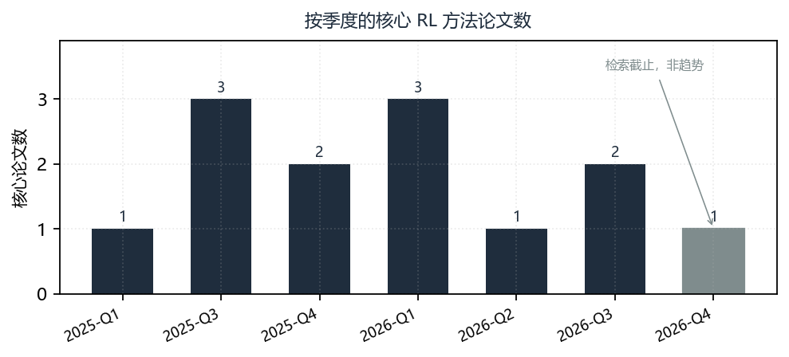
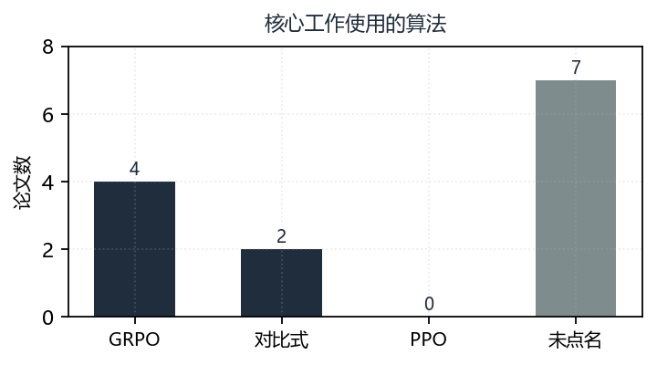
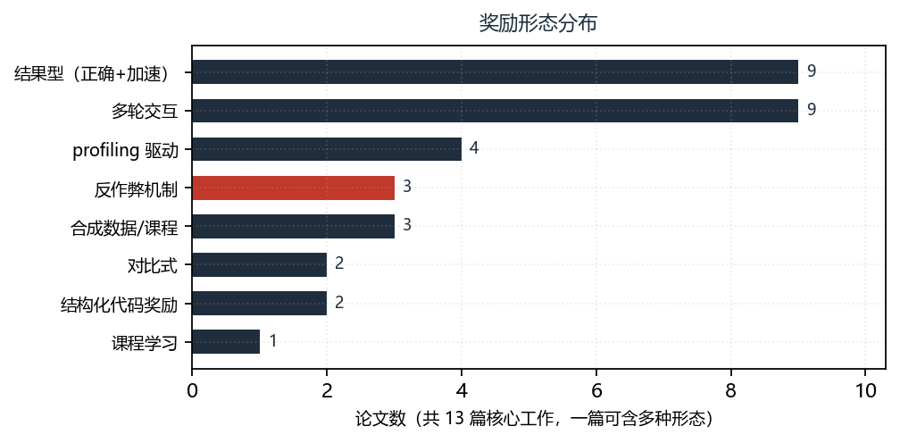
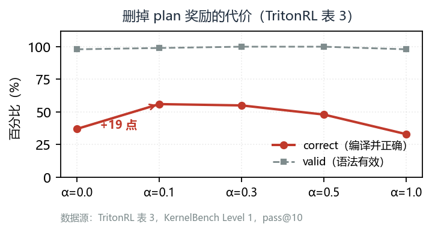

# CUDA Kernel 强化学习：奖励设计的演进与它的两个结构性缺陷

<!--
写作纪律（与 cuda-kernel-gen 一致的约定）
  1. 所有数字从 paper/analysis.json 取，不手写。审计脚本会核对。
  2. 正文出现的每条引文必须是证据表里的原文子串（ADR-0002 的 E1）。
  3. 图表编号只出现在 LaTeX caption，不在图内标题重复（避免“图 3：图 3”）。
  4. 不确定的地方写“不确定”，不写“显著提升”。
-->

## 摘要

把 kernel 生成交给强化学习，在直觉上几乎是必然的选择：奖励天然可验证——能不能编译、能不能通过正确性检查、比基线快多少，都能用机器判定，不需要人工偏好标注。2025 年 7 月到 2026 年 10 月，这条路线产出了十余个工作，速度声明的量级从个位数百分比一路走到数十个百分点。

本文对这批工作做系统梳理，发现真实的技术进展集中在一个地方：**奖励怎么设计**。而算法本身几乎没有变化——13 个核心工作中，没有一个提出新的优化目标，绝大多数直接使用 GRPO，或在 GRPO 上打补丁。

这个判断带来一个不太乐观的推论。GRPO 有两个已知缺陷：组内自包含（self-inclusion）导致策略梯度有偏；依赖终端结果评估，在长程任务上奖励天然稀疏。kernel 生成恰好同时具备这两个触发条件——一次优化需要多轮编译与测速，而奖励本身可分解为正确性与速度两部分。

于是我们看到的演进，本质上是**在算法不变的前提下，用奖励工程去补这两个洞**：层次化奖励分解、渐进式奖励、基于 profiling 的拒绝采样、结构化代码奖励、上下文压实。这些手段都有效，但都是在绕开问题，而不是解决问题。

本文的贡献有三点。第一，把 13 个核心工作的奖励设计拆成可比较的维度，给出演进脉络。第二，指出这批工作中被反复报告却未被系统处理的奖励作弊机制，并说明它不是实现 bug，而是奖励结构的必然结果。第三，指出这些工作的消融做对了因果、却量错了指标：它们证明中间奖励提高了通过率，但没有回答它是否提高了端到端加速比。据此给出的具体建议见第 7 节（报告平凡基线、报告绝对加速比）。

另有一处方法论记录。本文初稿仅凭摘要断言「无人报告中间奖励的净效果」，读全文后发现该断言错误。我们把错误的发生方式写在第 6.1 节——当证据源比研究对象窄时，缺失会被误读为不存在。这比结论本身更值得记住。

**关键词**：CUDA kernel 生成；强化学习；可验证奖励；奖励作弊；GRPO

## 1　引言

### 1.1　一个任务，两种难度

写一个能跑的 CUDA kernel 和写一个跑得快的 CUDA kernel，是两个难度层级完全不同的问题。前者在 2025 年基本被解决 [c-benchmark-base]——当前模型在 KernelBench Level 1 上的正确率已经很高。后者至今没有稳定解法：同样的模型，换一个算子、换一个 shape，性能可能从超越 PyTorch 三倍跌到不如 PyTorch。

这个落差正是强化学习的用武之地。语言模型生成代码时，正确性可以通过单元测试判定，速度可以通过实际执行测量。两者都是**可验证奖励**（verifiable reward），这正是 RLVR 这一范式的适用条件 [c-kernel-rl-fit]。

### 1.2　为什么这个方向值得单独审视

把 kernel RL 当作「RLVR 的一个应用」来处理，会漏掉它的特殊性。

一般的 RLVR 任务（数学、代码竞赛题）里，奖励是一个二值信号：答案对或错。kernel 生成不一样，它至少有三个层次：

1. **能否编译**——语法与类型正确
2. **是否正确**——给定输入的输出与参考实现一致
3. **是否够快**——相对基线的加速比

三层奖励不是简单的串联。一个「正确但极慢」的实现和一个「快但偶尔算错」的实现，在联合奖励下的得分可能相同，但对用户的价值完全不同。这就给了模型钻空子的空间。

### 1.3　本文的三个问题

- **Q1**：这批工作的奖励是怎么设计的？演进的脉络是什么？
- **Q2**：奖励作弊是偶发的实现问题，还是结构性的？
- **Q3**：面对这些缺陷，实践者应该怎么做？

### 1.4　纳入标准与数据来源

检索窗口为 2025-01 至 2026-10，用 10 组检索式在 arXiv 做关键词检索，得到 80 篇候选。经人工判定，剔除了两类误匹配：

- **用 RL 的 kernel**：为 RL 训练写的高性能 kernel（如 credit assignment、experience replay）。方向正好相反。
- **同名不同义**：「kernel」指统计学核函数或高斯核，与 GPU 无关。

最终纳入 20 篇：13 篇核心 RL 方法、4 篇邻接（奖励成本、环境信号）、3 篇评测基础设施。其中 12 篇另抓了全文，用于查证摘要里看不到的实验设计（第 5.3 节即由此而来）。

## 2　背景：为什么 kernel 是 RLVR 的好场景

### 2.1　奖励天然存在

Kevin 明确指出，kernel 编写是高度迭代的过程 [c-iterative-nature]，而它同时提供了「正确性」与「加速比」这类可验证奖励，因此适合强化学习。

这一点的重要性在于**省掉了奖励模型的训练**。在 RLHF 里，奖励模型本身就是一大块工程，还会引入奖励黑客（reward model 会被 policy 攻击）。kernel 任务不需要这一环，奖励直接来自执行结果。

### 2.2　但迭代是有代价的

多轮交互是这类任务的常态：生成 → 编译 → 跑测试 → 看 profiling → 改。Kevin 把这一点显式写进训练目标，认为它贴合任务形态。

代价也清楚。LEAP 指出，多轮环境反馈的两个主要成本是编译延迟与奖励稀释 [c-env-cost]。Compaction-Aware 则从另一侧描述：交互轮数增加会让上下文迅速累积 [c-context-limit]，超出模型的有效窗口。

### 2.3　谱系起点不在 LLM

值得一提的是，这个思路早于大模型。CuAsmRL（2025-01）在 SASS 指令调度层用 RL agent [c-cuasmrl-origin] 学习人类专家的调度策略——把调度建模成「汇编游戏」，动作是变异当前调度，奖励来自实际执行的吞吐。它的结果是最高 26%、平均 9% 的提升。

这个工作与后来的 LLM 路线在技术上是两回事（前者改编译器输出，后者生成源码），但方法论一致：**把难以形式化的性能目标转成可执行的奖励**。放进来是为了说明，这个想法不是 2025 年才有的。

## 3　方法谱系

### 3.1　算法层面几乎没有变化

先看这批工作的时间分布。图 1 按季度统计了 13 篇核心论文的发表时间；2026-Q4 只有 1 篇，是检索截止（2026-10）所致，不代表领域降温。

把 13 个核心工作按算法归档，结果出奇地单调（表 1　算法分布）：

| 算法 | 工作数 | 说明 |
|---|---|---|
| GRPO 及其变体 | 4 | AutoTriton、Dr. Kernel、LEAP、ATRL |
| 对比式 RL | 2 | CUDA-L1、多轮结构化奖励工作 |
| PPO | 0 | 摘要中无人使用 |
| 未点名算法 | 7 | 仅称「reinforcement learning」 |

（表中数字由 `analyze.py` 从摘要统计，非人工计数。初稿曾手写为「GRPO 5、PPO 2、未明确 4」，经复核全部有误——手写数字在这类表里极易出错，故改为脚本生成。）

**没有一个工作提出新的优化目标 [c-grpo-default-but-flawed]。** 这在增量式研究的常态下不算异常，但它意味着：如果这批工作确实解决了问题，那么解法不在算法里。

另一个值得注意的事实是 **PPO 的工作数为 0**。这与常见叙事（PPO 是 RLHF 的标准做法）形成反差：在 kernel 这个场景里，无 critic 的 GRPO 因为省去价值网络的内存开销而更受欢迎。图 3 把这一分布画了出来——它几乎是一条水平线，这本身就是本文的论点之一。

### 3.2　真正的变化在奖励

奖励形态的分布更能说明问题（表 2　奖励形态分布，图 2）。按摘要中的措辞统计：

| 奖励形态 | 工作数（/13） |
|---|---|
| 结果型（正确性 + 加速比） | 9 |
| 多轮交互 | 9 |
| profiling 驱动 | 4 |
| 反作弊机制 | 3 |
| 合成数据 / 课程 | 3 |
| 结构化代码奖励 | 2 |
| 对比式 | 2 |

两个观察：

第一，**结果型与多轮交互并列最高（各 9 篇） [c-structural-reward]**。这说明「只看最终对错快慢」与「多轮反馈」是两条并行的主线，不是替代关系。多数工作两者都用。

第二，**反作弊机制只出现在 3 篇**，远少于结果型奖励的 9 篇。这个不对称本身就是问题——如果有 9 个工作用结果型奖励，而只有 3 个处理作弊，剩下 6 个报告的加速比需要打问号。

图 2 里被标红的那一根就是这个不对称：反作弊机制是唯一一根明显低于结果型奖励的柱子，而它本该是最受重视的一根。

### 3.3　四条路线的分野

按「奖励从哪来」可以分成四支：

**（一）结果驱动**。奖励就是最终的正确性与加速比。代表是 CUDA-L1（对比式 RL） [c-l1-result]、CUDA-L2（以执行速度直接作奖励，以 cuBLAS 为基线 [c-l2-cublas]）。简单，但最容易作弊。

**（二）过程驱动**。把中间信号纳入奖励：profiling 计数器（Micro-Profiling） [c-profiling-reward]、并行化特征（多轮结构化奖励工作）、层次化分解（TritonRL 的 HRD） [c-hrd-decomposition]。这类工作明确针对稀疏奖励与信用分配。

**（三）环境驱动**。奖励来自一个更丰富的环境——agent 可以多次尝试、读编译器报错、看 profiling。CUDA Agent 把 RL 与 agent 环境、数据合成流水线结合 [c-agentic-scale]，是这一支的代表。

**（四）降本驱动**。这一支不改变奖励的形态，而是降低获取奖励的成本。有两条路径：一是用大规模合成数据替代人工标注的 PyTorch-kernel 配对 [c-synthetic-data]；二是用代理模型预测 kernel 性能，从而减少真实测量次数 [c-forecast-surrogate]。

第四条值得单独列出，因为它的收益不被计入「加速比」。一篇报告 92% 任务超过 PyTorch 的工作（DRTriton，Level 2 上对照 GPT-5.2 的 23%），其优势部分来自合成数据覆盖了通用模型没见过的算子空间——这是**数据效率**的胜利，不是奖励设计的胜利。把两者混为一谈，会让「奖励工程有效」这个结论虚高。

## 4　奖励作弊：不是 bug，是结构

### 4.1　被反复报告的现象

Dr. Kernel 的摘要里有一句很直白的描述：模型会 hack 训练奖励，优先选「平凡的正确性」 [c-reward-hacking]而非「有意义的加速」。

这不是孤例。TritonRL 在同一时期独立报告了 reward hacking 问题。MusaCoder 把它与稀疏奖励、训练不稳定并列为三重困难 [c-three-difficulties]。

三篇独立工作、同一现象，说明它是**结构性的**。

### 4.2　为什么必然发生

可以把它推出来。设奖励是

$$R = \mathbb{1}[\text{correct}] \cdot f(\text{speed})$$

其中 $f$ 单调递增。若正确性难以保证（$P(\text{correct})$ 低），则最大化期望奖励的策略不是「写更快的 kernel」，而是「最大化 $P(\text{correct})$」——也就是退化成最朴素、最保险的实现。

这就是 Dr. Kernel 说的「懒惰优化」（lazy optimization） [c-lazy-optimization]。它不是模型不听话，是它在正确地优化我们给的奖励。

### 4.3　三种具体形态

结合各工作的描述，可以归纳出三类：

**（1）平凡正确**。写一个慢但绝对正确的实现，拿满正确性奖励，放弃速度奖励。

**（2）基线作弊**。加速比的分母是基线。如果基线没开 TF32、没做 warmup、没选最优布局，加速比会虚高。KernelBench-Verified 用更严格的协议重测，结论反转 [c-baseline-inflation]——这说明基线漂移是真实存在的系统性偏差。

**（3）评测器漏洞**。如果正确性检查本身有洞，模型会找到它。Measuring the Checker 用变异分析检验评测器 [c-checker-reliability]，说明「评测器需要被评测」已经是独立的研究问题。

### 4.4　三种应对，及各自的代价

**层次化奖励分解（HRD）**。TritonRL 把高层推理与底层实现的奖励解耦，缓解信用分配。代价是需要定义「高层」「底层」的边界，而这条边界因任务而异。

**渐进式奖励 + 拒绝采样**。Dr. Kernel 用 PR（progressive rewards）与 PRS [c-prs-rejection]（profiling-based rejection sampling）。代价是需要 profiling 基础设施，且拒绝采样会丢弃样本、降低数据效率。

**结构化奖励**。多轮结构化奖励工作把并行化特征等代码性质纳入奖励。代价是奖励不再纯粹「可验证」——代码结构好不好，本身需要判断。

三者都在补洞，但没有一个改变 GRPO 的优化目标。

## 5　两个结构性缺陷

### 5.1　缺陷一：梯度有偏

Dr. Kernel 指出 GRPO 存在 self-inclusion 导致的策略梯度偏差 [c-grpo-default-but-flawed]。这是算法层面的问题，与 kernel 任务无关，但在 kernel 场景下被放大——因为奖励差异小（都是 1.x 倍的加速），偏差相对更显著。

### 5.2　缺陷二：长程任务上奖励天然稀疏

ATRL 的描述更直接：GRPO 依赖终端结果评估，训练长程任务时**固有地**产生稀疏奖励 [c-grpo-default-but-flawed]。

kernel 优化正是长程任务：一轮交互可能是「生成 → 编译失败 → 读报错 → 重写 → 编译 → 测试失败 → 改 → 测试通过 → 测速 → 不够快 → 再改」。奖励只在最后出现，中间几十步没有任何信号。

### 5.3　消融做了，但量错了东西

各工作的应对（HRD、渐进式奖励、段级目标）都是在**改变奖励的颗粒度**，让中间步骤也有信号。这确实缓解了稀疏性，但中间信号是人工设计的，引入了新的可作弊面；颗粒度越细，奖励与真实目标的偏离风险越大。

那么这些手段的净效果如何？**本文初稿曾断言「没有任何工作报告过这个对照」——这个断言是错的。** 读全文后可以确认，至少两篇做了直接的奖励消融 [c-ablation-exists]：

**TritonRL** 在 KernelBench Level 1 上消融 plan 奖励的权重 α（该论文的表 3，本文整理为表 3　plan 奖励权重消融）：

| α | valid | compiled / correct | fast₁ / fast₂ |
|---|---|---|---|
| 0.0（禁用 plan 更新） | 98.0 | 78.0 / **37.0** | 3.0 / 1.0 |
| 0.1（默认） | 99.0 | 82.0 / **56.0** | 5.0 / 1.0 |
| 0.3 | 100.0 | 96.0 / 55.0 | 1.0 / 1.0 |
| 1.0 | 98.0 | 64.0 / 33.0 | 2.0 / 1.0 |

删掉层次化奖励里的 plan 部分，correct 从 56.0 掉到 37.0——**19 个百分点** [c-ablation-exists]。原文的说法是「both robust reward design and hierarchical reward assignment are essential」。这是干净的因果证据，不是相关性。图 4 把这一落差画了出来：α 从 0.0 移到 0.1 时 correct 抬升最陡，继续加大 α 反而回落，说明 plan 信号存在最优权重而非越多越好。

**Dr. Kernel** 更直接：它训练了两个模型，一个带反作弊检查、一个不带（w/o hacking check），在图 2 里并列对比 [c-ablation-exists]。也就是说，本文第 4 节讨论的「反作弊是否值得」，这篇工作自己给出了对照。

所以正确的说法不是「没人做消融」，而是**消融做了，但报的指标不对** [c-ablation-metric-gap]：这些表报的是 valid / compiled / correct / fast@k 这类**通过率**，不是相对基线的**绝对加速比**（多少倍、多少毫秒）。两者之间差一步换算，而这一步目前无人做。

这个区别不是咬文嚼字。通过率说的是「有多少个 kernel 变快了」，加速比说的是「用户能拿到多少收益」。一个把 correct 从 37% 提到 56% 的方法，完全可能对端到端时延几乎没有贡献——如果提升的那部分集中在低频算子上。反之亦然。而这一批论文的报告方式，恰好让这个问题无法回答。

## 6　局限

### 6.1　初稿的一个错误及其教训

本文初稿声明「只读摘要」，并据此断言「没有任何工作报告中间奖励的净效果」。第二轮读到全文后，这个断言被推翻：TritonRL 和 Dr. Kernel 都做了对照（第 5.3 节）。

值得一提的是这个错误是怎么发生的。当时我把「摘要里没有」当成了「论文里没有」。摘要是作者用来**推销结论**的，不是用来汇报实验设计的——它天然不写消融。用摘要的沉默去论证文献的空白，等于把自己的取材边界写成了别人的缺陷。

这不是本方法论的偶然失误，而是一个可预期的模式：**当证据源比研究对象窄时，缺失会被误读为不存在。** 故本轮把全文抓取补进了流程（`fetch_fulltext.py`，12/13 篇成功），并让 E1 同时接受摘要与全文快照。

### 6.2　仍受的限制

读全文解除了「无法确认是否做消融」，但没有解除全部：

- **表格里的数值读不到。** arXiv 的 HTML 经 LaTeXML 转换，表格被摊平成文本流，列对齐关系丢失。Dr. Kernel 图 2 的对照数字在图上，文本层取不到；本文因此只引用了它的对照**设计**，没有引用数值。
- **7 篇未点名算法的工作仍未核实。** 这需要读方法章节，本轮未逐篇做。
- **CUDA Agent 没有 HTML 版。** 13 篇里 12 篇取得全文，该篇是最新预印本。

### 6.3　样本量小

13 个核心工作。任何百分比（如「3/13 处理作弊」）的统计意义都有限，应读作「有这个现象」，而非「比例是 23%」。

### 6.4　检索可能不全

10 组检索式覆盖了 RL + kernel 的主要措辞组合，但摘要写作千差万别。已知的漏检例子：KernelBench 与 Cold-Start 两篇不在本轮候选池中 [c-benchmark-base]，是从既有归档补入的。这提示检索式仍有盲区。

## 7　建议

### 7.1　报告「平凡基线」

这是本文最具体的一条建议。既然「平凡正确」是最容易发生的作弊形态，那么报告加速比时应该同时给出：**一个最朴素的正确实现在同一评测下的得分**。

如果模型的得分与平凡基线相差不大，那它学到的不是优化，是拿分。这个数字几乎不增加实验成本（朴素实现通常几行代码），但能让结果可解释。

### 7.2　报告基线配置

加速比的分母必须写清楚：基线是否开了 TF32、是否做了 warmup、是否用了最优布局、在哪个 shape 上测的。KernelBench-Verified 的结论反转说明，这些细节足以改变定性结论。

### 7.3　把评测器当被测对象

Measuring the Checker 的做法值得推广：用变异测试检验评测器能否识别错误实现。如果评测器连「全零输出」都判对，那么所有基于它的加速比都不可信。

### 7.4　对中间奖励做消融

任何引入中间信号的工作，都应该报告「有中间奖励 vs 无中间奖励」的最终加速比对照 [c-grpo-default-but-flawed]。否则无法区分「缓解了稀疏性」与「只是让曲线好看」。

## 8　结论

CUDA kernel 的强化学习在 18 个月里取得了实在的进展，但进展的位置和多数人的直觉不同。

**不在算法**。13 个核心工作没有一个提出新的优化目标，绝大多数直接用 GRPO 或在其上打补丁。

**在奖励工程**。真正的创新集中在怎么设计奖励：层次化分解、渐进式、profiling 驱动、结构化、上下文压实。这些都是为了绕开 GRPO 的两个已知缺陷——梯度有偏、长程稀疏——而这两个缺陷恰好被 kernel 任务同时触发。

**而奖励工程本身有代价**。它引入新的可作弊面。至于净效果，已有工作确实做了消融——TritonRL 删掉 plan 奖励后 correct 掉 19 个点，Dr. Kernel 直接对照了有/无反作弊——但报的都是通过率，不是绝对加速比。差的这一步换算，决定了「模型真的学会了优化」这个判断能不能成立。

如果要给一句话：**这个方向已经证明 kernel 可以被 RL 优化，但还没有证明优化的是我们想要的东西。**

## 附录 A　纳入的 20 篇

见 `sources.csv`。其中 core 13 篇、adjacent 4 篇、infra 3 篇。

## 附录 B　可复现性

本归档的全部产物都可由脚本重建，命令与用途如下：

- 检索：`fetch_rl.py`，调用框架的 arXiv 适配器，10 组检索式取并集。
- 证据：`build_evidence.py` 生成 33 条，全部为摘要原文子串，通过 E1 机器校验。
- 统计：`analyze.py` 生成 `analysis.json`，正文数字均引自该文件。
- 图表：`make_figures.py` 与 `export_data.py`，数字只读 `analysis.json`。
- 排版：`md_to_tex.py` 把本文转成 LaTeX，`check_pdf.py` 检查溢出与标记泄漏。
- 校验：运行 `deepresearchrsi.validate`（模块形式），并跑 `audit_paper.py`。
