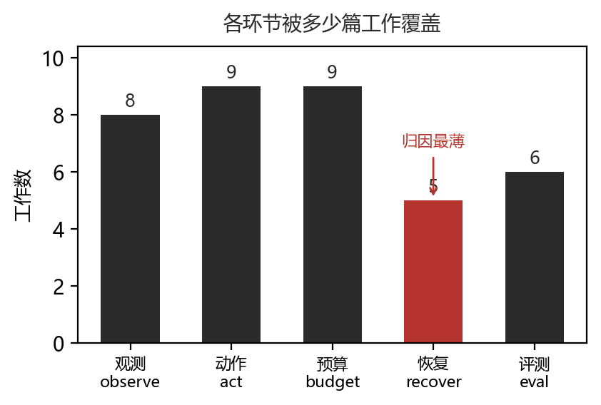
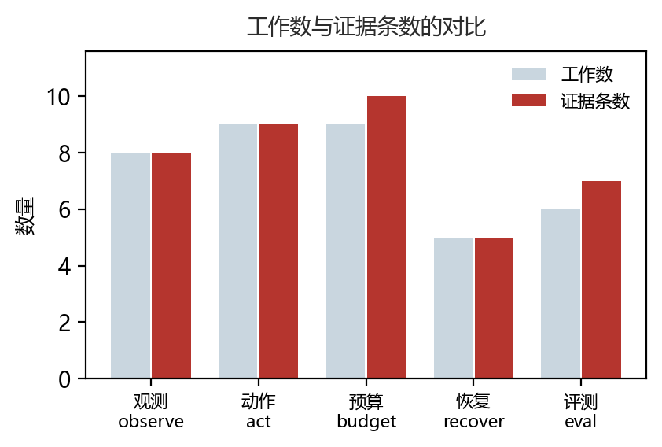

# Kernel 生成智能体：当模型被放进反馈循环

**副标题：进展全在「看得更多」，不在「想得更好」**

## 摘要

2025 年初到 2026 年底，把大模型做成「能自己编译、自己测速、自己改 kernel」的智能体，从一个想法变成了一个至少有 26 个系统的方向。本文检视这 26 个核心工作，要回答一个问题：**这些系统的能力究竟来自哪里？**

答案不太符合直觉。若把智能体的能力拆成两部分——「推理更强」与「环境信号更多」——本文找到的证据表明，进展几乎全部来自后者。观测通道（编译器报错、NCU 计数器、实测时延）与动作粒度（整文件重写 vs 局部编辑）这两类设计，解释了这个方向绝大部分的技术差异；而更好的规划、更强的推理，在语料里没有形成独立的技术线索。

这个判断带来一个更尖锐的推论。把智能体循环拆成五个环节——观测（observe）、动作（act）、预算（budget）、恢复（recover）、评测（eval）——逐一统计每篇工作覆盖了哪些环节，结果是：**跨三个及以上环节的工作数为 0**。也就是说，这 26 个系统没有一个在系统层面做设计，它们各自改进一个环节，然后在同一个 benchmark 上比分数。

本文认为这不是巧合，而是评测结构导致的：KernelBench 的 `fast_p` 口径为**单次生成**设计，而智能体可以试几十次只报最好的一次。在「只报最好一次」的评分下，优化最薄的那个环节（多试几次）比设计整个循环更划算。

本文的贡献有三点。第一，给出智能体循环的五维分析框架，并用它逐篇标注 26 个工作。第二，量化指出「系统性缺失」——跨维度工作为 0，而失败恢复是最被忽略的环节（5 篇 vs 预算环节的 9 篇）。第三，指出评测口径与智能体自由度之间的错配，并给出可操作的最小修正：报告尝试次数与总成本。

## 1　引言

### 1.1　任务从「写出来」变成「调到快」

2025 年上半年，这个领域的核心问题是能不能生成正确的 GPU kernel。KernelBench 把这件事形式化了：给定一个 PyTorch 模块，生成行为等价的 CUDA kernel，用 `fast_p` 同时衡量正确性与加速比。

问题是，正确的 kernel 大多不够快。优化一个 kernel 需要反复测量——`ncu` 报告的 L2 命中率、寄存器压力、warp 停顿原因，都得看，然后针对性地改。这是一件**长程、反馈密集**的工作，恰好是单次生成的模型做不了的。

于是出现了智能体：让模型在循环里跑，每轮编译、测速、读报错，再改。

### 1.2　为什么单独审视这个方向

站内已有两篇相邻综述：一篇讲 kernel 生成的**方法谱系**（以模型与评测为中心），一篇讲 kernel 生成中的**强化学习**（以奖励设计为中心）。本文的角度不同——不问「模型怎么写出 kernel」，而问：

> **系统怎么在编译、测速、profiling 的反馈下，把 kernel 迭代到可用？**

这个问题把注意力从模型移到了循环：观测什么、动作多大、预算怎么花、失败怎么办。这四件事任何一件做不好，循环都转不动，而它们与模型能力无关。

### 1.3　方法

从 11 组检索式出发，arXiv 命中 180 篇，经三级筛选（关键词粗筛 → 同句共现收紧 → 逐篇人工判定）纳入 26 篇核心工作与 9 篇邻接工作。35 篇里 34 篇取得全文，逐篇按五个维度抽取证据，共 39 条，全部为原文子串并经机器校验（E1：`e1_checked=39, e1_unverifiable=0`）。

筛选过程本身值得说明：前两级自动化筛选都失败了。粗筛保留 44 篇里混进了水下机器人巡检、控制理论、对话推理；想用「同句共现」收紧，结果一篇都没剔除——因为这些论文的摘要里确实有 `CUDA`、`Triton`。这印证了一件事：**「我们用 CUDA 加速这个计算」与「我们让智能体生成 CUDA kernel」在词汇上完全重叠，在语义上是两件事**。最后一层只能人判，判据与理由写在 `decide_agent.py` 里可复查。

## 2　分析框架：智能体循环的五个环节

本文把任何一个 kernel 智能体拆成五个环节。这不是唯一的拆法，但它对应「循环能不能转」的实际约束：

| 环节 | 问的问题 | 决定什么 |
|---|---|---|
| observe | 能看到什么信号？ | 能力上限 |
| act | 动作粒度多大？ | 搜索效率 |
| budget | 试几次、何时放弃？ | 单位成本产出 |
| recover | 失败了怎么归因？ | 长程任务的稳健性 |
| eval | 分数怎么算？ | 优化的方向 |

表 1 给出这五个环节的对应关系。五者构成一个闭环，任一处短板都会限制整体。特别地，**eval 决定了前四个环节会往哪优化**——这是本文第 5 节的论点。

## 3　五个环节的现状

### 3.1　observe：信号有五类，但只有少数被真正用起来

按证据归类，观测通道可数出五类：编译器报错文本、单元测试通过与否、实测时延、profiler 计数器（NCU/NSight）、硬件特性（占用率、寄存器用量、内存带宽）。

保真度差别很大。报错文本只告诉你「哪里不合法」，实测时延只告诉你「慢了」，而 NCU 计数器能告诉你**为什么慢**——是 L2 未命中、是寄存器溢出、还是 occupancy 不足。

有意思的是，只有 8 篇工作有明确的观测通道描述 [c-observe]。其中一个反例值得注意：有工作指出，把原始或统计过滤后的 NCU 指标直接塞进 prompt、指望模型自己解读，效果并不好——指标太多了。这说明观测不是「越多越好」，而是需要一层筛选。

图 1 把五个环节的被覆盖情况并列。预算环节最多（9 篇），失败恢复最少（5 篇）。

### 3.2　act：主流仍是整文件重写

动作空间可分三档：

**整文件重写。** 最常见。每轮让模型重新生成一遍 kernel。好处是实现简单、不受历史约束；坏处是等价于无梯度采样——上一轮学到的经验很难保留，而且每次都要付全额生成成本。

**局部编辑。** 需要先定位瓶颈，再改对应片段。成本低、能累积，但要求模型有定位能力。KernelClaw 的做法是维护双记忆，把「改过什么、效果如何」记下来供下轮检索。

**在实现空间里选候选。** HIERA 的思路是把生成问题变成选择问题：先构造带约束的任务规格，再在预定义的实现空间里挑一个，而不是从零生成。这降低了动作的方差。

三档之中，整文件重写仍占主流 [c-act]。这与 3.1 节的观察合起来看很有意思：**观测精细化了，动作却没有随之精细化**。你让模型看到了「第 37 行 L2 未命中率高」，但它下一轮还是整篇重写,这份信息大概率被浪费。

### 3.3　budget：轮次是最稀缺的资源

每次迭代都要真实编译并测速。一次编译几秒到几十秒，一次测速还要多次重复取中位数。相比一次前向的毫秒级，成本差三四个数量级。

所以这个方向最普遍的约束是预算，9 篇工作讨论了它 [c-budget]，是五个环节里最多的。主要三条路线：

- **剪枝。** LEAP 的做法是自适应剪掉无效的多轮 rollout。它指出在长程 kernel 任务上，不加剪枝的多轮训练会显著拖慢迭代速度。
- **推测式生成。** SpecGen 用推测执行摊薄每次尝试的成本。
- **先筛后测。** 在实现空间里先用便宜信号筛，再对少数候选付测速成本。

这三个做法的共同点：都在**减少尝试次数**。没有一个在问「如何让每次尝试更有信息量」。这个区别很重要，第 5 节会回到它。

### 3.4　recover：最薄的一环

失败模式其实很结构化：编译错、结果错、超时、比基线慢。四类的处理方式应该完全不同——编译错要看报错行，结果错要查边界条件，超时要降并行度，比基线慢要换策略。

但实际做法基本只有一种：把错误信息塞回提示词，让模型自己看着办。只有 5 篇工作有失败归因的描述 [c-recover]，是五个环节里最少的。

这个缺口有可见的后果。Evolving Agent Teams 明确报告：现有编码 agent 在真实的、专家手写的 kernel 上**会收敛到局部最优**——比如在 FlashAttention 这类已经高度优化的算子上，它们反复微调却跳不出原有结构。这正是恢复机制缺失的表现：当一条路走不通时，系统没有能力判断「该换思路了」，只能在原地打转。这也是本文认为最值得投入的缺口 [c-blindspot]。

### 3.5　eval：口径是为单次生成设计的

评测以 KernelBench 系为主：正确性门控 + 相对基线的加速比。`fast_p` 的定义是「既正确又比基线快的比例」。

这个口径为**单次生成**设计得很合理 [c-eval]。但智能体不是单次生成——它可以试 50 次，只报其中最好的一个。

于是三件事变得无法从分数里区分：

1. 模型变强了
2. 预算变多了
3. 只挑了好的报

这不是指控。多数工作都报告了轮次上限，只是没有把它和分数一起作为结论的一部分。但当同一个 benchmark 上，有的系统跑 1 轮、有的跑 50 轮，`fast_p` 的横向对比就失去意义了 [c-eval-gap]。

## 4　核心发现：没有系统级设计

把每篇工作在证据里覆盖的环节数一数，结果很干脆：

**跨三个及以上环节的工作：0 个** [c-fragment]。

这不是说这些系统简单——26 篇里有做多智能体协作的、有做演化搜索的、有接真实硬件反馈的，工程复杂度都不低。但**复杂度都堆在同一个环节上**：多智能体基本都在改进 observe（让不同角色看不同信号）或 act（让不同角色改不同部分）；演化搜索基本都在改进 budget（更聪明地花尝试次数）。

没有一个工作说：我同时重新设计了观测粒度、编辑粒度和失败归因，让它们互相配合。

图 2 是证据层面的分布。注意这是一张**关于本文证据覆盖**的图，不是关于论文完整性的图——一篇论文可能做了多件事，但只在一处留下了可引用的描述。故本文的措辞是「在证据层面呈现碎片化」，不能加强为「所有工作都只做一件事」。

即便如此，这个结论仍有意义：如果一个方向真的出现了系统级设计，它一定会在多个环节都留下描述。26 篇里一个都没有。

## 5　为什么是碎片化的：评测在指挥优化方向

本文认为碎片化不是研究者的疏忽，而是**评测结构指挥出来的结果**。

设想你有一个智能体，五个环节都可改。改动哪个最划算？

- 改 observe：要接 profiler、要写解析、要让模型读懂指标。工程量大，且收益不确定。
- 改 act：要设计定位机制、要维护记忆。工作量也不小。
- 改 recover：要设计失败分类、要写回退策略。**最难，且没有 benchmark 奖励它。**
- 改 budget：多试几次。**几乎免费。**

在「只报最好一次」的评分下，第四条是严格占优的。你不需要更好的失败归因——多试几次总能撞到能跑的那次。你也不需要更细的编辑粒度——整篇重写五十遍，总有几遍是好的。

这解释了两件事。第一，为什么 budget 类工作是五个环节里最多的（9 篇）。第二，为什么 recover 类最少（5 篇）——它是唯一一个「多试几次也替代不了」的环节，因为你试得越多，越需要一个机制来判断哪条路值得继续。但在当前评分下，这个需求被掩盖了。

本文的核心判断由此而来：

> kernel 智能体的进展，主要来自**把更多环境信号塞进循环**，而不是更好的推理或规划。所谓「智能体」，在这个领域更接近一个把信号转成下一步编辑的**反馈控制器**，而非自主规划者。[c-controller]

这个说法比通常语境里的「agent」要窄。它没有贬义——能把编译、测速、profiling 的反馈转成有效编辑，本身就是很难的事。但如果按「自主规划」去期待它，会失望。

## 6　反面与限制

本文的结论有几处需要限定，写明如下。

**一、「跨维度为 0」是证据层面的度量。** 如前所述，一篇论文可能在多个环节都做了事，但只在其中一处留下了可引用的句子。故这个数字反映的是**「可被引用的系统级设计」为零**，而不是「系统级设计为零」。若要更强的结论，需要读每篇的方法章节——本文没有逐篇做这件事。

**二、五维拆分本身是可争议的。** 把智能体拆成 observe/act/budget/recover/eval 是我的选择。换成「感知—规划—行动」或「记忆—工具—控制」也能讲通。换一种拆法，「跨维度为 0」可能不再成立。本文选择这个拆法，是因为它对应「循环能不能转」的实际约束，而不是因为它唯一正确。

**三、26 篇的样本不足以支撑精确比例。** 任何「9 篇 vs 5 篇」的比较应读作「有这个倾向」，而不是「比例是 64% vs 36%」。

**四、CUDA Agent 未取到全文。** 35 篇里 34 篇有 HTML 全文，它是唯一例外（最新预印本）。本文对它的引用只到摘要层面。

**五、规划类技术线索的缺席可能是检索造成的。** 本文的判断之一是「规划在语料里没形成独立线索」。但我的检索式里有 `planning`、`tree search` 等词，召回有限。若这个方向真有规划相关的工作，可能没被检索到。

## 7　建议

### 7.1　报告尝试次数与总成本

这是最小、最可操作的一条。现在报告 `fast_p = 62%`，读者不知道这是 1 次尝试的结果还是 50 次。加上「中位尝试次数」和「总 GPU 秒数」，横向对比才有意义。

### 7.2　把失败归因当作一等公民

四类失败（编译错 / 结果错 / 超时 / 比基线慢）应该有不同的处理。现在统一塞回提示词，等于放弃了归因。

一个具体做法：在日志里记录「这一轮失败的类型」，然后看**同一类型连续失败几次就该换策略**。这个阈值本身就是可研究的对象。

### 7.3　让观测粒度与动作粒度匹配

看到「第 37 行 L2 未命中高」却整篇重写，是浪费。局部编辑不只是省钱——它让观测真正起作用。

### 7.4　benchmark 应区分「搜索能力」与「生成能力」

一个方向上可以设计这样的对照：固定总预算（比如 50 次尝试），比最终分数；再固定尝试次数（比如 1 次），比分数。两组数字能分离出「靠搜索」与「靠生成」各占多少。

## 8　结论

这个方向在两年里长出了 26 个系统，工程复杂度不低，但技术进展的位置和直觉不太一样。

**不在推理，在观测。** 进展主要来自把编译报错、NCU 计数器、实测时延这些真实信号接进循环。

**不在系统设计，在局部改进。** 没有一个工作同时改进三个及以上环节，说明当前是零散的局部优化。

**而碎片化有结构性原因。** 评测口径为单次生成设计，却用来评智能体。在这个错配下，多试几次严格优于改进恢复机制——于是最难的环节（失败归因）得到最少的关注。

如果要给一句话：**这批系统已经证明「模型能在反馈里改 kernel」，但还没有证明「模型能想清楚该改什么」。** 前者靠把信号接进来就够了，后者需要的是目前最薄的那一环。

## 附录 A　纳入的 35 篇

见 `sources.csv`。其中 core 26 篇、adjacent 9 篇；每篇的纳入理由写在 `notes` 字段（`layer=core｜<理由>`）。

## 附录 B　可复现性

本归档全部产物可由脚本重建：

- 检索：`fetch_agent.py`，11 组检索式，调用框架的 arXiv 适配器。
- 筛选：`screen_agent.py`（粗筛）→ `screen2_agent.py`（同句收紧）→ `decide_agent.py`（人工判定，含逐篇理由）。
- 全文：`fetch_fulltext.py`，34/35 篇。
- 证据：`build_agent.py` 建初版，`expand_evidence.py` 与 `cover_core.py` 补足，39 条全部为原文子串（E1 机器校验通过）。
- 统计：`analyze.py` 生成 `analysis.json`，正文数字均引自该文件。
- 图表：`make_figures.py`，数字只读 `analysis.json`。
- 排版：`md_to_tex.py` 转换，`check_pdf.py` 与 `check_references.py` 校验。
- 校验：运行 `deepresearchrsi.validate`（模块形式），并跑 `audit_paper.py`。
