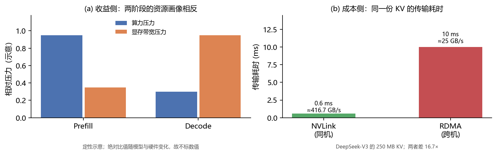

# Prefill–Decode 分离：收益不是一个倍数，而是一个差的函数

**46 篇论文 + 17 份官方文档：技术栈、模型差异与一条判据**

2026-11-04

> 本文是 `pd-disagg` 归档的正文。事实源是 `sources.csv` / `evidence.csv` / `claims.csv`，
> 由 `deepresearchrsi.validate` 与 `scripts/audit_paper.py` 校验。`paper/latex/` 是同一内容的排版版本。

## 一页判据

本文的结论散在六节里。这一节把它们收成一套可以直接照着走的顺序。
**如果只读一节,读这一节。**

### 四步，不可颠倒

> **图**：判断顺序。前三步任一步不通过, 后面的技巧都不必谈——
方向错了, 做得越细越糟。

顺序不能换, 因为每一步都能**让后面步骤的结论失效**,
而不只是让它更精确: 第 1 步能让一整类技巧失去用武之地（命中率
$94.2%$ 时搬得更快没有意义）; 第 2 步能翻转技巧的方向（同一 token
预算在两个 SLO 下反向）; 第 3 步能直接否决分离本身。
反过来先问「用什么技巧」, 只会得到一堆互相冲突的建议。

### 六层的关系

> **表**（数据源 `tables/tab9`）：六次切法各自回答的问题。它们不是六个并列章节, 而是一条链:
前四层是*否决层*, 后两层是*执行层*。

| 层 | 切法 | 回答什么 | 能否决什么 | 节 |
|–-|–-|–-|–-|–-|
| 2 | SLO 形状 | 要什么 | 技巧的方向 | sec:slo |
| 3 | 收益边界 | 值不值得做 | 分离本身 | sec:boundary |
| 4 | 中间结论 | —— | 三者都成立的区间 | 本节 |
| 5 | 实现平面 | 栈里有哪几层 | 保证不漏 | sec:plane |
| 6 | 四类技巧 | 传输账怎么省 | 给出同类替代 | sec:technique |
| 7 | 模型差异 | 具体模型怎么做 | 给出起点配置 | sec:model |

常见错误是把六层当清单逐条做——那会做很多本不该做的事。
正确用法是**先跑否决层, 任一层否决就停**, 通过了再进执行层。

### 本文没有回答什么

一页判据看起来太像完整答案, 故这几条必须并列:

  - **没有端到端复现。** 未在任何硬件上跑过分离部署,
        硬件相关数字都是文献值。
  - **没有配比公式。** 只说配比应由两阶段的实测吞吐与延迟
        曲线决定, 没有闭式解。
  - **窗口形状来自模拟。** 8 个模型的扫描全部来自同一套 NPU
        模拟设计空间, 窗口的*位置*可能迁移, 但「跨一个数量级」
        这个*形状*更可能稳。
  - **一页判据不能替代测量。** 它只能排除错误方向,
        不能告诉你某个具体部署能快多少。

若只能记一句: 分离是「让两阶段不必做同一件事」这条
主线里最贵的一个实例。考虑它之前, 先看有没有更便宜的实例
（前缀命中、chunked prefill、按阶段配置）——往往有。

## 引言

大模型推理被分成两个阶段：**prefill** 一次性把整个输入 prompt 送进模型，
产出第一个 token 并建立 KV cache；**decode** 逐 token 自回归生成，
每步只算一个 token，却要读全部权重与已积累的 KV cache。

这两个阶段的资源画像恰好相反。prefill 是计算密集的——它把成百上千个 token
并行送进同一批矩阵乘，受 FLOPS 限制；decode 是内存带宽受限的——它每步只做
一个 token 的运算，却要把整个模型权重和 KV cache 从显存搬到计算单元。
Sarathi-Serve 把这件事说得最直白：prefill 处理一个 prompt 的全部 token
因而计算受限，decode 每请求每次只处理一个 token 因而带宽受限
`[c-profile]`。

既然两阶段要的东西不同，把它们放到不同的卡上、按各自的偏好分别配置，
似乎就该更快。这就是 **PD 分离**（prefill-decode disaggregation）。

但分离有代价：KV cache 必须从 prefill 实例搬到 decode 实例。
同一份 KV，经同机 NVLink 传是 0.6 ms，经跨机 RDMA 传是 10 ms，
差 16.7 倍`[c-transfer]`。也就是说，分离是赚是赔，
取决于「两阶段配置差异带来的收益」能否盖过「KV 搬运的成本」。

本文的主张是：**PD 分离的收益不是一个固定倍数，而是一个差的函数**。
文献里报告的加速倍数（从一点几倍到数倍不等），都是这个差在特定模型、
特定拓扑、特定负载下的取值，不能当作分离的固有属性`[c-formula]`。据此可以给出一条判据，
而不是一套推荐配置。

### 本文做了什么

  - 按「收益侧 / 成本侧」两侧拆解分离，给出两阶段的量化差异与
        KV 传输的三档实测（第 （见前文）、（见前文） 节）。
  - 梳理切分与调度的三条路线，指出其中两条互斥、第三条可叠加
        （前文所述）。
  - 按模型的 KV 结构（MLA / GQA / MHA）、上下文长度、负载形态
        给出差异化做法，并明确说明为什么不存在统一配置
        （前文所述）。
  - 把分散在框架文档与工程博客里的**具体优化技巧**按
        「作用于哪个环节」归为四类，逐条给实测幅度与前置依赖，
        并指出其中几条其实是分离的**替代品**而非补充
        （前文所述）。
  - 指出上述四类只管「分离引入的额外成本」，按实现平面重看还有数据面/执行面/控制面三层，并用三个反例界定这些手段的适用条件（前文所述）。
  - 指出同一技巧在不同 SLO 下**方向相反**——chunked prefill 的 token 预算调小则 TBT 好、吞吐差，调大则相反；三组真实应用的 TTFT 跨约 $120$ 倍而 TPOT 几乎不变，故决定配置的是两个 SLO 的相对松紧，不是「SLO 严不严」（前文所述）。
  - 指出**负载形态是前置输入而非决策维度**：真实 agentic 负载的缓存命中率达 $94.2%$、输入输出比 $131:1$，前者把「省传输量」与「隐藏传输」两类挤到边缘，后者使 P:D 配比极端倾斜；并记录一个测量陷阱——哈希链未固定种子时跨实例查找会静默全未命中，却呈现一个看起来合理的零命中率（前文所述）。
  - 主动搜集使分离失效或转负的条件，包括一篇明确报告
        「聚合优于分离」的反例（前文所述）。

### 方法说明

本文的证据来自 46 篇论文全文与 24 份官方工程文档快照，共 70 个来源、
92 条证据、11 条主张。每条引文都是快照的原文子串（E1 不变量，
92/92 全部校验通过，无「未校验」条目）。文中所有数字由脚本从证据文本
正则抽取并写入 `analysis.json`，可逐项回溯到 `evidence\_id`。

需要说明的是：本文**没有**做端到端复现实验。所有量化结论都是
对已发表结果的整理与再计算，不是新的测量。

最后一点值得前置说明：本文列出的技巧里有几条是分离的
**替代品**而非补充——chunked prefill 与 piggyback 在不分离的
架构里就能拿到相当一部分收益。这意味着前文所述
的判据不是「要不要分离」的二选一，而是「先试便宜的手段、
再考虑分离」的顺序问题。

## 两阶段为什么值得分开

### 资源画像的相反性

把两阶段当成同一种工作来对待，是混部方案的默认假设；分离的全部合理性
都建立在「这个假设不成立」之上。所以先看它在哪不成立。

三篇独立工作给出同一判断。DistServe 指出 LLM 服务的延迟由两个指标定义：
首 token 时延（TTFT）对应 prefill 阶段，每输出 token 时延（TPOT）对应
decode 阶段`[c-profile]`。Sarathi-Serve 进一步说明两者的瓶颈不同
（见第 1 节引文）。Splitwise 的表述最直接：他们把 LLM 推理请求的
两个阶段**拆到不同的机器上**，理由是这样可以用「更贴合各阶段特性」
的硬件。

### 差异如何限制混部

两阶段放在同一张卡上时，必须共享同一套配置：同一个并行度、同一个
batch 上限、同一个显存配额。这对两阶段都是次优的。

  - **并行度冲突。** prefill 偏好更大的张量并行以摊薄单次
        大矩阵乘的时延；decode 偏好更小的并行以降低通信占比。
  - **batch 冲突。** decode 阶段增大 batch 能显著提升吞吐
        （权重读取成本被更多请求分摊），而 prefill 的 batch 受
        显存和 TTFT 约束。
  - **显存冲突。** prefill 需要大块临时激活内存，
        decode 需要尽量多的 KV cache 空间。两者抢同一块显存。

分离的收益正来自解除这三处冲突。但要注意：收益的大小取决于
两阶段的最优配置差多远，而不是取决于分离这个动作本身。
小模型、短上下文、单卡可容纳全部权重与 KV 的场景下，两阶段的最优配置
可能很接近，此时分离的收益就很小，甚至为负`[c-formula]`。

> **图**：分离的收支两侧。(a) 收益侧：prefill 与 decode 的资源画像相反，
  这是分离的唯一理由；此处为**定性示意**，不标具体数值，因为绝对
  比值随模型与硬件显著变化。(b) 成本侧：同一份 250 MB KV cache 经
  NVLink 传输 0.6 ms、经 RDMA 传输 10 ms，相差 16.7 倍。
  两侧对照说明：分离是否划算，取决于收益能否盖过这个成本。

## KV cache 怎么搬

分离把「一次本地写读」变成「一次跨进程或跨机传输」。传输层因此不再
是细节，而是决定分离成败的主变量。

### 三档传输方案

> **表**（数据源 `tables/tab1`）：KV 传输的三档方案。带宽为实测或规格值，比值为相对跨机 RDMA 的
倍数。第三档为推算值，已在文中标注。

| 档位 | 典型承载 | 有效带宽 | 相对 |
|–-|–-|–-|–-|
| 跨机 | RDMA / IB | 25 GB/s$^{*}$ | 1× |
| 经存储 | 共享存储 / CXL | $\sim$2.5 GB/s | $\sim$0.1× |

DistServe 报告了另一个层面的数字：现代 GPU 集群配备 InfiniBand
（如 800 Gbps），而节点内 NVLink 在 A100 之间的峰值带宽是 600 GB/s。
按 8 bit/byte 折算，800 Gbps 约合 100 GB/s，与 600 GB/s 相差 6 倍。
DistServe 据此指出：跨节点带宽受限时，分离可以退回到节点内 NVLink，
此时传输开销可以忽略`[c-transfer]`。

这个「可以退回」很关键——它说明分离的可行性不取决于某一代互联，
而取决于**是否存在一条带宽足够高的路径**。

### 传输的工程抽象

NIXL 的做法是把传输差异抽象掉。它的自述是：为推理框架之间的点对点
通信加速，同时通过插件式架构对多种内存（CPU、GPU）与存储（文件、
块设备、对象存储）提供统一抽象`[c-transfer]`。这样上层的
KV 连接器不必关心底层是 NVLink 还是 RDMA。

工程实现的取舍值得单列。vLLM 的默认 NIXL 连接器是**拉取式**的：
decode 实例在 prefill 完成后通过 NIXL READ 从 prefill 实例读走 KV 块。
而 push 模式则相反`[c-transfer]`。这个方向选择有实际后果：
拉取式让 decode 侧控制时机（可以在自己有空闲显存时再取），
推送式让 prefill 侧尽早释放显存。哪个更好取决于哪一侧先成为瓶颈。

### 压缩与精度：直接压低传输量

既然成本与传输字节数成正比，另一条路是把字节数变小。

SplitZip 走无损压缩路线，报告其压缩比在计入元数据开销后仍比
ZipServ 高 7.1%，仅比基于 Huffman 的 DFloat11 低 7.0%`[c-transfer]`。

SpectrumKV 走逐 token 混合精度路线，其核心结论不是「省了多少带宽」，
而是一个更有意思的判断：把全部 token 都降精度，明显优于丢掉一部分
token。也就是说，对 KV 传输而言，均匀降质比选择性丢弃更划算。

> **图**：KV 传输耗时随 KV 规模的增长（对数坐标）。两条实线由
  e-011 的两点实测定标，虚线为按 RDMA 的 1/10 推算的共享存储档，
  **非实测**。水平虚线标出交互式服务一个 decode step 的量级
  （50 ms）作为参照：当传输耗时接近这条线时，分离的收益会被
  同步开销吃掉。

### 一个必要的提醒

上面所有带宽数字都是**峰值或理想条件**下的。实际传输还要付出
同步、建连、内存注册的代价，且这些代价与消息大小不成正比——
小 KV（短上下文、小 batch）时，固定开销占比会急剧上升。

这解释了一个看起来矛盾的现象：短上下文场景下 KV 绝对量小，
按「字节数 ÷ 带宽」算传输应该很快，但实测收益往往不好。
原因是此时固定开销主导，而不是带宽主导`[c-formula]`。

## 怎么切分与调度

### 三条路线，其中两条互斥

> **表**（数据源 `tables/tab2`）：切分与调度的三条路线。第一条与第二条互斥：选了 chunked prefill
就不存在「独立的 prefill 实例」。第三条可与任一叠加。

| 路线 | 做法 | 代表 |
|–-|–-|–-|
| 显式分离 | P / D 各自独立实例，KV 跨实例搬 | DistServe、SGLang、Mooncake |
| 弹性调整 | 运行时改变 P:D 配比或迁移请求 | FluidPD、Llumnix |

**第一条路线是「不分离」。** Sarathi-Serve 提出 chunked prefill：
把一次 prefill 拆成若干个 chunk，与 decode 请求拼进同一批。
这样长 prefill 不会阻塞 decode 的迭代节奏，TTFT 与 TPOT 得以解耦。
vLLM 在 V1 里把 chunked prefill 设为默认开启（「whenever possible」）
`[c-split]`。这条路线的优点是零传输成本，缺点是两阶段仍共享
同一套配置，前文所述说的三处冲突一个都没解除。

**第二条是显式分离。** SGLang 用 `–disaggregation-mode`
显式指定实例角色：一个进程起 prefill、另一个起 decode，再由 router
把请求分发到两侧`[c-split]`。官方文档给出的完整命令中，
prefill 与 decode 各占一张卡、各用一个端口，router 通过
`–prefill` 与 `–decode` 两个参数知道对端地址。

**第三条是运行时弹性。** FluidPD 的出发点是一个观察：
一个此刻配置良好的部署，可能很快变得不匹配，导致延迟 SLO 违例——
即使别处还有空闲容量`[c-split]`。它的做法是把一部分 prefill
计算下放到 decode 实例，从而在不增删实例的前提下改变配比。
Llumnix 走另一条路：在运行时重调度请求，用于负载均衡以减少抢占
`[c-split]`。

### 配比怎么定

分离之后必须回答一个问题：P 卡与 D 卡按什么比例分配？

DistServe 的答案是把这变成一个优化问题：给定应用的 TTFT 与 TPOT 要求，
有效的服务系统应当在满足两个 SLO 的前提下最大化**goodput**
（满足 SLO 的请求吞吐）`[c-split]`。配比是这个优化问题的解，
不是拍出来的。

这一点值得强调，因为它解释了为什么「P:D = 1:1」这类经验值经常失效：
最优配比随负载的输入输出长度比、随 SLO、随模型而变。
固定配比在负载漂移后就不再最优，这正是 FluidPD 与 Llumnix 存在的理由。

### 小结：怎么选

  - 单机、模型能塞进单卡或同机多卡、上下文不长
        $\rightarrow$ 先用 chunked prefill，零传输成本。
  - 两阶段最优配置明显冲突（长输入 + 大 batch decode）
        且同机有 NVLink $\rightarrow$ 显式分离，收益最容易兑现。
  - 负载随昼夜或业务波动大 $\rightarrow$ 在分离之上加弹性，
        否则配比会持续失配。

这个顺序有实际意义：分离的复杂度（多实例、router、KV 连接器、
故障域变大）远高于 chunked prefill。先用低成本手段拿掉大部分收益，
再考虑是否值得为剩余部分付出复杂度。

## 不同模型的最佳实践

这是本问的核心。要回答「不同模型该怎么做」，先要区分两类差异：
一类真的随模型变，另一类只是看起来随模型变。

### 两个正交的轴，不是一个「模型类别」

常有人把模型分成「MLA 系」「MoE 系」「稀疏注意力系」再分别
给建议。这个分法有内在缺陷：它把两个**正交**的轴压成了一维。

KV 占用随注意力变体而变——MHA、GQA、MLA 的每 token 大小可差一个
数量级；而 MoE 的稀疏性完全落在 FFN 里，与 KV 无关。这一点有明确
表述：KV footprint 确实高度依赖注意力变体，但该轴与稀疏性
正交`[c-model]`。

分开之后，做法才清楚：

- **注意力轴**（MHA $>$ GQA $>$ MLA）决定 KV 每 token 字节数，
  因而决定**传输成本侧**——这一侧直接进收益公式的减项。
- **FFN 轴**（dense vs MoE）决定权重的访问模式，
  因而决定**并行与放置策略**——它不改变传输字节数，
  但改变「专家该放哪一侧」。

DeepSeek-V3 同时是 MLA 与 MoE，所以它同时受两个轴影响；
把它的表现归因于「MoE 类模型」会掩盖真正的机制。

### 收益边界：一批可引用的测量

第二件要说清的事：分离的收益随负载形态如何变化。此前这只能定性
说「负载轻时分离不划算」，现在有一个跨 8 个模型、扫 9 个输入输出比的
测量可以引。

HeteroPanacea 在 NPU 设计空间上比较了四种模式：ND（不分离）、
PD（prefill 与 decode 分离）、AF（注意力与 FFN 分离）、
PDAF（两者都分，四段独立配置）`[c-model]`。

结果分三段：

**低与均衡比例：不分离最强。** 在 $I/O = 0.01$ 与
$I/O = 1$ 时，**ND 对每一个被测模型都是最强配置**，
PD、AF、PDAF 全线低于 $1.00\times$，其中 PD 最接近
（GPT-OSS 在 $I/O=1$ 时达 $0.89\times$）但从未越过平价。
原文的判断是：当 prefill 的工作量相对 decode 很小时，
分离的开销单纯地超过任何收益`[c-window]`。

**高比例：翻转。** 在 $I/O = 100$ 时，
两种分离策略几乎全面越过平价：PDAF 对全部 8 个模型超过 ND
（$1.05$–$1.92\times$），PD 对 8 个中的 7 个超过；
唯一仍在 ND 之下的是 DeepSeek-V4-Pro（$0.95\times$）
`[c-boundary]`。

**翻转是突变的，而且之后非单调。** 这是最值得记的一条
一条：扫过九个比例后，PDAF 在 $I/O=1$ 时仍是 $0.48\times$，
到 $I/O=10$ 已经是 $2.10\times$——**翻转集中在一个数量级之内**。
此后并不继续上升：在 $I/O$ 到 500 的区间平台化在 $1.5$–$1.8\times$，
到 $I/O=1000$ 反而回落到 $1.27\times$。原文的解释是 prefill 大到
成为系统瓶颈后，为 decode 单独配置的硬件开始空闲
`[c-window]`。

这一段把前文所述的判据第三条（负载足够重）
从一个条件变成了一个有形状的函数：不是「越重越好」，
而是一个有上下界的窗口。上界此前完全没有被讨论过。

> **图**：分离收益随输入输出比的变化是一个窗口，不是单调上升。
数据取自 HeteroPanacea 跨 8 个模型的扫描（e-028 至 e-030）：
$I/O=1$ 时 $0.48\times$、$I/O=10$ 时 $2.10\times$、
平台期 $1.5$–$1.8\times$、$I/O=1000$ 回落至 $1.27\times$。
注：原作者只报了这几个离散点与区间，中间曲线为线性连接，
不是拟合结果。

### 按注意力结构的做法

**MLA 系（DeepSeek-V3/V4 等）。** KV 极小，传输成本低，
故分离的门槛低、同机分离几乎白赚。但要注意一处反向效应：
**正因为 KV 小，分离的收益也随之变小**——收益侧来自两阶段
配置差异，而 KV 小意味着 decode 的带宽压力相对轻，两阶段的最优
配置被拉近。所以 MLA 模型「容易分离成功」与「分离收益大」
是两件事，不要混为一谈。

**GQA 系（Llama、Qwen 等）。** 处在中间。KV 比 MLA 大，
但又比 MHA 小得多，故传输成本可控而收益侧仍然明显。这一类的实测
材料最多：

- Qwen3-32B 在 8K 上下文下 KV 状态已达 **GB 级**；
  即便走 100 Gbps 的 RDMA 网络，单次 post-prefill 传输也要
  **数百毫秒**，与 prefill 本身相当`[c-transfer]`。
  这个数字很关键：它说明「传输耗时」不能只按 250 MB 的
  DeepSeek-V3 去估——换一个模型、换一个上下文长度，
  同一个耗时量级的结论会完全反过来。
- Llama2-7B 上的系统性评测报告了阶段依赖的性能不对称：
  GPU 达成**低 $39\times$ 的延迟、高 $41\times$ 的吞吐**
  `[c-model]`。这是「两阶段画像相反」最直接的量化。
- Llama 3.3 70B 在 $16\times$H100 集群上，分离方案在满足
  TTFT/TPOT SLO 的同时把prefill 能耗降 39%、
  decode 能耗降 48%`[c-model]`。能耗是常被忽略的一维，
  且两阶段降幅不同，正好对应配置差异。
- Llama-13B 上，固定 prefill 长度 2048、把解码长度从 128 加到
  1024，**最大边际收益所在的阶段会移动**`[c-model]`。
  这直接说明「某模型的最佳配置」会随负载漂移。

**MHA 系。** KV 最大，传输成本最高。这一类在文献里
反而少见——因为分离对它最不划算，很少有人把它作为主实验对象。
这个**沉默本身就是证据**：把 MHA 模型放进分离框架，
要先算清 250 MB 这个数字在它身上会放大几倍。

### 按 FFN 结构的做法

**MoE 系。** 多一层专家并行的复杂度。ExpertPlex 报告，
专家共享消除了超过 95% 的重复模型权重，同时按需复用动态稀疏计算，
而注意力分离降低了注意力的通信开销`[c-model]`。
这说明 MoE 场景下的分离不只是 P/D 两分，还要考虑专家在两侧的放置。

**更细的分法：四路。** 如果把 FFN 也拆出来，
就得到四段（prefill-attention、prefill-FFN、decode-attention、
decode-FFN）。跨 8 个模型的比较显示，四路 PDAF 是跨模型
最一致的做法，在 8 个模型中的 6 个上是最佳模式，对 Llama-4
Maverick 与 Scout 分别达 $1.81\times$ 与 $1.77\times$
`[c-model]`。相比之下，只拆注意力与 FFN（AF）在所有测试
比例上都是最弱的，从未超过 ND，$I/O=100$ 时也只在
$0.20$–$0.65\times$`[c-boundary]`。

这个对比有方法论价值：**「拆得更细」不等于「更好」**。
AF 只拆一部分、且把两个阶段混在一起，结果最差；PDAF 拆得彻底，
结果最好。关键不是拆分粒度，而是**是否让每个子阶段独立配置**。

### 按部署形态的做法

**稀疏注意力 + CXL。** SAC 在 DeepSeek-V3.2 上用 SGLang
评测，相对 RDMA 基线取得 $2.1\times$ 吞吐、$9.7\times$ 更低的 TTFT、
$1.8\times$ 更低的 TBT`[c-model]`。含义是：当注意力本身变稀疏，
瓶颈转移到「**KV 放哪里**」而非「算得多快」，
此时载体的选择（CXL vs RDMA）比分离本身更重要。

**异构加速器。** HMA-Serve 在四块 Tenstorrent Blackhole
p150b（prefill）与一块 A100 80 GB（decode）上实现，
经 100 Gbps RDMA 互联`[c-transfer]`。这是把「两阶段画像不同」
推到极致的做法：不只换配置，直接换硬件类型。

**多模态：三段。** 唯一需要把分离从两段变三段的情形。
EAServe 指出，静态 50/50 切分虽然优于不切分，但仍然浪费了本地
prefill 容量`[c-model]`。原因是多模态多一个 Encode 阶段
（视觉编码），其资源画像又不同于 prefill 与 decode，
故 SGLang 提供 EPD（Encode-Prefill-Decode）三段分离。

**长上下文与容量。** LoongServe 指出，上下文窗口在快速
增长，导致资源使用的巨大方差，显存消耗随上下文线性上涨
`[c-model]`。这类场景下 KV 不只是传输成本问题，
还是**放不放得下**问题——分离顺带解决了容量，
故即使传输不便宜也可能划算。

**干扰而非带宽。** 一个容易忽略的失效模式：DeepSeek-V3.2
在 $DP=16$ 时，单条 prefill 请求可以拖住所有其它 decode 批次，
造成 **36.21%–59.98% 的空转率**`[c-model]`。
这里的瓶颈不是带宽也不是算力，而是调度干扰。
分离之所以有效，有一部分来自把这种干扰从架构上消除。

### 跨模型的通用手段：逐阶段量化

一个不依赖模型类型的做法：既然两阶段偏好不同，连量化精度也可以不同。
代价不对称——在 prefill 密集型任务上，只对 prefill 量化所付出的
精度损失，是只对 decode 量化的 $1.1$ 至 $4.1$ 倍（八个模型里
七个如此）`[c-model]`。故「按阶段分别量化」不是免费的，
prefill 侧对精度更敏感。

另一个例子来自格式分离：在 NVFP4 下，prefill 侧获得
$1.49\times$ 与 $1.67\times$ 相对 BF16 的加速，
而长上下文（$>$16K）时卸载使 NVFP4 prefill 延迟仅增加
不到 5%（Qwen3）与 8%（Gemma3）`[c-model]`。
后一个数字说明：**长上下文下卸载的代价比预期低**，
这与「长上下文必然传输昂贵」的直觉相反——因为卸载的是冷块。

> **表**（数据源 `tables/tab3`）：决定分离做法的六个变量，只有前两个是模型属性。「轴」一列标出该变量影响的是传输成本侧还是并行策略侧——这是本文区分注意力轴与 FFN 轴的依据。

| 变量 | 轴 | 影响 | 是否模型属性 |
|–-|–-|–-|–-|
| FFN 结构 | FFN | dense vs MoE，决定专家放置 | 是 |
| 上下文长度 | –- | 线性放大 KV，兼有容量问题 | 否（业务） |
| 输入输出比 | –- | 决定 P:D 配比，且收益有窗口 | 否（业务） |
| 互联拓扑 | 成本 | 决定传输带宽档位 | 否（部署） |
| SLO | –- | 决定 goodput 定义与最优配比 | 否（业务） |

### 为什么仍然不存在统一配置

把上面合起来：最优做法取决于 KV 大小（注意力轴）× FFN 结构（并行轴）
× 上下文长度（业务）× 输入输出比（业务）× 互联拓扑（部署）×
SLO（业务）。六个变量里只有前两个是模型属性。

更关键的是，证据表明**收益随负载是窗口而非单调**，
且翻转集中在一个数量级内。这意味着：即使模型固定，
换一个业务负载就可能从 $2.10\times$ 掉到 $0.48\times$。

因此「某模型的最佳 PD 配置」这个提法缺的不只是自变量的个数，
还缺**适用区间**。可迁移的只能是判据：
在给定这六个变量的取值下，用前文所述的条件判断
是否分离、按什么比例分离。

## 优化技巧：按作用对象分四类

前一节讲的是「分不分、怎么分」。但一个已经上了分离的部署，
真正决定它跑得好不好的往往不是架构，而是**一串具体技巧**。
本节把这些技巧组织起来。

组织的维度不是「属于哪个框架」，也不是「新不新」，而是
**作用于哪个环节**。按此分四类`[c-technique]`：

> **表**（数据源 `tables/tab5`）：优化技巧按作用对象分四类。同类的技巧互相替代，
异类可以叠加——故取舍问题不是「选哪个」，而是「每类选一个」。

| 类别 | 作用于 | 代表技巧 | 实测幅度 |
|–-|–-|–-|–-|
| B 让传输不可见 | 传输与计算的时序 | TBO、SBO、DBO、piggyback | 隐藏传输 |
| C 均衡负载 | 每个 rank 分到多少 | Waterfill、LPLB、EPLB、
  请求迁移、弹性配比 | 0.84–7.34% |
| D 省 decode 步 | 要跑多少步 | DSpark 自适应验证、投机解码 | 前沿 |

四类的性质完全不同，混着谈会得出错误结论。以下逐类说。

### A 类：省传输量

最直接的一类——传输成本与字节数成正比，那就少传。

**逐层传输。** 不等整个 prefill 算完再传，而是每算完
一层就异步传该层的 KV，prompt 计算同时进入下一层。Splitwise 的做法是：
在每层末尾触发该层 KV 的异步传输，让 prompt 计算继续
`[c-technique]`。好处有三——传输被计算掩盖、token 阶段可以
更早开始、prompt 机器可以更早释放显存。

但这条技巧**有适用下限**，这点常被忽略：原文明确指出，
小 prompt 时 KV 很小，「没有必要为逐层传输所需的细粒度同步付出开销」
`[c-technique]`。也就是说，逐层传输把一次大传输切成 $L$ 次
小传输，每次都付固定开销；当 KV 总量小到固定开销占比显著时，
切得越细越亏。

**chunk 级传输。** 与逐层同类但切分维度不同：沿
chunked prefill 的 chunk 切，使 prefill 与 KV 传输并行。
另有 request 级传输，用来减少传输次数（一次传整个请求的 KV）。
原文把三者的关系说清了：chunk 级让计算与网络并行，request 级
最小化传输次数，逐层则可与 chunk 级结合以进一步并行
`[c-technique]`。

这三者是同一维度的不同粒度。选哪个取决于两件事：
固定开销占多大（粒度太细不划算）、以及 prefill chunk 有多长
（chunk 级需要 chunked prefill 才有意义）。

**KV 压缩与量化。** 直接从字节数下手。前文所述已提到逐阶段量化的代价不对称：只量化 prefill 的
精度损失是只量化 decode 的 $1.1$ 至 $4.1$ 倍`[c-model]`。
所以压缩要用在 decode 侧更划算——那里 KV 读得多、且对精度更宽容。

**前缀缓存。** 相同前缀不重算、也不重传。
严格说它省的是 prefill 计算而非传输，但它会**改变传输量的分布**：
命中前缀后需要搬的 KV 变小，于是前面所有按「全量 KV」算的成本估计
都要下调。这是部署时最容易低估的一条。

**重算 vs 传输。** 还有一个非技巧的技巧：KV 太小时，
**重算比传输便宜**。这条与前文所述的
「上下文极短导致固定开销主导」是同一件事的两面。

### B 类：让传输不可见

不减少字节数，而是让传输发生在计算的同时，从而在端到端时间里
看不见它。这一类全部依赖**MoE 的 all-to-all 通信**与
**attention 计算**可以交错这一事实。

**TBO（Two-Batch Overlap）。** 把请求拆成两个
micro-batch，让一个 micro-batch 的 attention 计算与另一个的
dispatch/combine 通信交错。SGLang 的官方描述是：TBO 把请求拆成
micro-batch，把 attention 计算与 dispatch/combine 操作交错，
执行图中的 yield 点允许暂停以形成重叠，从而在**不增加峰值显存**
的前提下提高吞吐`[c-technique]`。

最后半句是关键：TBO 不靠加显存换吞吐，靠的是给通信
找一个可以并行的伙伴。

**SBO（Single-Batch Overlap）。** 不拆 batch，
而是在同一个 micro-batch 内部把通信与 shared expert 的计算重叠
`[c-technique]`。相比 TBO，SBO 不需要拆 batch，
故没有「拆完每半太小、GEMM 效率下降」的风险，但可重叠的窗口也更窄
（只有 shared expert 那一段）。

**DBO（Dual Batch Overlap）。** vLLM 的实现思路相同但
手段不同：在 model runner 里把 batch 拆成两个 micro-batch，
**起两个 worker 线程**各跑一半，在两个线程之间设置 yield 点，
使一个在算时另一个在等通信，形成乒乓`[c-technique]`。

DBO 有一段值得记的工程细节：拆不拆要跨所有 DP rank
统一决定——只要有一个 rank 拆不动，全体都不拆；且若 padding 后
某个 rank 的第二个 micro-batch 为空，也全体放弃`[c-technique]`。
这是「并行组内必须同步决策」的典型代价。

更实用的是它的**阈值**：DBO 只在 batch 的 token 数超过
阈值时才启用，低于阈值不拆`[c-technique]`。原因不难推：
拆成两半后每半的 GEMM 变窄、线程切换有成本，小 batch 上得不偿失。

**piggyback。** 让 decode 搭 prefill 的便车一起批处理
（Sarathi-Serve 的做法：把 decode 挂到 chunked prefill 上）。
它在不分离的架构里替代分离——这一点很重要：
**B 类技巧里有几个是分离的替代品，不是补充**。

这一类的共同前提是 **MoE + EP**。若模型是 dense，
没有 all-to-all 可重叠，B 类基本失效。这是选型时第一个要看的。

### C 类：均衡负载

MoE 的 router 不产生均匀的专家流量，某些专家收到的 token 远多于
其它，EP 组于是等最忙的那个 rank。C 类技巧处理这件事。

**Waterfill。** 一个轻量的 shared-expert 负载均衡：
把 shared expert 通过 DeepEP 派发，并**指派给负载较轻的 rank**
`[c-technique]`。实测：在两台 Hopper 节点上跑 DeepSeek-V3/R1
风格负载，Waterfill 在 MMLU、GPQA、GSM8K 上把总吞吐提升
**+1.48% 至 +4.66%**；在 DeepSeek V4 上最好测点从
49{,}253 tok/s 提到 51{,}677 tok/s（+4.92%）`[c-technique]`。

注意幅度：个位数百分比。这类技巧**不是数量级的改进**，
但它的成本也很低（只改派发目标，不动权重、不改路由）。

**LPLB。** 针对**冗余专家副本**的线性规划均衡器：
对每层解一个 dispatch 优化问题，在冗余副本之间重新分配 token
`[c-technique]`。实测：同样的两台 Hopper 节点、同样的
冗余 EPLB 放置，LPLB 把总吞吐提升 **+0.84% 至 +7.34%**
`[c-technique]`。

LPLB 有一个必须说清的性质：它不移动权重，也不改变
router 的逻辑决策，只改物理副本的分配`[c-technique]`。
故它不损精度——这一点与量化类技巧形成对比，也是它能「默认打开」
的原因。

**两个前置依赖，缺了就只有开销。**

第一，**必须有冗余副本**。原文明确：在 `red0`
（无冗余副本）配置下，没有副本可重新平衡，算法无法改善派发，
其 all-reduce 与求解路径**纯粹表现为开销**`[c-technique]`。

第二，**收益取决于在线流量的分布与标定分布的偏离程度**。
原文的说法是 LPLB 的收益「跟随 live batch 偏离标定分布的程度」，
并在中等规模处最强`[c-technique]`。

这两条合起来说明一件事：C 类技巧的收益是
**有条件的、个位数百分比**,不该被当成「开了就变快」的开关。

**PD 给 C 类带来的新约束。** 这是本节最需要单独讲的
一处交互。DP attention 下，不同的 EP rank 在同一步跑不同的
forward 模式——有的在跑 prefill、有的在跑 decode、有的 idle。
于是没有单个 rank 能看到全局的 token 分布`[c-technique]`。

后果很具体：均衡算法的输入（全局各专家的 token 计数）
在 PD 下不是本地可得的，必须额外做一次 all-reduce 才能拼出来。
这既是开销，也是延迟——负载均衡决策要等全局信息到齐。

这一条解释了为什么有些在不分离部署里跑得很好的均衡技巧，
搬到 PD 上收益变薄：**信息可见性被架构改变了**。

**其它 C 类手段。** EPLB（静态专家放置）、
请求迁移（Llumnix 在运行时重调度请求）、以及弹性配比
（FluidPD 在运行时改 P:D 比）。它们作用于不同的时间尺度：
EPLB 是天级、请求迁移是秒级、弹性配比是分钟级。
**不同时间尺度的手段可以叠加**，因为它们不抢同一个决策点。

### D 类：省 decode 步

decode 的每一步都要读全部权重与 KV，故减少步数是最直接的加速。
投机解码就是这条路：用小模型起草 $k$ 个 token，大模型一次验证。

但这条路有一个**随负载反转**的收益结构。原文说得很清楚：
batch size 为 1 时这是笔好交易——GPU 受显存带宽限制、算力有余，
起草的额外计算近乎免费；到 batch size 256 时这笔交易就微妙了，
draft token 开始与真 token 抢同一份算力，每个被拒的 token 都浪费
了有用的算力，被拒够多时吞吐显著下降`[c-technique]`。

为什么会拒？因为**逐位置存活率衰减很快**：在
DeepSeek-V4-Pro-0813 上，一个 7 token 块的最后一个 token 存活率
不足 10%，而第一个超过 70%`[c-technique]`。那个低概率的
token 在每次验证批里都占一个槽位——显存受限时这个槽位是免费的，
算力饱和后它就有真实成本。

**DSpark 的做法**：给每个 draft token 打一个置信度，
**按步决定验证多少**，而不是按部署选一个固定的
`num\_speculative\_tokens``[c-technique]`。

效果：开启自适应验证后，投机解码在并发 1 到 256 全程都能
带来收益，且低并发时仍保有长 draft 的好处`[c-technique]`。
原文的说法是「停留在 Pareto 前沿的边缘」`[c-technique]`。

这条技巧的意义超出它自身：它是把静态超参换成按负载
决策的一个范例。前面 A、B、C 三类里的阈值（DBO 的 token 阈值、
LPLB 的冗余度）都可以用同样的思路做成自适应。

**代价与限制。** DSpark 需要 ALWAYS 级的 CUDA graph
支持，故不支持 `–enforce-eager`、LoRA 与 pipeline
parallel`[c-technique]`。这是 B、D 两类共有的特征：
**越依赖 kernel 级重叠的技巧，对执行模式的要求越硬**。

### 补充三类：数据通路、准入、并行度重切分

上面四类是按「作用于哪个环节」分的。还有三类技巧不落在这四类里，
但都是 PD 部署上实际在用的，且各有独立的量级。

**①** 数据通路层：不是少传，而是让每次传输更便宜。

最典型的是 **zero-copy**：让发送/接收 kernel 直接操作应用的数据区，
省掉中间那一次拷贝`[c-technique]`。在 CloudMatrix384 的
send/recv 设计里，除了基于内存语义（MTE2/MTE3）的传输路径，
还专门提供 zero-copy 版本`[c-technique]`。

与之配套的是 **GPUDirect RDMA**：让网卡直接读写显存，
绕过主机内存。Mooncake 把 KV 块在 CPU 与 GPU 之间的搬移交给一个
独立的 GPUDirect RDMA 组件（Messenger）`[c-technique]`。

这一类的收益不在「传得少」，而在把传输从「要经过
CPU 与两次拷贝」变成「网卡直接进显存」。它与 A 类正交，可以叠加。

**②** 准入与拒绝：容量不够时不排队，直接拒。

这条在过载场景下最重要，也最常被忽略。传统研究假设所有请求都会被处理，
但真实的高负载场景下，**把注定超时的请求排进队列只会拖垮其它请求**。

Mooncake 的做法是**预测式 early rejection**：先预测这条
请求能否在 SLO 内完成，不能就早拒`[c-technique]`。效果：在
某些模拟场景下吞吐最高提升 **525%** 且仍满足 SLO；在真实负载下
让 Kimi 多处理 **75%** 的请求`[c-technique]`。

这是本文所引技巧里**幅度最大的一条**，但它提升的不是
「单位时间算得更多」，而是「单位时间算的都是有用的」。二者在过载时
差别巨大。

这也解释了为什么它属于 PD 的优化技巧：分离之后 P 与 D 的
队列是独立的，一条请求要过两个池子，**任一池子超时都白做**，
故准入判断必须放在分离之前，且要同时考虑两段的排队时间。

**③** 并行度重切分：运行中改 DP/TP/PP 布局。

比「弹性改 P:D 比」更激进的一层——不只改两阶段的比例，而是改
**每个阶段内部的并行方式**，并为此重新切分权重与重算 KV。

有一个完整的实测：某系统以 Layout A 起步，当活跃轨迹数降到
批量的 10% 以下时切到 Layout B（DP=8、PP=16、TP=8），
切换要付一次**权重 reshard 与 KV 重物化**的代价
`[c-technique]`。收益：rollout makespan 从 528.8 s 降到
259.1 s，有效 decode 吞吐提升 2.04 倍`[c-technique]`。

原文把这归因为「相位匹配的并行度」：Layout A 吸收密集突发，
而重新切分让稀疏尾部的 decode 效率回升`[c-technique]`。

这一类的取舍很清晰：重切分有一次性成本，
故只在相位持续足够久时才划算。这与前文所述的
「窗口」是同一个道理——收益要摊得平固定成本。

### 怎么选：三条判据

把四类放在一起，取舍可以按三条判据走。

**①** 先看模型是不是 MoE + EP。 若不是，B 类（TBO/SBO/
DBO）基本不可用，因为没有被重叠的 all-to-all。这一步就能砍掉一半选项。

**②** 每类选一个，先做前置条件检查。 同类别替代，
故不必都上。但每条都有前置条件：逐层传输要求 KV 够大（否则固定开销
主导）；LPLB 要求有冗余副本（`red0` 下只有开销）；
DBO 要求 token 数过阈值；DSpark 要求 CUDA graph 全量模式。
**前置条件不满足时，开了是负收益**——这是本文最想强调的一点。

**③** 按幅度排优先级。 A 类与 C 类不在一个量级：
A 类按传输比例省（可能省掉一半），C 类是个位数百分比
（$0.84%$–$7.34%$）。D 类的幅度取决于并发——低并发时大、
高并发时靠自适应才不亏。

所以合理的顺序是：先用 A 类把量降下来，
再用 B 类把剩下的藏起来，然后用 D 类减少步数，
最后用 C 类抹平尾部不均。反过来做（先上 C 类）会得到
「调了很久只有 3%」的体验。

最后一条经验值得单独记：这四类里有几条是分离的替代品
而非补充。piggyback（decode 搭 prefill 的便车）与 chunked prefill
在不分离架构里就能拿到相当一部分收益。若一个部署还没上分离，
先试 A 类与 piggyback 的性价比通常高于直接上分离——这与前文所述的判据一致：分离是这些手段里最贵的一个。

## 四类之外：按实现平面重看优化栈

前文所述的四类是按「作用于 KV 传输成本的哪个环节」
分的：省量、隐藏、均衡、少步。这个维度覆盖了分离本身带来的
额外成本，但它不是唯一的切法，也不覆盖全部优化。

对照生产系统的实际做法就能看出边界。vLLM 的大规模服务文档列出九项
关键优化，把每 H200 的吞吐从约 1{,}500 提到 2{,}200 tok/s——其中
**六项与 KV 传输无关**`[c-plane]`：异步调度、CUDA graph 的
`FULL\_AND\_PIECEWISE` 模式、DeepGEMM、DeepEP kernel、
SiLU kernel、算子融合。

这说明四类不够。本节换一个维度重看：按**实现平面**分。

### 三平面框架

生产系统普遍把优化分成三个平面`[c-plane]`：

> **表**（数据源 `tables/tab6`）：三平面与各自的优化手段。与第 sec:technique 节的四类
正交——四类只回答「分离的那笔账怎么省」，三平面回答「整个栈有哪几层可以动」。

| 平面 | 管什么 | 代表手段 |
|–-|–-|–-|
| 执行面 | 单步算多快 | 并行策略（DEP/DCP/PCP/Wide-EP）、
  kernel 融合、CUDA graph、异步调度 |
| 控制面 | 谁在什么时候被调度 | 长 prefill token 上限、
  prefill 节拍、路由策略、准入、P/D 配比 |

这个划分比四类更好用的地方在于：它对应不同的负责人
与不同的时间尺度。数据面是容量规划，执行面是 kernel 与并行团队，
控制面是调度策略。四类都在控制面与执行面的交界处，看不全。

### 执行面：完全不涉及传输的优化

这是四类漏得最多的一块。它不减少传输、也不隐藏传输，
而是**直接把单步算得更快**。

**算子融合。** 把多个小算子合成一个 kernel，省掉中间的
读写与启动开销。实测幅度不小：

  - SiLU-mul-quant 融合、Cutlass QKV kernel 等改进，与 DBO 一起
        构成 1.5k$\to$2.2k tok/s/H200 的主要来源`[c-plane]`。
  - Kimi K3 的 GEMM 与 reduce-scatter 融合，改善序列并行的通信
        `[c-plane]`；latent-tail MoE 融合把端到端延迟降约
        $5%$`[c-plane]`。
  - 用对称内存把 query 多播、部分输出与 LSE 直接写进对端接收槽，
        再在 kernel 内融合——每层延迟降约 $13%$`[c-plane]`。
  - MiniMax M3 的长上下文 indexer（CuteDSL），GB300 上延迟改善
        约 $3%$ 至 $31%$，取决于 shape`[c-plane]`。

这些数字有个共同特征：个位数到三十个百分点，
但都是端到端可见的。它们不依赖架构选择，改动局部，
是投入产出比最高的一类——也正因如此，它们最容易被
「这是 kernel 团队的事」推给别人，然后从架构讨论里消失。

**并行策略：不是「均衡」，是「选哪种切法」。**

我在四类里把负载均衡与并行放在一起谈，这是不准确的。并行策略
是**选切分维度**，与均衡是两个问题。

同样的模型，不同切法的差别是数量级的：
DeepSeek V4 在 32K prompt 上，prefill 上下文并行（PCP8）相对张量并行
（TP8）有 $2.65\times$ 的 prefill 加速`[c-plane]`。Kimi K3 的
decode 上下文并行（DCP）沿序列切 KV，每个 rank 只留 $1/N$ 的状态，
既降 decode 延迟又扩大 KV 容量`[c-plane]`。

但**切法必须服从模型架构**，这是本节最重要的一条，
而它是从一个反例得出的。DeepSeek V4 的压缩稀疏注意力包含 indexer、
compressor 与主注意力三部分，上下文并行必须切分并协调全部子层。
vLLM 团队「在重叠通信与优化对应 kernel 上投入很大」，最后
DCP **只是打平 DEP，没有超过**`[c-plane]`。

原文的总结值得直接引：并行必须跟随模型架构；
在一个隐注意力模型上成功的策略，未必能推广到另一个
`[c-plane]`。这解释了为什么前文所述按模型给做法
是对的——但理由不是「模型大小不同」，而是注意力结构的内部
组成不同，可切的维度就不同。

**第二个反例：流水线并行不适合热轮次。** PP（含 chunked PP）
在长而新的 prompt 上表现很好——大 prefill 提供的计算足以填满各级流水线，
吞吐近线性扩展。但 agentic 场景的多数轮次已有系统提示与前几轮缓存，
每个新请求只增加几百到几千 token，没有足够的新计算填满流水线，
bubble 吃掉大部分潜在收益`[c-plane]`。

原文的措辞很克制：「教训不是 PP 无效，而是它对冷的、
计算重的 prefill 有效，但不该成为热的、前缀重的轮次的默认」
`[c-plane]`。这是一条**按负载形态选并行**的判据，
比任何「PP 好/不好」的结论都有用。

### 数据面：容量与命中率

四类里的 A 类（省传输量）只管「少搬」，但生产系统还有另一半：
**把 KV 留在更近的地方，提高命中**。

**KV 池分层。** 把分布式 KV 池做成多层，用磁盘与纯 CPU
节点扩容量；`standalone-store` 模式下由外部 Mooncake 客户端
持有 CPU 池与磁盘层，vLLM worker 变成纯请求方`[c-plane]`。

**打包布局。** 这个细节很能说明问题：DeepSeek V4 早期的
KV 布局把不同 cache 类型碎成三个尺寸桶、分配了 92 个独立
tensor，padding 浪费显存，且对 P/D 传输与 offload 都不友好。
新的打包布局把全部 cache group 与层放进每块一个连续分配
`[c-plane]`，减少描述符与 P/D 传输开销，并允许更小的分配单元
（开 FP4 indexer 时省约 $10%$ 的 KV 显存）`[c-plane]`。

这一条对本文主题有直接含义：数据传输效率不只取决于
网络，还取决于内存布局。同样的字节数，碎片化布局要发 92 个描述符，
打包布局只发一个。这属于「让传输便宜」，但既不在我的 A 类
（省量）也不在 B 类（隐藏）里。

**session 感知的保留。** 对混合了线性/滑窗注意力与全注意力
的模型，前缀复用需要在复用边界上保留线性状态或滑窗缓存。
逐 token 保存太贵，故两条策略并用：按间隔保留每轮 prompt 末尾的状态；
以及「同一前缀被观察到第二次时才保留检查点」`[c-plane]`。

这条的判据是**观测到第二次才投资**——把存储成本
押在有复用证据的前缀上，而不是预测哪些前缀会被复用。

### 控制面：调度顺序与路由

**调度顺序：一个被四类完全漏掉的维度。**

我原来的 B 类是「让传输不可见」，讲的是 micro-batch 交错。
但控制面还有另一个问题：**队列里的顺序**。

vLLM 的 chunked-prefill 调度器默认先进先出。一条长 prefill
会一步接一步地占满整个 token 预算，同 rank 上排队的短轮次
**在长 prefill 结束前完全无法被调度**——这就是队头阻塞。

修法是给单条请求每步可调度的 token 数设上限
（`–long-prefill-token-threshold`）。用 512 token 的阈值，
长 prefill 就给短轮次留出空间，让它们同批加入、更早开始 decode。
在 B300 上跑 DeepSeek V4 Pro，这使每 GPU 每秒总 token 数（TPGS）
提升最多 $93%$，P90 交互性约 $2.3\times$`[c-plane]`。

代价也写清了：长请求自身的 TTFT 变高，故对 TTFT 敏感
的部署要用更大的阈值`[c-plane]`。

幅度上，这条比四类里任何一条都大——$93%$ 与 $2.3\times$，
而 C 类均衡是个位数百分比。原因不难理解：队头阻塞让整个
队列白等，而均衡只抹平尾部差距。

还有一条更细的：DEP 下 MoE 的 all-to-all 迫使各 rank 同步推进，
一个 rank 在处理 prefill 就拖慢整组。若 prefill 在各 rank 的不同步
到达，这个代价被反复支付。修法是设 `–prefill-schedule-interval`，
只每隔 $N$ 个引擎步接纳 prefill，把 prefill 集中到相同的步上，
使其余步成为纯 decode`[c-plane]`。

**路由：一个必须写进正文的反例。**

四类的 C 类假设均衡有价值。生产实测推翻了它。

观察到聚合部署里各 rank 的 KV 使用严重不均，自然的反应是按
队列深度、运行 token 数或当前 KV 利用率来均衡请求。
**但这些策略全部劣于简单的 session 粘性路由**`[c-plane]`。

机制值得逐字理解：agentic 会话的轮次间隔很短，下一轮到达时
它的前缀往往还在上一张卡上。把会话迁到更空的 rank，就必须去取 KV——
即使前缀保存在分布式池里。传输是异步的、与计算重叠的，
**但它不是免费的**：预取的块会临时占用目标 rank 的 GPU KV 容量，
减少它能接纳的序列数。结果是**队列更均衡了，总并发却更少**
`[c-plane]`。

原文的结论是：轮次间隔短时，保住会话局部性比完美
均衡瞬时负载更有价值；路由必须考虑每个 worker 上已驻留的状态，
而不只是排队的量`[c-plane]`。

这一条对本文的判据是一个补充而不是否定：前文所述说分离要考虑负载是否落在窗口内，
现在要加一句——**即使落在窗口内，均衡策略也可能让收益变薄**，
因为均衡与局部性冲突。

### 四类与三平面是什么关系

写到这里可以说清两套划分的关系，这也是本节最想给出的结论：

  - **四类是按成本链切的**，覆盖「KV 传输这笔账怎么省」。
        它的优点是能直接对应到收益与代价，缺点是看不到传输之外的层。
  - **三平面是按实现层切的**，覆盖「整个栈有哪几层可以动」。
        它的优点是完备，缺点是不能直接告诉你「哪个划算」。
  - **两者正交，应该叠加使用**：用三平面保证不漏，
        用四类判断传输那一层的取舍。

若只能记一句，我选这一句：四类解决的是分离引入的
额外成本；而生产系统里最大的单项收益往往来自与分离无关的执行面
改进——$2.65\times$ 的 PCP、$93%$ 的调度上限、$13%$ 的 kernel 融合，
都不在四类里。把注意力全放在「怎么把 KV 搬得更快」，
会错过这些。

## 同一技巧在不同 SLO 下方向相反

前面三节换过两次切法：按成本链（四类）、按实现平面（三平面）。
本节换第三次：按**SLO 的类型**。

之所以还要再切一次，是因为它揭示的东西与前两次不同。四类与三平面
回答「有哪些手段」，本节回答**「同一个手段什么时候是反的」**。

### 一个旋钮，两个 SLO

最干净的例子是 chunked prefill 的 token 预算。Sarathi-Serve 的原文
把冲突写得很直接：token 预算由**两个相互竞争的因素**决定——
TBT 的 SLO 要求，与 chunked prefill 自身的开销。从压低 TBT
的角度看，预算越小越好，因为一迭代里 prefill token 越少延迟越低；
但预算太小会导致 prefill 被过度切分，带来开销`[c-slo]`。

这个开销不是含糊的「固定成本」，有确切机制：一个 prompt 被切成
$N$ 个 chunk 时，第一个 chunk 的 KV cache 要被加载 $N-1$ 次，
第二个 $N-2$ 次，以此类推——计算量不变，但 HBM 的重复读取增加
`[c-slo]`。

所以同一个旋钮的两端是这样的：

center
\small
tabular{@{}p{2.3cm}p{2.2cm}p{2.2cm}@{}}
\toprule
token 预算 & TBT & 吞吐 

\midrule
调小 & 变好 & 变差（chunk 过碎，HBM 重复读） 

调大 & 变差 & 变好 

\bottomrule
tabular
center

这不是「参数有权衡」这种泛泛之谈。它的含义更硬：
不存在一个「最优 token 预算」，只存在「对某个 TBT SLO 最优的
预算」。同一个数在另一个 SLO 下就是错的。

同一件事还有一句更直白的表述：优先 prefill 会让已经在跑的
decode 停等，故延迟变高`[c-slo]`。反过来说，优先 decode
就压住 prefill、抬高 TTFT。**调度的两端各自伤害一个 SLO**，
没有中间地带能同时最优。

### 应用层：两个 SLO 的相对松紧才是变量

上面说的是机制。到了部署参数层，问题变成：给定一个应用，
两个 SLO 该怎么配？

DistServe 的三组配置给出了很说明问题的分布`[c-slo]`：

> **表**（数据源 `tables/tab7`）：三组应用的 SLO 配置。TTFT 跨约 120 倍而 TPOT 几乎不变，说明决定配置的是两个 SLO 的相对松紧。

| 应用 | TTFT | TPOT | 特征 |
|–-|–-|–-|–-|
| Code Completion OPT-66B | 0.125 s | 0.2 s | TTFT 极严 |
| Summarization OPT-66B | 15 s | 0.15 s | TTFT 极宽松、TPOT 最严 |

看这两个数字的跨度：TTFT 从 $0.125$ s 到 $15$ s，
跨约 $120$ 倍；而 TPOT 几乎不变，都在 $0.1$ 到 $0.2$ s 之间。

这个对比说明一件事：决定配置的不是「SLO 严不严」，
而是「两个 SLO 的相对松紧」。代码补全与摘要在「总体严格程度」上
难以比较，但它们的**偏好方向完全相反**——一个要第一个 token
立刻出来，一个可以等 15 秒但要后续 token 稳定。

原文对摘要的判断印证了这一点：摘要任务强调低 TPOT
以便更快生成整段摘要`[c-slo]`，而它同时容忍 15 秒的 TTFT。

这解释了一个实践中反复出现的困惑：为什么同一个分离方案，
在 A 团队那里是 3 倍提升，在 B 团队那里几乎没变。不是配置错，
是 SLO 的形状不同。

### 收益本身随应用变

DistServe 在同一套系统、同一批硬件上报告了两组差异明显的数字
`[c-slo]`：

  - 代码补全（OPT-66B）：支撑 $3.2\times$ 更高的请求率，
        同时 SLO 更严 $1.5\times$。
  - 聊天（OPT-13B/66B/175B）：SLO 更严 $1.4\times$ 至 $1.8\times$。

两者都算「显著提升」，但结构不同：前者主要体现在
**能扛多少请求**，后者主要体现在**能扛多严的延迟**。

这带来一个方法论上的要求：报告分离收益时必须同时
报 SLO 形状，否则数字不可比。一个「3.2 倍」若不说清是在什么
TTFT/TPOT 组合下达成的，对读者没有决策价值。

### 由此得到的判据

把本节与前面几节合起来，可以给出一条比前文所述
更细的判据：**先定 SLO 的形状，再定技巧的方向**。

具体地，问三个问题：

  - **哪个 SLO 更紧？** TTFT 紧（代码补全、搜索）意味着
        优先 prefill、增大 token 预算、倾向不分离或 P 侧多配；
        TPOT 紧（摘要、长文生成）意味着优先 decode、减小预算、
        倾向分离且 D 侧多配。
  - **两个 SLO 的比值是多少？** 单独看任何一个都不够。
        摘要的 TTFT 是代码补全的 $120$ 倍，这个比值比绝对值更能
        决定配置。
  - **目标达成率是多少？** goodput 的定义是「在 SLO 达成率
        目标（如 $90%$）下每 GPU 能服务的最大请求率」
        `[c-slo]`。达成率从 $90%$ 提到 $99%$ 会显著改变
        可行配置——尾部延迟的代价不是线性的。

这三问的次序不能换。先问「用什么技巧」会得到一堆
互相冲突的建议——因为每个技巧的推荐方向都依赖于 SLO 的形状，
而形状还没定。

### 这一节新增的判断力

三平面保证不漏，四类给出取舍，而 SLO 是第一个能让前面结论
**发生方向翻转**的维度——这是它存在的全部理由。
六层的完整关系与使用顺序见前文所述的
图 （见前文） 与表 （见前文）。

## 负载形态：一个前置的输入

前四节换了四次切法：成本链、实现平面、SLO 方向。本节要说的东西
性质不同——**负载形态不是决策维度，是决策的输入**。

理由很简单：同一套技巧、同一个 SLO，如果输入长什么样不同，
结论会翻转。而翻转的幅度大到**可以让前面整节的分析失去意义**。

### 两个数字足以翻转结论

先看一组真实 agentic 负载的统计。Codex / SWE-bench Pro 的
$610$ 条 trace，中位数每条 $33$ 轮`[c-load]`：

  - **缓存命中率 $94.2%$**
  - **输入输出比 $131:1$**
  - 每轮上下文增长约 $2{,}242$ token，中位轨迹从 $12$K 涨到 $80$K
  - 轮间隔中位数 $5.2$ s，P99 为 $81.4$ s

这两个加粗的数字各自推翻一件事。

**$94.2%$ 命中率推翻「省传输量」的意义。** 命中意味着
KV 已经在本地，根本不需要搬——不是搬得更快，是不搬。
当命中率到九成以上，前文所述 A 类（逐层传输、
KV 压缩、量化）与 B 类（TBO/SBO/DBO）的收益空间被压缩到
剩下的那几个百分点里，而它们的复杂度与前置条件一分不减。

这不是说 A、B 两类没用，而是说它们的价值取决于
一个本文前面没有当作变量的量。同样的技巧，在命中率 $0$ 的负载上是
主线，在命中率 $94.2%$ 的负载上是边角。

**$131:1$ 的输入输出比推翻 P/D 配比的常规直觉。**
分离的立论基础是两阶段资源画像不同，故可以各自配最优资源。
但当输入是输出的 $131$ 倍时，prefill 侧承担的计算量
与 decode 侧完全不成比例，P:D 的实例比会极端倾斜。
这时「均衡负载」的含义也变了：不是两类实例之间调平，
而是少量 D 实例要服务大量 P 实例产出的 KV。

本文前文所述给出的窗口判据里有一个 I/O 比维度
（$0.01$ 到 $1{,}000$ 的扫描），那里的结论是窗口只跨一个数量级。
现在可以补一句：真实 agentic 负载落在 $131$，正在窗口内，
但它的命中率把 A/B 两类挤到了边缘——两个维度的作用不是相加的。

### 负载形态还决定「传输是否发生」

命中率之外，负载形态还从另一个方向影响结论：它决定
**那些被设计的传输到底会不会被触发**。

**容量与驱逐。** 一个 $100$K token 的上下文可占数 GB
存储——例如 Kimi-2.5 的 FP8 KV cache 约 $3.8$ GB`[c-load]`。
一个繁忙实例服务多个长会话时，这些大的前缀缓存会迅速撑满本地容量
并触发驱逐`[c-load]`。此时「KV 留在本地」这个前提不成立。

**跨实例未命中。** 更微妙的是这一条：为了均衡负载，
路由器可能不会把会话的下一轮调度到同一个实例上；一旦会话被迁到
别的实例，那个实例**从未见过该前缀，必须从头重算**
`[c-load]`。

这条与上一节的反例是同一件事的两面。上一节说
「按队列深度均衡劣于 session 粘性路由」；这里给出了它的
负载形态条件——**轮间隔中位数只有 $5.2$ s**。间隔短，
前缀大概率还在原实例上，粘性就赢；若间隔长到缓存已被驱逐，
粘性的优势也就消失了。

所以「该不该做粘性路由」这个问题没有独立答案，
它的答案是一个关于轮间隔与缓存容量的函数。

### 命中率本身可能是假象

这一节必须提一个测量陷阱，因为它会让人把假的负载形态当成真的。

vLLM 的 KV 块按内容的哈希寻址。而哈希链默认用
`os.urandom()` 按进程播种——两个引擎对完全相同的 token
会算出**不同的哈希**，于是每一次跨实例查找都**静默地未命中**，
**呈现出一个看起来完全合理的零命中率**`[c-load]`。

修法是把 `PYTHONHASHSEED` 在所有共享同一区域的副本上
设为同一个值`[c-load]`。

这条值得单独写出来的原因：它的失败模式是
「**数字合理、无报错、无告警**」。一个零命中率在诊断时会被
归因为「负载的前缀复用不好」，而不是「哈希没对齐」。
**这与本文反复强调的「不可校验 $\neq$ 通过」是同一类错误**——
一个看起来像测量的零，与一个真的零，在报表上没有区别。

还有一层更细的粒度问题：offload 的粒度是 $256$ token
（该研究的配置），任何不是 $256$ 整数倍的前缀都要重算尾部的
部分块`[c-load]`。这意味着即使命中率很高，
实际省下的计算也取决于输入长度与 $256$ 的余数——
一个纯属实现细节的量，却直接改变收益。

### 缓存能换回多少：三个不同性质的数

有了负载形态，才能谈缓存的价值。表 （见前文） 汇总了
三个来源的数——它们差别很大，
而且**差别来自对比基线不同**，把它们并列会误读。

> **表**（数据源 `tables/tab8`）：缓存能换回多少：三个不同性质的数。幅度差别主要来自
基线不同，故第三列是这张表的关键。

| 来源 | 幅度 | 基线是什么 |
|–-|–-|–-|
| Mooncake 集成 | 吞吐 $3.8\times$、TTFT 降 $46\times$、
  端到端 $8.6\times$ | 本地 KV offload，非「无缓存」 |

CXL 那项研究还报了一个有意思的派生量：**sharing gap**
（跨节点复用与同节点复用的延迟比）只有 $1%$ 至 $4%$`[c-load]`，
说明在它的测试床上跨节点复用几乎没有额外代价。

但这项研究的作者自己把边界写清了，值得原样引用：两个副本
**都跑完整引擎**，因此该研究展示的是内存分离而非
P/D 分离，并声明它是**可行性研究而非性能评估**
`[c-load]`。

这句话对本文的用法是个提醒：一个数和它成立的范围是
一起交付的。若只引「$46\times$ 更低 TTFT」，读者会以为那是分离的收益；
实际上它测的是「有个共享 KV 池 vs 只有本地 offload」。
两者不是一件事。

### 这一节新增的判断力

负载形态是唯一一个能**取消一整类技巧**的维度，
而 SLO 只能翻转方向——理由已在前文所述说明。
这里只补它带来的正面结论：
当命中率足够高时，最有效的优化不是把 KV 搬得更快，
而是让 KV 不必被搬。这与本文反复出现的那条主线一致——
收益来自「让两阶段不必做同一件事」，而最高效的做法是
让某件事根本不发生。分离是这条主线里最贵的一个实例；
前缀命中是同一个道理在缓存层的体现，且它比分离便宜得多。

## 收益的边界：什么时候不该分离

文献普遍报告正收益，但这里有一个发布偏差：失败的部署不会写成论文。
故本节的证据需要主动找——找那些**专门问「何时不划算」**的工作。

### 一条直接的判据

最清晰的表述来自对 Prefill–Decode–Attention–FFN 四段分离的模拟研究：
更细的分离粒度「不保证值得它的复杂度」，收益取决于模型架构，
也取决于负载的 prefill/output 比率`[c-boundary]`。

这句话的价值在于它把问题从「分离好不好」改成了
「在当前架构与负载比下，分离好不好」。前者无解，后者可测。

### 收益是一个窗口，不是一个倍数

上一句只是说「取决于比率」。证据可以把它量化，而且结论比
「取决于」更强：它是一个**有上下界的窗口**，且**非单调**。

同一项研究跨 8 个模型、扫 9 个输入输出比，报告了三段结果
（前文所述已述，此处只说边界含义）：

- 在 $I/O = 0.01$ 与 $I/O = 1$ 时，不分离对**每一个**被测模型
  都是最强配置，PD、AF、PDAF 全线低于 $1.00\times$
  `[c-window]`。这不是「模型选错了」，是负载没到那个区间。
- 在 $I/O = 100$ 时，PDAF 对全部 8 个模型超过不分离
  （$1.05$–$1.92\times$），PD 对 8 个中的 7 个超过
  `[c-window]`。仍然有例外：DeepSeek-V4-Pro 在 $0.95\times$。
- 翻转集中在**一个数量级**之内：$I/O=1$ 时 $0.48\times$，
  $I/O=10$ 时已是 $2.10\times$；此后平台化在 $1.5$–$1.8\times$
  至 $I/O=500$，到 $I/O=1000$ **反而回落到 $1.27\times$**
  `[c-window]`。

第三条是本节最需要记住的：**收益有上界**。当 prefill 大到成为
系统瓶颈后，为 decode 单独配置的硬件开始空闲——分离的成本从「传输」
变成了「闲置」。此前讨论分离的文献几乎只谈下界（负载太轻不划算），
没有谈上界。

因此本文前文所述的判据第三条要改写：不是「负载足够重」，
而是「**负载落在窗口内**」——太轻与太重都不划算。

这是一个可操作的差别：只判断「够不够重」会让人在最重的工作负载上
做分离，而那恰好是收益回落的区间。

### 四类使分离失效的条件

**①** 传输成本超过收益。 这是最直接的一类。由前文所述的数据，同一份 250 MB 的 KV 经 RDMA 传输需 10 ms。
若 decode 的单步时延目标是 50 ms 量级，传输就吃掉了 20%——
而分离带来的配置优化能否补回这 20%，要看收益侧有多大。

但要注意这个数字不能随便外推：Qwen3-32B 在 8K 上下文下 KV 已达
GB 级，走 100 Gbps RDMA 时单次传输需**数百毫秒**，
与 prefill 本身相当`[c-transfer]`。同一个「传输耗时」
在不同模型与上下文长度下能差一个数量级以上。

**②** 两阶段资源画像接近。 小模型、短上下文、单卡可容纳
全部权重与 KV 时，prefill 与 decode 的最优配置差别很小。此时分离只增加
传输与复杂度，收益趋近于零。

**③** 负载本身很轻。 算力闲置时，配置是否最优无关紧要——
反正都够快。分离的收益本质上来自「在资源紧张时把资源用得更对」，
资源不紧张时这个收益无从兑现。这一条现在有了定量支撑：
$I/O \le 1$ 时 8 个模型全部不支持分离`[c-boundary]`。

**④** 上下文极短导致固定开销主导。 这一条最反直觉：
KV 绝对量小时，按字节数算传输应该很快，但建连、内存注册、同步这些
固定开销不随消息大小缩放。此时带宽不是瓶颈，固定开销才是。

**⑤** 干扰没有被消除。 还有一类失效容易被漏掉：瓶颈既不是
带宽也不是算力，而是调度干扰。DeepSeek-V3.2 在 $DP=16$ 时，
单条 prefill 请求可以拖住所有其它 decode 批次，造成
$36.21%$–$59.98%$ 的空转率`[c-model]`。这种情况下分离的价值
主要来自从架构上消除干扰，而非带宽；反过来，如果部署的调度器已经能
隔离干扰，分离的收益就要打折扣。

### 一个明确的反例

必须单独列出这条，因为它直接挑战「分离更优」的默认假设。

有工作报告：相对 PD 分离与 PD 聚合，某方案的 TTFT 最多降低 13.2×，
TPOT 最多降低 1.69×`[c-boundary]`。也就是说，
**存在一种方案，在 TTFT 上比分离好 13 倍**。
如果只读「分离 vs 不分离」的对比，会完全看不到这个量级的改进空间——
因为分离本身可能不是这个维度上的最优解。

这条证据的意义不在于否定分离，而在于提醒：
「分离 vs 混部」是一个二选一的问题框架，而真实的设计空间里
还有第三、第四种做法（如按注意力与 FFN 再拆、如用 CXL 换载体）。
把问题设成二选一，会系统性地漏掉这些。

### 判据汇总

> **表**（数据源 `tables/tab4`）：分离的决策判据。四项全满足才建议分离；任一项不满足时，应优先考虑 chunked prefill
等零传输成本的方案。第三条由 HeteroPanacea 的 8 模型扫描定量支撑（e-028 至 e-030）。

| \# | 条件 | 检查方式 |
|–-|–-|–-|
| 2 | 存在高带宽 KV 通路 | 同机 NVLink 或跨机 RDMA，而非共享存储 |
| 3 | 负载落在窗口内 | 太轻不划算，太重则 decode 硬件闲置 |
| 4 | KV 规模足够大 | 传输固定开销占比可忽略 |

这四项不是充分条件，但是必要条件——任一项不满足时，
分离的收益很难为正。它们也是可操作的：每一项都能在部署前测出来。

## 讨论

### 本文的结论有多可靠

需要区分两类结论。

**第一类是量化的**：NVLink 与 RDMA 的传输耗时相差 16.7 倍、
聚合方案把 TTFT 降低 13.2 倍、专家共享消除 95% 重复权重。
这些数字都能追到具体证据与原文（`analysis.json`），
但它们都是**别人在别人的条件下测的**。换硬件、换模型、换负载，
数值会变。故本文引用它们时始终带上条件，不给孤立数字。

**第二类是判据性的**：分离的净收益 ≈ 收益侧的配置优化
$-$ 成本侧的 KV 搬运。这个式子的形式是可辩护的（它只是收支相抵），
但本文**没有**给出各项的系数——那需要自己的实验。
故前文所述的四项判据应被当作**检查清单**，
而不是可代入计算的模型。

### 一个反复出现的模式

整理这些材料时，一个模式反复出现：几乎所有的收益都来自
「按阶段区分对待」，而不是来自「分离」这个具体手段。

chunked prefill 区分了两阶段的时间片；分离区分了两阶段的硬件；
逐阶段量化区分了两阶段的精度；EPD 把区分扩展到三段。
它们的共同点是承认「prefill 与 decode 要的东西不同」，
而分离只是实现这个承认的一种方式——且是成本较高的一种
（要搬 KV、要多实例、故障域变大）。

这个视角解释了为什么 chunked prefill 先在 vLLM 里成为默认：
它是「区分对待」的最低成本实现。也解释了为什么分离在有 NVLink 的
同机场景最容易成功：那时它的成本被压到接近零，就退化成了
一种便宜的「区分对待」。

### 收益有上界，且上界会回落

跨 8 个模型扫 9 个输入输出比`[c-window]`，
结果比「一个交叉点」更有信息量，也更不利于简化叙事：

  - 翻转确实存在，而且很陡：$I/O=1$ 时 $0.48\times$、
        $I/O=10$ 时 $2.10\times$，集中在**一个数量级**内。
  - 但翻转之后**不是单调上升**。平台期 $1.5$–$1.8\times$
        延续到 $I/O=500$，$I/O=1000$ 回落到 $1.27\times$。
  - 回落的原因是 decode 侧硬件开始闲置：prefill 大到成为瓶颈后，
        为 decode 单独配置的算力用不满。

这一条改变了我对「最佳实践」的理解。此前我把它想成「在什么条件下
分离划算」——一个单调的门槛。实际是**一个区间**：太轻不划算，
太重也不划算。而「太重」这一侧此前几乎没人讨论，
因为它不是失败案例，只是收益变薄。

实践含义很具体：如果按「负载越重越该分离」来判断，
会在最重的工作负载上做分离——恰好落在收益回落的区间。

### 没做的事

本文的局限必须写清楚，否则读者会高估结论。

  - **没有端到端复现。** 未在任何硬件上跑过分离部署，
        所有数字都是文献整理。
  - **没有给配比公式。** 前文所述说配比应由
        goodput 优化求解，但本文没有实现这个求解，也没给出
        可代入的参数。
  - **模型覆盖有平台偏差。** 第 5 节引到 8 个模型的结果（Llama-3.1-405B、
        DeepSeek-V4、GPT-OSS、Llama4-Scout、Llama4-Maverick、Qwen3-235B-A22B、
        GLM-4.6、DeepSeek-V4-Pro），但**全部来自同一套 NPU 模拟设计空间**。
        故「8 个模型」不等于「8 种硬件」，跨真实加速器平台（GPU / NPU / CXL 池）
        的结论仍需实测。
  - **缺失两篇全文。** 46 篇纳入文献中有 2 篇未取到全文
        （`2603.04716`、`2510.08544`），
        它们的主张只能靠其他文献间接支撑，本文未引用其具体数字。

### 如果要做下一步实验

「扫描输入输出比、测出交叉点」曾是明显的空缺，而已有工作
做了这件事（见本节前面）。故剩下的空缺不是交叉点的**位置**，
而是它的**可迁移性**：已有结果全部来自模拟，且局限在一套
NPU 设计空间内。

最小可行的真实实验是：在同一套真实 GPU 上，固定模型与 SLO，
扫输入输出比，**测出窗口的上下沿**；再换一套互联
（NVLink vs RDMA）重复一次，看窗口平移多少。两张表就能回答
「窗口位置由负载决定还是由拓扑决定」——这是本文无法回答的问题。

## 结论

PD 分离的技术栈可以分成四层：**为什么分**（两阶段资源画像相反）、
**怎么搬**（NVLink / RDMA / 存储三档，相差一个数量级以上）、
**怎么切**（chunked prefill、显式分离、弹性调整三条路线）、
**怎么优化**（具体技巧，按作用对象分四类）。

第四层是本文最后补上的一层，也是最容易被一句「部署时调一调」
打发掉的一层。它值得单列，因为四类技巧**同类互相替代、异类可以叠加**：
省传输量（逐层与 chunk 级传输、KV 压缩、前缀缓存）、
让传输不可见（TBO、SBO、DBO、piggyback）、
均衡负载（Waterfill、LPLB、EPLB）、
省 decode 步（DSpark 自适应验证、投机解码）。
取舍问题因此不是「选哪个」，而是「每类选一个」。

各类的幅度差一到两个数量级，且都**有前置依赖**：
均衡类是个位数百分比（$0.84%$–$7.34%$），
且在无冗余副本时只有开销；逐层传输在 KV 太小时因固定开销反而更慢；
DBO 在 token 数低于阈值时不拆。**前置条件不满足时，开了是负收益。**

更关键的是：这几类里有几条是分离的**替代品**而非补充——
chunked prefill 与 piggyback 在不分离架构里就能拿到相当一部分收益。
故本文的判据不是「要不要分离」的二选一，而是一个先后顺序：
先试便宜的手段（省量、隐藏、准入），再考虑分离——
因为分离是这些手段里固定成本最高的一个。

不同模型的最佳实践不能被表述为一套配置，因为最优做法取决于
六个变量（KV 每 token 大小、FFN 结构、上下文长度、输入输出比、
互联拓扑、SLO），其中只有前两个是模型属性。可迁移的结论是判据而非配置：
两阶段最优配置显著不同、存在高带宽 KV 通路、**负载落在窗口内**、
KV 规模足够大——四项全满足时分离才划算。

第三条的措辞值得单独说明：容易写成「负载足够重」，
现在是「负载落在窗口内」。差别在于收益有**上界**——
$I/O$ 从 10 涨到 1000 时，相对收益从 $2.10\times$ 回落到 $1.27\times$。
按「越重越好」判断，会在最重的工作负载上做分离，恰好是收益变薄的区间。

还有一层必须说清，否则上面的四层会被误读成完整清单。
这四层的共同视角是「分离引入的额外成本」。换成按实现平面看,
还有数据面、执行面、控制面三层,而生产系统里最大的单项收益
往往在这四层之外:并行策略选择可带来数倍差异,
一条调度策略的上限可达数十个百分点的吞吐,
算子融合是十余个百分点的端到端延迟——都不涉及把 KV 搬得更快。
所以判据的用法是:用三平面保证不漏,用四类判断传输那一层怎么取舍。

同一节里还有三个反例值得记住,因为它们界定了适用条件:
流水线并行不适合热轮次(前缀已缓存、新增 token 太少);
上下文并行不必然迁移到另一种注意力结构(它只是打平了原来的做法);
负载均衡也可能有害——迁移要取 KV,预取的块占容量,
结果是队列更均衡但并发更少。

还有最后一层，它是使用顺序上的第一步。
本文的四次切法里，只有 SLO 那一次能让前面的结论**反转**:
同一个技巧在一个 SLO 下是正收益,在另一个下可能为负。
chunked prefill 的 token 预算就是例子——调小则 TBT 好、吞吐差,
调大则相反;而三组真实应用的 TTFT 跨约 120 倍、TPOT 几乎不变,
说明真正决定配置的是两个 SLO 的相对松紧。

还有一层排在 SLO 之前，它是使用顺序上的第一步:
**负载形态**。理由是它能**让后面三步的结论失效**,
而不是让它们更精确——SLO 只能翻转方向,
负载形态能直接取消一整类技巧的用武之地。
真实 agentic 负载的缓存命中率达 $94.2%$、输入输出比 $131:1$：
前者把「省传输量」与「隐藏传输」两类挤到边缘,
后者使 prefill 与 decode 的计算量完全不成比例、P:D 配比极端倾斜。
故当命中率足够高时,
最有效的优化不是把 KV 搬得更快,而是让 KV 不必被搬。

故使用顺序应当是:
**先看负载形态**(命中率、I/O 比、轮间隔、长度分布),
**再定 SLO 形状**(哪个更紧、比值多少、达成率目标),
**按实现平面查漏**(数据面/执行面/控制面),
**最后按成本链取舍**(四类里每类选一个)。
顺序不能颠倒:方向错了,后面做得越细越糟。

这也意味着全文所有「某技巧提升 X%」的说法都隐含了一个 SLO 形状。
把它们当作无条件成立的结论,与把分离当成固有属性,是同一个错误。

最后一点值得重复：文献里报告的加速倍数都是这个判据在特定条件下的
取值。把它当作分离的固有属性，是当前实践中最容易犯的错误。
