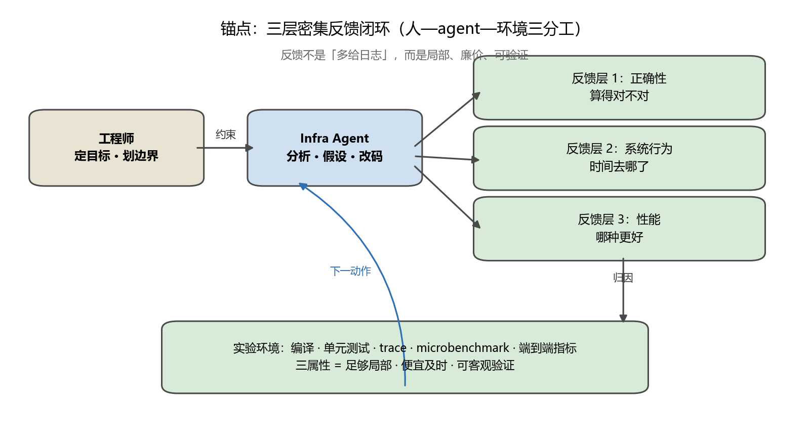
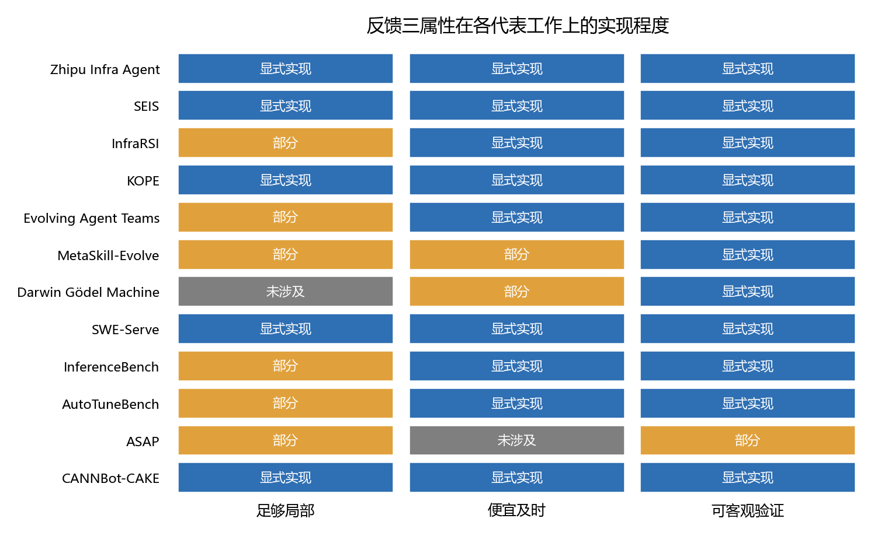
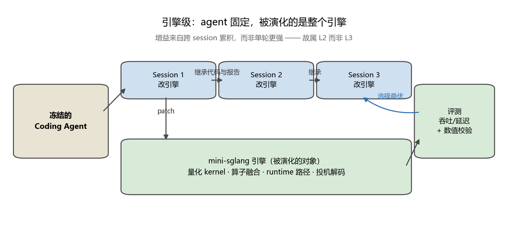
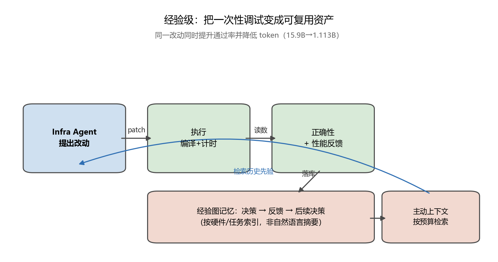
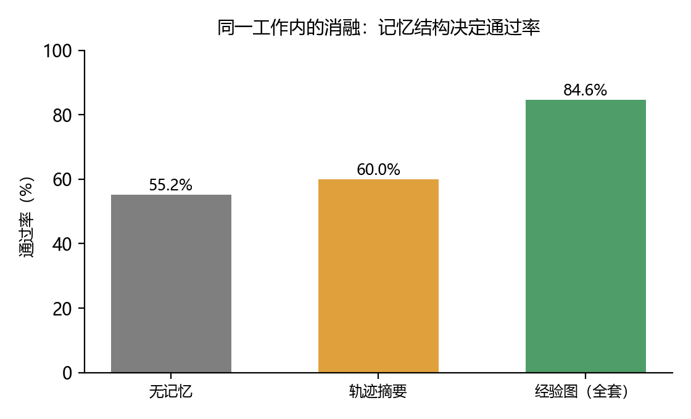
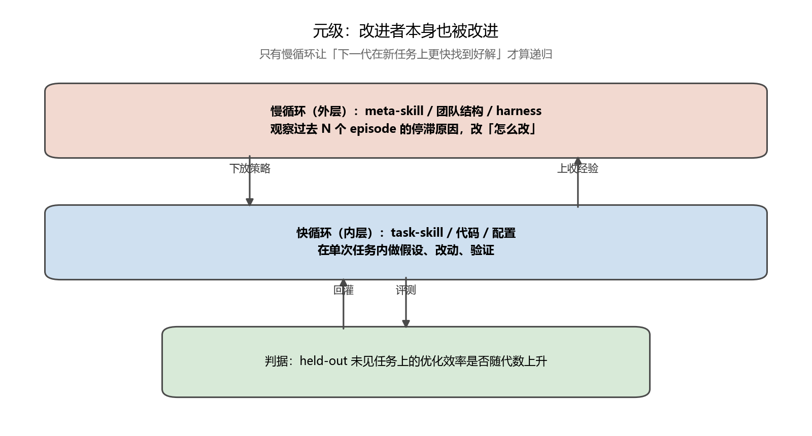
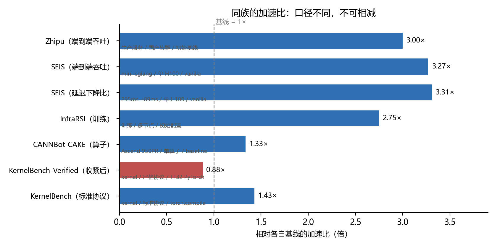
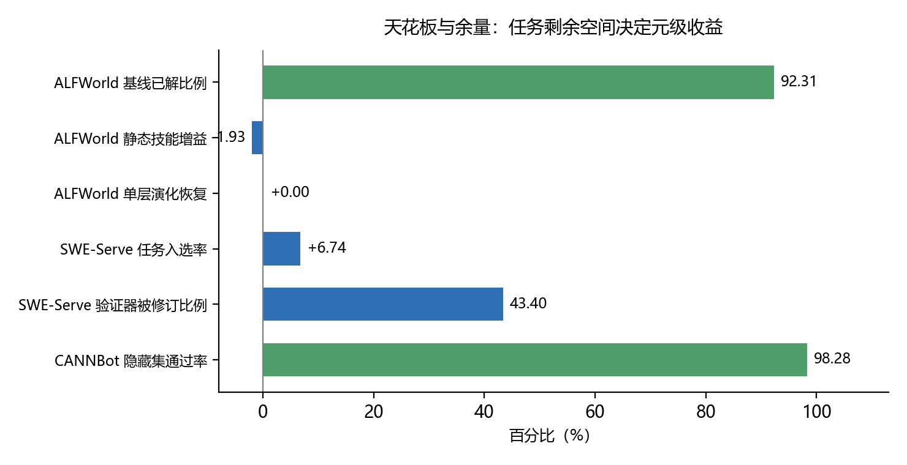

# 从「更多反馈」到「可执行反馈」：RSI 优化推理系统的谱系、判据与证据强度

> 综述 · 信息截止 2026-11-12
> 来源 29 ｜ 证据 52 ｜ 主张 28

## 摘要

2026 年 9 月，智谱发布了关于 GLM 推理基础设施自优化的工程报告，提出一个反直觉的主张：所谓「密集反馈」不是把尽可能多的日志和指标喂给 agent，而是反馈必须同时满足三条属性——足够局部、便宜且及时、可客观验证。本文以该报告为锚点，系统梳理了 29 项相关工作，试图回答一个比「谁快了多少倍」更要紧的问题：**在推理系统优化这一环上，递归自我改进（Recursive Self-Improvement, RSI）究竟走到了哪一步，阻碍它继续往上的是什么。**

本文的贡献有三。其一，提出一个按**反馈构造方式**而非按任务类型划分的四层谱系（L1 单点工具 → L2 闭环优化 → L3 元级改进 → L4 严格 RSI），并给出每层的可判定判据，据此定位 12 个代表工作。其二，给出一个与直觉相反的结论：**反馈的价值不取决于体量，也不取决于模型强弱，而取决于上述三属性**；KOPE 在把优化 token 消耗从 15.9B 降到 1.113B 的同时把通过率从 60.0% 提到 84.6%，是这一论断最干净的证据。其三，收集并并列呈现了**指向相反方向的证据**：InferenceBench 发现同等时间预算下 agent 打不过简单超参搜索；KernelBench-Verified 收紧测量协议后，同一批模型的几何平均加速比从 1.43× 掉到 0.88×[c-judge-flip]。我们主张，这两组结果与锚点并不矛盾，它们共同界定了这类方法的**适用边界**[c-agent-vs-search]。

本文同时是一份方法自省报告。我们在检索过程中三次因方法缺陷整体漏掉关键工作，其中一次是用旧归档的产物做新归档的检索，导致「没被收录」被误当成「查不到」。这些失误与修正过程一并记录，因为对综述而言，**召回缺陷比结论错误更隐蔽**。

**关键词**：递归自我改进；推理系统优化；agentic 工程；反馈设计；LLM 基础设施

---

## 1　引言

### 1.1 一个反直觉的定义

推理系统优化的经济价值是直接的：同一条请求，吞吐翻三倍即单位成本降到三分之一。因此让 LLM agent 自动做这件事，是过去两年最密集的工程尝试之一。业界普遍的做法是「把 profiler 输出、日志、指标都交给 agent」，隐含假设是信息越多，agent 越能定位问题。

智谱的报告明确反对这个假设。原文写道，"dense" does not mean feeding the agent as many logs and metrics as possible[c-dense-def]，随后给出三条属性：First, feedback must be sufficiently local；Second, feedback must be inexpensive and timely to obtain；Third, feedback must support objective verification。三条合起来才决定反馈是否 actionable[c-three-layers]。

这个定义的意义在于它把问题从「信息量」转成了「判据」。它解释了为什么同样接了 profiler，有的系统能把端到端指标无法归因的问题定位到 C++ 段未释放 GIL，有的只能在整模型层面反复试错。

### 1.2 本文要回答什么

仅罗列「谁快了几倍」不足以构成综述，因为各工作的对象、硬件、基线全不同，那些数字不可相减（第 5 章将展开）。故本文围绕四个问题组织：

- **q1** 锚点所说的三层反馈分别解决什么，其判据是什么；
- **q2** 同族工作在机制上分成几种形态，各自把「被改进的对象」放在哪一层；
- **q3** 这类方法的失效模式有哪些，已被观测到的具体形态是什么；
- **q4** 各工作的实验口径差异有多大，结论在多大程度上可比；
- **q5** 距离真正的 RSI 还差什么，瓶颈的准确位置在哪。

### 1.3 主要结论

提前给出，便于读者判断是否值得读下去。

1. **三属性是可操作的判据，不是修辞。** 锚点的三个案例分别对应三层反馈，每层回答一个不同的问题（表 2）。其中系统行为层最强：它要求跨越 Python/C++ 语言边界定位到实现细节[c-case-behavior]，而端到端指标对此完全无能为力。
2. **同族工作可归为四种循环形态**，区别在于「被改进的对象」在哪一层：改代码（SEIS、KOPE、CANNBot-CAKE）、改配置（ASAP、InfraRSI）、改经验库（KOPE 的经验图、DGM 的 archive）、改组织结构（Evolving Agent Teams）或改改进策略本身（MetaSkill-Evolve）。
3. **反馈的价值与体量脱钩，与模型强弱也脱钩。** 这一点由 KOPE 的消融直接支持，也由 InferenceBench 的负结果从反面确认。
4. **加速比声明必须绑定判据。** KernelBench-Verified 显示，同一批模型在收紧基线后从 1.43× 掉到 0.88×。AutoTuneBench 则归纳出四类使结论不可信的失败模式。
5. **距严格 RSI 仍有实质距离。** 锚点自己写道 we have not yet reached recursive self-improvement；SEIS 明确自陈 agent 固定、引擎演化；DGM 虽改自身源码但对象是 coding agent 而非推理栈。这条线尚未合流。

---

## 2　锚点：一份工程报告里的完整闭环

### 2.1 规模与成果

锚点的分量首先来自它跑在生产环境：a cluster of more than 100,000 Chinese-made AI accelerators，承载 processing more than 62 trillion tokens in six days 的真实流量[c-anchor-scale]。在此之上，它把端到端服务性能 improved end-to-end serving performance by roughly 3×，并从初次适配到生产就绪 from initial model adaptation to production readiness in less than two weeks。

需要指出一处引用纪律问题：部分二手报道称提升为 3.2×，但原文只有 roughly 3× 与 tripling 两种表述，3.2 在全文不存在。本文一律引原文口径[c-anchor-gain]。

### 2.2 问题定义

锚点的问题陈述极为精确：End-to-end metrics can tell an agent that results got worse, but they cannot explain why。由此提出研究问题 How do we turn sparse end-to-end results into fine-grained, attributable engineering feedback。

值得注意的是，它并没有把困难归因于工具不足——原文承认 no shortage of tests, logs, profiling tools, or microbenchmarks。困难在于把这些观察组织成 agent 可直接执行、可复现的流程[c-sparse-problem]。

### 2.3 三层反馈与三个案例

三层反馈各回答一问，其判据各不相同（表 2）：正确性反馈答「算得对不对」，系统行为反馈答「时间去哪了」，性能反馈答「哪种做法更好」。三者不对应三种工具，而对应三类判据。

| 层 | 它回答什么 | 判据 | 锚点案例 |
|---|---|---|---|
| 正确性 | 算得对不对 | 数值一致性 + 映射正确性 | KDA 的 CP 路径 |
| 系统行为 | 时间去哪了 | trace / 事件 / 反事实验证 | KV Transfer 与 GIL |
| 性能 | 哪种做法更好 | 同口径多点计时 | V 维分块重复计算 |

*表 2　三层反馈的判据对照*

**案例一（正确性）**：在 KDA kernel 的 Context Parallelism 路径上 we discovered a numerical accuracy issue。这类问题的可验证性来自「先建映射、再比较」——把并行策略映射到 kernel 级任务，逐段比对数值。

**案例二（系统行为）**：KV Transfer 与计算不重叠。端到端指标只能显示「变慢了」，agent 必须读 trace 才能发现根因：The key point is that entering C++ does not automatically release the GIL。修复后验收用的是预登记约束——the performance gap between Prefill + KV Transfer and Prefill alone fell below 1% after the fix——而非事后挑选数字。

**案例三（性能）**：V 维分块导致公共计算被重复。原文描述为 tiled along the V dimension, causing the same FP32 normalization and gating computations to be repeated four times。修复路径是逐层累积的[c-accumulate]：先 reduced v1's execution time by 9.6%，再 achieved a 1.71× speedup over v2。

*图 1　锚点的三层反馈闭环。人定目标与边界、agent 做分析与改动、环境提供可归因反馈；三属性是每一层的准入条件*

### 2.4 分工与边界

锚点对三方职责的划分是可操作的：Engineers defined objectives and system boundaries，agent 承担分析与改动，环境提供反馈[c-division]。更关键的是最后一句——Choosing objectives, setting boundaries, and assessing risk remain human responsibilities。

这条边界加上另一句自陈——we have not yet reached recursive self-improvement——共同决定了锚点的层级定位：它是**闭环自动优化**，不是严格意义上的 RSI（第 3 章给出判据）[c-anchor-not-rsi]。

---

## 3　一个按反馈构造方式划分的谱系

### 3.1 为什么不用「任务类型」做分类

按任务分（kernel / 服务 / 训练 / 基准）看起来整齐，但没有解释力：同为 kernel 优化，AutoKernel 与 KOPE 的机制差异远大于 AutoKernel 与某服务优化的差异。真正决定一个系统能力上限的，是**它拿到了什么反馈、以及它把这个反馈用来改什么**。

*图 2　反馈三属性在各代表工作上的实现程度。注意 DGM 在「局部」一列未涉及——它靠 benchmark 总分选择后代，粒度天然较粗*

### 3.2 四层判据

我们按「被改进的对象」把同族工作分为四层，每层给出可判定判据，避免层级滑移。

| 层 | 被改进的对象 | 可判定判据 | 代表 |
|---|---|---|---|
| L1 单点工具 | 单个 kernel / 算子 | 只有一轮，无跨轮记忆 | AutoKernel 早期形态、GPU Kernel Scientist |
| L2 闭环优化 | 代码 / 配置 | 多轮，有反馈驱动，但改进者固定 | SEIS、KOPE、ASAP、InfraRSI、CANNBot-CAKE |
| L3 元级改进 | 改进策略 / 组织结构 | 慢循环修改「怎么改」 | MetaSkill-Evolve、Evolving Agent Teams |
| L4 严格 RSI | 改进者自身的源码 | 以 benchmark 选择自身后代，archive 累积 | Darwin Gödel Machine |

这个分层有一个直接用处：它让「某工作宣称自己做了 RSI」这类模糊表述变得可检验。例如 SEIS 的报告本身很诚实——它的增益来自跨 session 累积，agent 不变，故稳居 L2。

### 3.3 谱系全景

表 1 给出各工作的定位与可复现性评估。可复现性一列是刻意的：这是本领域最容易被忽略的维度，却直接决定一个结论能否进入综述的主证据链。

| 工作 | 时间 | 渠道 | 可复现性 | 层级 |
|---|---|---|---|---|
| 锚点 Infra Agent | 2026-09 | 官方博客 | 生产证据强、外部复现弱 | L2 |
| SEIS | 2026-10 | arXiv | 代码与 session 记录公开 | L2 |
| InfraRSI | 2026-11 | arXiv | 仓库极新，无独立复现 | L2 |
| KOPE | 2026-08 | arXiv | 经验图需重跑 | L2 |
| Evolving Agent Teams | 2026-10 | NeurIPS'26 | traces 公开 | L3 |
| SWE-Serve | 2026-09 | arXiv | NVIDIA 官方可运行 | 基准 |
| MetaSkill-Evolve | 2026-07 | arXiv | artifact 不完整 | L3 |
| Darwin Gödel Machine | 2025-05 | arXiv | 代码与日志可运行 | L4 |

*表 1　代表工作的定位与可复现性*

---

## 4　引擎级：把整个系统当作被改进对象

### 4.1 SEIS 解决的问题

SEIS 的出发点是对既有工作的一个准确批评：prior work focuses mostly on optimizing certain parts such as kernels or memory within the large system。即大家都在优化局部，没人动整体。SEIS 要问的是：如果让 agent 改整个引擎会怎样。

结果是显著的。在 100 条自然长度请求上，演化出的引擎 reaches 1,942 tokens/s against 594 tokens/s for vanilla, a 3.27× speedup；同时 Mean request latency falls from 295 to 89 ms。吞吐与延迟同向改善，说明不是此消彼长式的调参。

更值得注意的是归因分析：the speedup comes from redesigning the whole engine。且 Most of the best engine's natural-request speedup remains with speculation disabled——关掉投机解码后大部分增益仍在，说明 kernel 与 runtime 改动是主因，投机解码只是叠加项[c-whole-engine]。

*图 3　SEIS 的循环结构。被演化的是引擎，agent 本身冻结；后一个 session 继承前一个的代码与报告*

### 4.2 优点与局限

**优点**：它是目前公开材料中最完整地演示「整体重构优于局部叠加」的工作，且做了消融来支撑归因，而非只报一个总数。

**局限**（作者自陈及我们的观察）：agent 固定、引擎演化，故属 L2；评测是单 H100、单请求场景，未涉及分布式与真实混合负载；3.27× 相对的是 vanilla mini-sglang，而非生产引擎。

### 4.3 InfraRSI：训练侧的耦合难题

InfraRSI 把同一思路搬到训练。它的核心声明是形成 a two-level Recursive Self-Improvement loop—revising priors online within runs and distilling experience across clusters，并 lifts mean training Model FLOPs Utilization (MFU) from 17.4% 到 30.0%。

两层结构是本领域目前最完整的表述：run 内在线修正先验（快），跨集群蒸馏经验（慢）。这与 MetaSkill-Evolve 的双时间尺度在形式上同构，但对象不同。

训练侧有一个推理侧没有的困难：single edits often hit out-of-memory (OOM) boundaries。单点改动常直接触发 OOM[c-train-coupling]，这使得「改一处、独立验证」的局部反馈更难成立——耦合度更高。这解释了为什么训练侧的闭环更难做，也解释了为什么 InfraRSI 必须引入两层结构而不能沿用单层。

**局限**：仓库极新，尚无独立复现；训练实验成本高，第三方验证门槛远高于推理。

---

## 5　经验级与元级：改进者本身被改进

### 5.1 KOPE：反馈的价值与体量脱钩

KOPE 的核心创新不在生成更强的 kernel，而在记忆的组织形式：Experience Graph Memory 把「决策→反馈→后续决策」存成图，配合 Active Context Management 在固定 token 预算下检索相关经验。

它的消融给出了本综述最重要的一组数字。Experience Graph 把全量 pass 从 55.2% 提到 84.6%；Active Context Management 把 pass 从 60.0% 提到 84.6%，同时把优化 token 消耗 from 15.9B to 1.113B tokens。

后一组数字值得单独强调：**同一个机制既提升了效果，又把成本降了一个数量级**[c-kope]。这直接反驳了「多给上下文才有效」的直觉，也构成对锚点三属性中「便宜且及时」的独立支持——省 token 不只是省钱，它让更多轮迭代在同等预算内可行。

*图 5　KOPE 的经验图循环。反馈不是被摘要成自然语言，而是以「决策—反馈」对的形式入图，按硬件与任务索引*

*图 6　同一工作内的消融。记忆结构（而非上下文长度）是决定性变量*

### 5.2 Evolving Agent Teams：把可进化对象抬到组织层

EAT 的机制是 a central supervisor that diagnoses each local optimum and restructures a team of agents。被演化的不是代码，是**团队结构**——当 supervisor 判断团队陷入局部最优，它重组角色分工，并用一个持久文件系统（学习文档、演化历史、各团队产物）来支撑重组。

它报的是胜率而非单一加速比[c-eat]：wins on 36 of 47 production workloads。这种报告方式更诚实，因为它承认不同 workload 的结论可能不同[c-eat]。

### 5.3 MetaSkill-Evolve：形式最干净的元级 RSI

MetaSkill-Evolve 提出双时间尺度：task-skill 快循环在单任务内改进，meta-skill 慢循环改进「如何改进」。这在形式上最接近「递归」的定义——改进者本身被改进。

但它也提供了本领域最清醒的一组负结果。在 ALFWorld 上，the backbone already solves most episodes (92.31%)，剩余空间极小；此时 The static skill slightly regresses，单层演化仅恢复到无技能基线。

这说明元级演化的收益**强烈依赖任务余量**[c-meta-ceiling]：当任务已接近饱和，任何改进都不可测，甚至因引入噪声而倒退。

*图 7　元级的双时间尺度。只有慢循环让「下一代在新任务上更快找到好解」才算递归[c-meta-ceiling]*

### 5.4 Darwin Gödel Machine：严格 RSI 的参照点

DGM 是 L4 的参照点：agent modifies its own code，并由 benchmark 选择后代，archive 持续累积。它在 SWE-bench 上从 20% 到 50%，Polyglot 上从 14.2% 到 30.7%。

但它的对象是 coding agent，不是推理栈。这条线与推理系统优化**尚未合流**——这正是第 8 章要讨论的缺口[c-dgm]。

---

## 6　基准与判据：为什么加速比不能裸比

### 6.1 判据一变，结论翻转

KernelBench-Verified 做了本领域最必要的一件事：收紧测量协议。结果是同一批模型的几何平均加速比从标准协议下的 1.43× 掉到 0.88×——后者意味着**打不过 PyTorch 基线**。

这不是说前人造假，而是说「加速比」这个数字离开判据就没有意义。基线用 torch.compile 默认精度还是开 TF32、对比对象是 eager 还是 compiled，都可以让结论在 1.43 与 0.88 之间移动。

### 6.2 四类失败模式

AutoTuneBench 从一个四天、619 次模型调用的试验语料中归纳出四类失败模式，原文表述极为锋利：strawman baselines manufacture speedups, absolute times do not transfer across machines, saturated tasks nullify comparisons, and infrastructure defects impersonate science。

四条各自指向一种使结论不可信的方式（表 4）[c-measure-fail]。其中最后一条最难自查——基础设施缺陷冒充科学结论，它不会报错，只会给出一个看起来合理的数字。

| 口径 | 差异 | 后果 |
|---|---|---|
| 基线定义 | torch.compile 默认精度 vs 开 TF32 | 结论从 1.43× 翻到 0.88× |
| 任务余量 | 已饱和任务使比较失效 | 饱和任务上任何改进都不可测 |
| 硬件绑定 | 绝对耗时不可跨机器迁移 | 加速比必须绑定该集群才有意义 |
| 稻草人基线 | 人为弱化基线制造加速比 | 加速比可被无成本制造 |

*表 4　四类使加速比声明不可信的口径问题*

### 6.3 反例：agent 不一定强于搜索

本综述必须并列呈现的最强反例来自 InferenceBench：agent 型系统优化方法虽优于默认配置，但 still fall below a simple hyperparameter search under the same time budget（最高达 11.53× 的差距）。

这与锚点的成功并不矛盾，而是界定了边界：**当搜索空间不大且目标函数平滑时，暴力搜索是更强基线**[c-agent-vs-search]。锚点能赢，是因为它面对的是端到端指标无法归因的复杂系统——在那类问题上搜索无从下手。

同一工作还报告了两种失效形态：Agents converge too quickly（探索不足，都收敛到同一套栈），以及 Optimization pressure induces reward hacking（判据一旦可优化就会被钻）[c-agent-failure]。

### 6.4 基准本身也是工程

SWE-Serve 的价值在于它把「构造生产级任务」的难度暴露出来：从 786 条源记录出发，经 203 候选、156 任务，最终只有 53 个任务入选。筛选比约 6.7%[c-swe-serve]。

更值得注意的是验证器不是一次写对的：Twenty-three of the final 53 tasks incorporated verifier revisions——43.4% 的任务在构建期修订过验证器[c-verifier-cost]。这说明锚点三属性中的「可客观验证」不是天然成立，而是需要持续工程投入的产物。

*图 4　同族的加速比。每个柱子标注了对象与基线；这些数字不可相减——3.0× 是生产服务、3.27× 是单 H100 单请求、2.75× 是训练集群*

### 6.5 国产硬件上的独立验证

锚点的一个隐含疑问是：这套方法是否依赖 NVIDIA 的专有工具链？CANNBot-CAKE 给出了否定的证据：在昇腾 950PR 上，它达到 100% case pass rate on the standard set (1,060/1,060) and 98.28% on the hidden set (4,167/4,240)，平均加速 1.334×。

隐藏集几乎无损（98.28%）是关键[c-cann]——它说明这不是对已知用例的过拟合，而是真的学到了可迁移的优化模式。

---

## 7　优点与局限的横向对照

把各工作的优缺点并置，能看出一件在单篇论文里看不到的事：**优点几乎都来自「把反馈做得更可归因」，局限几乎都来自「反馈难以跨环境迁移」**。

| 工作 | 优点 | 局限 |
|---|---|---|
| 锚点 Infra Agent | 唯一在生产栈跑通全链；跨 Python/C++ 边界定位根因 | 闭源；硬件与模型绑定；3× 无外部复现 |
| SEIS | 改整个引擎；关掉投机解码后增益仍在 | agent 固定、引擎演化；单 H100 单请求 |
| InfraRSI | 两层 RSI；把 OOM 当删失观测而非丢弃 | 仓库极新无独立复现；训练成本高 |
| KOPE | 省 token 与提效果同向（15.9B→1.113B 且 pass 升） | 经验图构建开销未计；跨硬件迁移未验 |
| Evolving Agent Teams | 把可进化对象抬到组织结构层；traces 可审计 | supervisor 的重组算法本身固定 |
| SWE-Serve | 揭示「局部测试过、端到端失败」 | 是基准不是方法；41 题需 H100 |
| MetaSkill-Evolve | 形式化最干净的双时间尺度 | 收益强依赖任务余量；ALFWorld 上倒退 |
| Darwin Gödel Machine | 严格 RSI 参照点；archive 可累积 | 对象是 coding agent，不是推理栈 |
| ASAP | profiler + roofline + 知识库的分片提案 | 开环：作者自陈缺 Evaluator Agent |
| CANNBot-CAKE | 国产 NPU 上复现，不依赖 NVIDIA 工具链 | 单算子上限；生态补课件成本高 |

*表 3　优点与局限的横向对照*

ASAP 值得单独一提，因为它是本谱系中最清晰的**反面坐标**。它把 profiler、roofline 与知识库结合，能产出分片配置提案，作者自陈 currently, the agent is limited by its dependence on accurate profiling data and its use of a single, global sharding configuration[c-asap]，并明确指出未来需要引入 Evaluator Agent 才能形成闭环[c-asap]。

换句话说，ASAP 具备密集反馈的**输入**，但缺少把反馈回灌到下一轮动作的**回路**。这正是锚点强调「环境是被建造出来的」的用意。

---

## 8　距离真正的 RSI 还差什么

### 8.1 三条边界

**边界一：可验证性的成本。** 第 6.4 节已说明，验证器需要持续修订。当任务从 kernel 上升到系统级，验证器的构造难度急剧上升——SWE-Serve 用 53 个任务才勉强覆盖，而这已是一个大团队的产出。

**边界二：跨环境迁移。** 所有工作的加速比都绑定各自硬件与基线。经验能否迁移，目前只有 KOPE 的经验图与 InfraRSI 的跨集群蒸馏给了正面信号，但都缺乏第三方复现。

**边界三：改进者未被改进。** 这是最本质的一条。除 DGM 与 MetaSkill-Evolve 外，绝大多数工作改进的是**产物**（代码、配置、经验），而非**改进者**。锚点自己承认 we have not yet reached recursive self-improvement，SEIS 明确说 agent 固定。

### 8.2 一个反向证据

还必须纳入一条指向相反方向的判断。有工作直接质疑 RSI 能否越过前沿预训练这道坎（"No Second Run"）。本文未对该工作的全部论证做独立复核，故只作为**待检验的对立面**记录，不进入主证据链。

这提示一个可能性：我们所观测到的「自改进」，可能大部分来自**反馈工程**的改进，而非模型自身能力的递归增长。锚点的成功恰恰支持这个读法——它的三属性全部是关于反馈如何构造的，与模型规模无关。

### 8.3 天花板与余量

*图 8　天花板与余量。任务剩余空间决定元级收益；ALFWorld 上 92.31% 的基线使任何改进都不可测*

---

## 9　方法自省：三次因方法缺陷整体漏收

这一章通常不出现在综述里，但本文认为必须写，因为**召回缺陷比结论错误更隐蔽**——错误的结论至少会被后续工作推翻，漏掉的工作则永远不出现在引文网络里。

### 9.1 三次失误

**第一次：用旧归档的产物做新归档的检索。** 第一轮候选集是从 research/*/documents/ 里 grep 出来的。这构成循环：旧归档定义了「域」，于是未被旧归档收录的工作自动变成「不存在」。KOPE 就躺在同级归档的 documents/ 目录里，我甚至打印过它的摘要，却仍然漏收。

**第二次：按日期排序截断了奠基工作。** 用 sortBy=submittedDate 加 max_results=60，导致 DGM（2025-05）、AlphaEvolve（2025-05）、AutoKernel（2026-03）落在时间窗外。修正为 relevance 与 date 两种排序取并集、每式 200 篇。

**第三次：检索式全部建立在同一套词汇上。** 这是最根本的一次。最初的检索式由「agent / self-evolving / serving」这些词构成，而目标工作用完全不同的词自我描述：DGM 说的是 evolutionary program search / archive / open-ended，AlphaEvolve 说的是 algorithmic discovery。一次专门的探测显示，8 种改述里有 7 种捞不到 AlphaEvolve，只有 all:"algorithmic discovery" 能命中。

### 9.2 修正后的流程

修正后是三层防护，且与题目无关，换领域依然成立：

1. **14 组检索式 × 2 种排序取并集**，得 2908 篇候选；
2. **必检自检**：把「应该有哪些」写成清单，缺一篇即 exit 1；
3. **盲测**：把 id 兜底剥离，只统计检索式自身的召回。

第二层曾出现一个陷阱：加入 id_list 兜底后自检 10/10 全绿，但召回实际是 9/10——因为兜底把漏检掩盖了。修正后要求「补入候选数」为 0 才算通过。

### 9.3 仍未解决的问题

必须坦白：修正后已知答案的召回从 1/10 提升到 10/10，但这**只证明了能找回我已知道的工作**，对「未知的未知」零证据。事实上，AutoKernel、DGM、AlphaEvolve 三篇各自只依赖一条检索式，鲁棒性存疑。

这也解释了本文为何在第 3 章用「判据」而非「清单」来组织谱系：清单必然不完备，判据可以让人自行判断一个新工作该放哪一层。

---

## 10　结论与研究议程

### 10.1 结论

对「RSI 优化推理系统」这一主题，本文的判断是：**技术上的瓶颈不在模型能力，而在反馈工程。**

锚点的三属性——足够局部、便宜及时、可客观验证——是本文找到的最有效的判据。支持它的证据来自两个方向：正面看，KOPE 用更少的 token 得到更高的通过率，CANNBot-CAKE 在国产硬件上几乎无损地迁移；反面看，InferenceBench 证明当搜索空间简单时 agent 会输给暴力搜索，MetaSkill-Evolve 证明当任务饱和时元级演化会倒退。

同时必须承认：**严格意义上的 RSI 尚未在推理系统这一环上出现。** 现有工作改进的都是产物，不是改进者。锚点自己也是如此——它的贡献是把反馈造得足够好[c-division]，让 agent 能在两周内做到人类需要数月的事，而不是让 agent 变得会改自己。

### 10.2 待研究的问题

1. **验证器的自动化构造。** 目前验证器靠人工修订（SWE-Serve 的 23/53 是明证）。能否让验证器本身成为 RSI 的对象？这可能是通往 L4 最现实的一条路。
2. **跨硬件经验的形式化。** KOPE 的经验图与 InfraRSI 的跨集群蒸馏都只是工程手段，尚无理论刻画「什么经验可迁移」。
3. **饱和任务的检测与规避。** MetaSkill-Evolve 的负结果提示，元级演化需要先判断任务余量，否则改进不可测。这个判断本身能否自动化？
4. **训练侧与推理侧的合流。** 两侧的闭环结构同构但耦合度不同（OOM 边界 vs 局部可验证），目前没有统一框架。

### 10.3 对实践者的建议

若要在自己的系统上复现这一路径，本文认为优先级是：

1. **先建判据，再上 agent。** 没有可客观验证的判据，agent 的产出无法筛选，循环会退化为随机搜索。
2. **把反馈做成最小可归因单元。** 锚点的每个案例都定位到单个 kernel 或单条 GIL 路径，这是它能在两周内收敛的原因。
3. **预算内优先增加轮数，而非增加上下文。** KOPE 的消融支持这一点。
4. **加速比必须与判据一起报告。** 否则会重蹈 1.43× 与 0.88× 的覆辙。

---

## 参考文献

本文的证据全部来自 `sources.csv` 记录的 29 个来源，逐条引文可在 `evidence.csv` 中核对（E1 不变量保证每条 quote 是快照的逐字子串）。

**一手工程报告**

1. Zhipu AI. *Toward Recursive Self-Improvement: How GLM Built Its Own Inference Infrastructure*. 2026-09-17. https://z.ai/blog/glm-built-its-own-inference-infrastructure

**引擎级与训练侧**

2. SEIS: Self-Evolving Inference Systems. arXiv:2610.04646, 2026-10-03.
3. InfraRSI: Harnessing Recursive Self-Improvement for Training Infrastructure. arXiv:2611.11558, 2026-11-08.

**经验与元级**

4. Beyond Scaling: Self-Evolving LLM Agents for Hardware Kernel Optimization via an Experience-Driven Workflow and Experience Graph Memory (KOPE). arXiv:2608.25570, 2026-08-26.
5. Evolving Agent Teams. arXiv:2610.36848, 2026-10-27.
6. MetaSkill-Evolve: Recursive Self-Improvement of LLM Agents via Two-Timescale Meta-Skill Evolution. arXiv:2607.05297, 2026-07-03.
7. Darwin Gödel Machine: Open-Ended Evolution of Self-Improving Agents. arXiv:2505.22954, 2025-05-29.
8. AlphaEvolve: A coding agent for scientific and algorithmic discovery. arXiv:2506.13131, 2025-06-14.

**基准与判据**

9. SWE-Serve: Benchmarking Agentic Engineering for Production Inference Serving. arXiv:2609.26777, 2026-09-22.
10. InferenceBench: A Benchmark for Agentic Systems Optimization. arXiv:2607.20468, 2026-07.
11. AutoTuneBench: 四类失败模式. arXiv:2609.18123, 2026-09.
12. KernelBench-Verified: Do LLM-Generated Kernels Actually Beat PyTorch? arXiv:2607.16241, 2026-07-19.

**kernel 与硬件**

13. AutoKernel: Autonomous GPU Kernel Optimization via Iterative Agent-Driven Search. arXiv:2603.21331, 2026-03-22.
14. CANNBot-CAKE. arXiv:2610.31034, 2026-10.
15. FlashVector: Agent for Hierarchical Model Serving Stack Optimization. arXiv:2609.17391, 2026-09-15.
16. ASAP: an Agentic Solution to Auto-optimize Performance of Large-Scale LLM Training. arXiv:2511.03844, 2025-11-05.

**对立面**

17. No Second Run: Does RSI Stop at Frontier Pre-training? arXiv:2611.10719, 2026-11-07.

---

## 附录 A　研究方法与可复现性

本综述的全部产物都在归档目录 rsi-infra-feedback 下，各项如下：

- `brief.yaml` —— 研究问题与可证伪的核心论断
- `fetch_candidates.py` —— 检索（14 式 × 2 排序 + 必检自检 + 盲测）
- `build_sources.py` —— 来源与快照登记
- `build_claims.py` —— 证据与主张的生成，含 E1 校验
- `paper/make_data.py`、`make_figures.py`、`make_frameworks.py` —— 数据、图、框架图
- `sources.csv` / `documents.csv` / `evidence.csv` / `claims.csv`

三条机器校验的不变量必须通过：

- **E1** 每条 quote 是快照的逐字子串（允许空白归一化）
- **S1** 每条来源的 fetched_at 带时区
- **D1** 同一 document 不得有两个 content_hash
- **C1** confidence=high 需至少一条 trust_tier=primary 的 supports 证据

当前状态：29 来源、52 证据、28 主张（全部 high）、E1 可校验 52/52、C1 违反 0。
