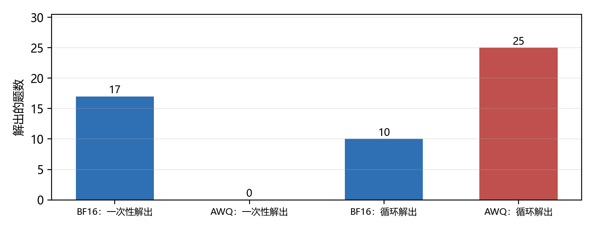
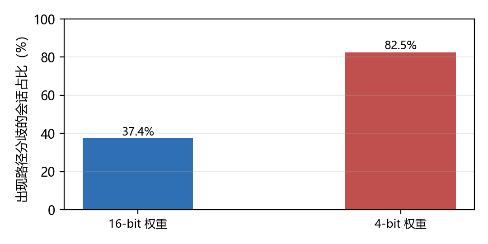
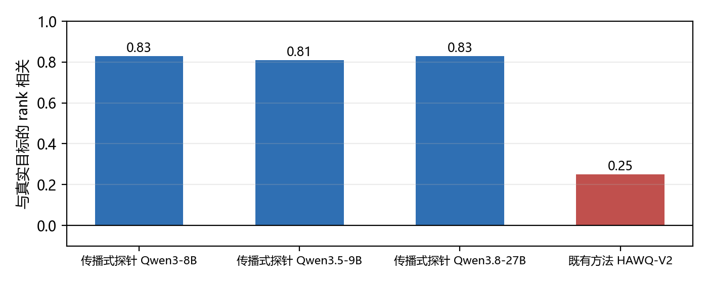
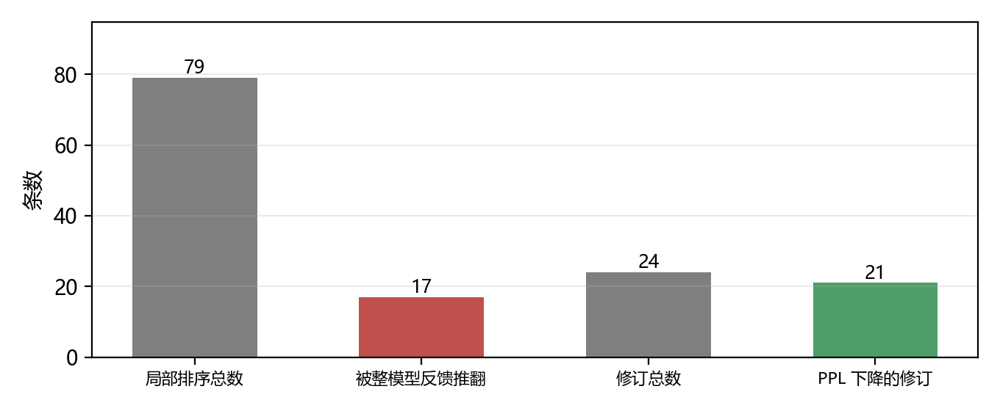

# 模型量化的「递归自我改进」：判据的不可迁移性

**一份按「压到多少才算还正确」组织的综述（2025-01 — 2026-11）**

> **数据快照**：2026-11-05 ｜ **纳入论文**：34 篇（core 17 / 旁证 17）｜ **来源时间跨度**：2026-06 至 2026-11 ｜ **主张**：12 条 ｜ **证据**：64 条（高置信 12 条）

## 摘要

量化是推理优化里最容易被宣称「无损」的一层。4-bit 几乎成了默认配置，理由通常是「基准准确率只掉一两点」。本文要检验的正是这句话——不是它数字对不对，而是**它作为判据是否成立**。

本文核对 34 篇工作（17 篇给出可被循环直接使用的判定量，17 篇提供判据的另一半），核心结论是：**量化层的自我改进卡在判据的不可迁移性上，而不是搜索能力上。**

**第一，「无损」不是一个模型的属性，而是三元组 (模型, 校准集, 评测集) 的属性。** 同一批量化模型，准确率与校准的权衡会随评分规则反转，且换 NLL 与 Brier 也反转，说明这不是某个指标的伪影[c-calibration-dependence]。

**第二，perplexity 与基准准确率都只覆盖「平均」，不覆盖「尾部与过程」。** 有工作显示量化可以摧毁安全对齐而这两者几乎不动[c-lossless-not-ppl]；更近的一例是编码 agent：检测不到显著准确率损失，但同一次量化把 Qwen-7B 的一次性解从 17 降到 0、循环解从 10 升到 25[c-lossless-not-ppl]。

**第三，分数不动的原因是基准自带的误差预算把它吸收了。** 一个多轮工具调用基准的十次错误预算，正好容得下量化多出来的失败[c-flat-score]。所以「分数持平」不是证据，它只是说明这个基准的分辨率不够。

**第四，把 bit 花在哪有反直觉的答案：全局更细的粒度优于局部修补关键层。** 同样 +0.146 bit/weight 的增量，全局细化对所有测试模型都赢局部修复[c-budget-global]。这条否证了「先找关键层再补精度」这一流行直觉。

本文因此给出一条比「4-bit 够用」更窄也更硬的结论：**量化循环要闭合，必须同时解决三件事——用过程指标补足阈值、用相关性标定代理、用整体重排校验局部排序**[c-transfer]。

**关键词**：量化；混合精度；位分配；敏感度代理；保真度指标；校准集；自我改进

## 1　引言：一句被引用了一万次的话

### 1.1　「近乎无损」这句话的来源

量化的标准叙事是这样的：把权重从 16 bit 降到 4 bit，显存降四倍、延迟降数倍，而基准准确率只掉一两点，故「近乎无损」。这句话在文献里被反复复述[c-lossless-not-ppl]。

本文想问的不是「一两点」是否准确，而是：**如果判据就是这一两点，那么什么样的损伤会从它下面溜过去？**

答案不止一种，而且都不牵强：

- 安全对齐可以被摧毁，而 accuracy 与 perplexity 几乎不变[c-lossless-not-ppl]。
- 编码 agent 的准确率检测不到显著损失，但一次性解从 17 掉到 0[c-lossless-not-ppl]。
- 小模型在 2.6 bit 下仍能生成流畅文本，但已经说不出这些词的含义——定义能力相对基线掉 20–67%[c-lossless-not-ppl]。

### 1.2　本文要检验的假设

> 量化层的 RSI 卡在**判据的不可迁移性**上，而不是搜索能力上。

若成立，则量化层的自动化创新应集中在校准集构造、评测划分、阈值推导与代理标定；反过来，若某个系统的主要增益来自更聪明的位分配搜索，这条假设即失效。

第 5 章给出了它的正面证据（代理的标定质量决定分配成败），第 8 章给出了它的边界（结论不可跨对象迁移）。

### 1.3　纳入标准与数据来源

- **时间**：检索下限 2025-01-01，实际入选集中在 2026-06 之后（量化方法学的迭代速度极快，2025 年的结论多已被后续工作修正）
- **检索**：arXiv 官方 API，七组检索式（位分配 / agent / 演化搜索 / KV / QAT / 评测 / 循环）共 26 条式子，去重后 1358 篇候选，脚本 `fetch_quant.py` 可复现
- **筛选**：core 必须给出一个「能被另一个系统拿去当判据」的量（敏感度估计、误差归因、位分配准则），或实现完整自动流水线；旁证提供判据的另一半——量化到底怎么算「坏了」
- **全文**：34 篇中 32 篇抓到 HTML 全文，2 篇仅摘要（已在 `run.json` 声明）

⚠️ **必须声明的局限**：本文没有跑任何实验，所有数字都是二手且可逐条点回原文；34 篇里 2 篇的证据仅来自摘要。

## 2　被优化的对象：数值表示

### 2.1　三层对象的参数化方式不同

| 层 | 被优化的是什么 | 参数化 | 「正确」由什么定义 |
|---|---|---|---|
| kernel / 算子 | 一段可独立编译的 GPU 程序 | 实现方式（离散） | allclose + 隐藏测试集 |
| 端到端 / 服务 | 系统设计 + 运行时状态 | 调度与算法（混合） | 无损判据 + SLO |
| 量化 / 表示 | 权重与激活的数值表示 | bit / 粒度 / 分组（连续） | 前沿位置 + 退化阈值 |

*表 1　三层对象与参数化方式：只有量化层的「旋钮」是连续的*

这个差别不是分类学趣味。kernel 优化是离散选择：写对了就是对了，写错了 allclose 会抓。端到端优化是混合选择：调度策略换了，正确性靠无损判据兜底。**量化是连续选择：每多花零点几个 bit，正确性就滑一点，而「滑到哪算不能接受」本身需要被决定。**

这正是为什么量化的位分配被形式化成带约束的优化问题，而不是阈值判断[c-object-numeric]。

### 2.2　分配单元必须是执行单元

一个容易被忽略但决定成败的约束：精度分配的单元、存储的单元、执行的单元必须是同一个，否则分配写不进 kernel。近期的两条工作都在这上面做文章——一条用硬件对齐的二维权重 tile 作为统一单元[c-object-numeric]，另一条用 tile 同时承担分配、紧凑存储与执行[c-object-numeric]。

回报是实在的：tile 级分配在 3B 模型上达到原 16-bit 的 2.66 倍生成吞吐[c-object-numeric]，另一条 tile 对齐路线相对 BF16 最多 2.50 倍[c-object-numeric]。

### 2.3　位宽不是开关，是一组可选值

混合精度之所以叫「混合」，是因为位宽可以取中间值。有工作用 4/6/8 三档尾数位宽，理由是「给温和的离群值留一个中间档」能改善同等压缩率下的困惑度[c-object-numeric]。

这也解释了为什么真正的难题不是「能不能压」，而是「固定内存预算下如何分配」[c-object-numeric]——预算固定时，分配方案的空间远大于「选几 bit」。

## 3　「无损」的四套定义

### 3.1　四套定义，四种盲区

| 定义 | 保护什么 | 什么时候会漏 |
|---|---|---|
| perplexity 相对增量 | 语言建模的平均似然 | 安全对齐、稀有词定义能力 |
| 下游基准准确率 | 任务级平均表现 | 过程行为、一次性解到循环解的迁移 |
| 与 FP16 的分布散度 | 整个预测分布的位移 | 方向——KLD 测不出分歧落在哪 |
| 过程诊断量 | 失败发生在哪一步 | 需要重跑日志，非默认产出 |

*表 2　四套无损定义各自的盲区：没有一套能单独用*

### 3.2　第一套与第二套：平均值的两个变体

perplexity 与基准准确率经常被当成同一件事的两种写法，因为它们高度相关。但它们共享同一个盲区：**平均**。

一例来自安全：量化可以在 accuracy 与 perplexity 几乎不变的情况下摧毁安全对齐[c-lossless-not-ppl]。

另一例来自 agent：编码 agent 上检测不到任何统计显著的准确率损失[c-lossless-not-ppl]，但同一次 AWQ 量化把 Qwen-7B 的一次性解从 17 降到 0，同时把循环解从 10 升到 25[c-lossless-not-ppl]。

*图 1　同一次量化：一次性解与循环解的反号。总数看起来没变，构成完全变了。*

这张图是本文最重要的一张：它说明**准确率这个量可以把「解法类型迁移」这件事完全吸收掉**。模型没有变差，它变的是「怎么解」。

第三例更极端：激进量化的小模型仍能生成流畅文本，但已经不知道自己在说什么[c-lossless-not-ppl]——在 2.6 bit 附近，定义能力相对基线掉 20–67%，而表面包含几乎不掉[c-lossless-not-ppl]。

### 3.3　第三套：散度

替代方案是绕开「对不对」，直接测「分布变了多少」：用全词表预测分布之间的散度衡量信息损失[c-lossless-not-ppl]。

这条路更敏感，但它有它自己的问题，下一章展开。

### 3.4　第四套：过程诊断量

最后一类是过程指标：逐通道错误率、收缩预算下的成功率。它们的优点是能定位「失败发生在哪一步」，缺点是不是默认产出，必须重跑日志[c-flat-score]。

本文的判断是：**这四套不是备选，而是必需的四层。** 前两套判「大体没坏」，第三套判「分布没漂」，第四套判「坏在哪」。只报前两套是当前文献的常态，也是判据失效的主因。

## 4　为什么分数不动：误差预算与指标方向

### 4.1　误差预算会吸收额外失败

有一个反直觉的观察：在标准指标上，量化看起来真的是免费的。一个多轮工具调用基准上，八个格子、每格 456 个 episode、16/8/4 bit 三档，最终分数几乎不动[c-flat-score]。

原因不是损伤不存在，而是**基准自带的十次错误预算把多出来的失败吸收了**[c-flat-score]。总分是「在预算内完成任务」的指示函数，只要总额不超，中间多错几次看不出来。

作者给出的修法很朴素：把逐通道错误率与收缩预算下的成功率一起报，这两个量都能从已有日志算出来[c-flat-score]。

还有一个更精确的刻画：**量化放大的是既有的失败集合，不是引入新失败**[c-flat-score]。这解释了为什么「平均不掉」和「尾部变差」可以同时成立——量化噪声只翻转那些 margin 本来就很薄的 argmax 决策。

### 4.2　散度测的是位移，不是方向

第三套定义（散度）看起来能解决上面的问题，但它有一个结构性缺陷被明确指了出来：**KLD 测的是分歧的位移，不是方向**[c-metric-direction]。

量化数据支持这个说法：KLD 主要反映与参考之间的分歧量[c-metric-direction]，而它对该分歧是否落在关键处只有很弱的关系；在代码任务上，KLD 的失败预测力也很弱[c-metric-direction]。

更麻烦的是，这种「静默区」（分数看起来正常、实际已经坏了）的塌缩是 **metric-invariant** 的——换一个散度指标救不了[c-metric-direction]。

这逼出一个结论：散度不该被当成分数用，而该被当成护栏用[c-metric-direction]——它适合否决一个方案，不适合给方案排序。

### 4.3　把这条推到 serving 上

同一件事在服务侧有一个极端版本：**同一请求、同一采样参数，答案会随缓存是否命中而不同，而量化会放大这件事。** 在 llama.cpp + GGUF 上，Qwen2.5-7B 的路径分歧率从 16-bit 的 37.4% 升到 4-bit 的 82.5%[c-flat-score]。

*图 4　同一请求的路径分歧随量化放大：16-bit 37.4%，4-bit 82.5%。*

关键的那个对照是：**用 16-bit kernel 跑 4-bit 权重，分歧与 16-bit 无显著差异**[c-flat-score]。也就是说，放大来自量化执行路径本身，不是权重位宽。

这条对照的价值在于它把「量化坏了」这件事定位到了一个具体的层次上——不是数值精度，是执行路径。

## 5　把 bit 花在哪：全局 vs 局部，以及代理的标定

### 5.1　一个反直觉的结论

位分配领域的默认直觉是：找到关键层，把精度补给它。

有一篇工作直接检验了这条直觉。设定很干净：从 per-row 4-bit RTN 出发，给一个固定增量 +0.146 bit/weight，有两种花法——

- **全局**：处处用更细的粒度（per-row → group-128 标度）；
- **局部**：把最该补的少数层恢复成高精度[c-budget-global]。

结果是：**同等预算下，全局对所有测试模型都赢局部**[c-budget-global]。恢复是弥散的，把精度堆在少数关键层不是最优[c-budget-global]。

这条结论之所以重要，是因为它同时否证了一个方法论假设：如果「关键层」真的是关键，那么逐层敏感度就该是个强信号；而它既然不是，敏感度代理的作用就必须被重新定义。

### 5.2　代理的验收标准是相关性，不是先验合理性

于是问题变成：怎么判断一个敏感度代理能不能用？

有一篇工作给出了本文认为最干净的答案：**把代理的估计与真实激活下算出的层目标做 rank 相关**。

结果分化极大：

- 传播式随机探针：在三个模型上 rank 相关 0.83 / 0.81 / 0.83[c-sensitivity-proxy]；

- 隔离式估计器：与该目标不相关，−0.07 到 −0.15[c-sensitivity-proxy]；

- 既有方法 HAWQ-V2：0.25[c-sensitivity-proxy]。

*图 2　敏感度代理的标定质量：传播式探针 0.81–0.83，隔离式估计器接近零，HAWQ-V2 为 0.25。*

这三个数字放在一起说明一件事：**「用敏感度做代理」这个想法本身没错，错的是没被标定过。** 一个在 −0.07 上工作的分配器，和一个在 0.83 上工作的分配器，看起来都是「按敏感度分配」。

### 5.3　为什么标量代理会失效

这不是经验观察，有理论支撑：标量代理会失效存在下界证明[c-sensitivity-proxy]；而模块的平均条件数可以作为标量代理失效的实用指示器[c-sensitivity-proxy]。

换句话说，失效是可预测的：条件数高的模型，标量代理就该被换掉。这给了循环一个「什么时候该换代理」的判据——而这正是自动化的关键一步。

### 5.4　五条路线

把当前的做法归并，至少五条，它们的差别主要在「分配单元」与「代理」：

| 路线 | 分配单元 | 代理/依据 | 代表工作 |
|---|---|---|---|
| 层间位宽分配 | 整个线性层 | per-layer 敏感度分数 | 层位宽分配 / MXSens |
| 块内 + 块间双层 | block / 专家 | 块内便宜代理 + 块间整模型目标 | Q-Strata |
| tile 级分配 | 硬件对齐的二维 tile | 校准打分 + 保留预算 | TileQuant / AlignQuant |
| 无数据探针 | tensor / 层 | 传播式随机探针 | 谱平坦探针（400B） |
| 训练期动态分配 | 层（随训练变） | 前向误差估计 | Q-PACE |

*表 3　五条位分配路线：分配单元越细，代理越需要被标定*

这张表的读法是：**分配单元越往细走，代理承担的责任越重。** 层间分配错了只损失一层，tile 级分配错了会损失一批。

## 6　校准集是判据的一部分

### 6.1　一个反转实验

量化论文几乎都报「准确率-校准权衡」。有一篇工作检验了这个权衡稳不稳。

结论是：**表象上的准确率-校准权衡取决于评分规则**[c-calibration-dependence]；而且换 NLL 与 Brier 也出现同样的反转，故这不是 ECE 分箱的伪影[c-calibration-dependence]。

这条结论的杀伤力在于：它不是说某个指标不好，而是说**同一批模型、同一个量化方案，「谁更好」这个判断依赖于你怎么把 logits 变成标签**。

### 6.2　「必须校准」不是物理约束

另一侧的证据同样重要：无校准方法可以和有校准方法打平，且完全离线、推理期零额外开销[c-calibration-dependence]。

同时，无数据地估计校准目标本身是可能的[c-calibration-dependence]。

两条合起来说明：「必须校准」是一个方法选择，而不是量化的物理约束。这直接改变了循环的设计空间——如果校准可以不要，那么「校准集泄漏」这条失效模式就可以被整个删掉。

### 6.3　校准子集稳定性

反过来说，用校准的方法必须报一件事：校准子集换一批，结论还成立吗。有工作把「校准子集上的稳定性」列为必报实验项[c-calibration-dependence]。

本文认为这应该是硬性要求。理由是：如果结论依赖于抽到哪批校准数据，那么循环就会「学到」一个只在这批数据上成立的分配——这不是自我改进，这是过拟合。

## 7　循环：agent 化与代价

### 7.1　agent 进来之后，变的是流水线

把 agent 放进量化，最直接的变化不是搜索更聪明，而是**流水线被拆开了**：

- 一个 profiling agent 负责测「代价分布在哪」[c-agent-loop]；
- 一个剪枝 agent 定逐层剪枝率，一个量化 agent 定逐层位宽[c-agent-loop]；
- 一个微调 agent 按损失大小做恢复，一个评测 agent 用同一协议测每个模型[c-agent-loop]。

另一条工作把整件事形式化成一个终端任务：给 agent 一个检查点、存储上限、推理环境与时间预算，让它自己构造压缩权重与可执行推理代码[c-agent-loop]。

### 7.2　但产出还很粗

同一份工作给出了一个诚实的成绩单：24 次修订里有 21 次降低了困惑度（存储几乎不变）[c-agent-loop]；但按任务挑 PPL 最低的 agent 设计，平均仍有 3.4% 的困惑度增量，下游准确率 77.33% 对 BF16 的 79.56%[c-agent-loop]。

这个数字组合很重要：**单步看，agent 几乎每次都在改进；整体看，仍有可见的差距。** 这正是「自动优化」与「自我改进」的分界——前者能爬坡，后者要能爬对坡。

### 7.3　局部排序必须被整体重排校验

第三条工作给出了循环里最关键的一个机制。它做了一个对照：

- 用**整模型反馈**去校验此前的**局部排序**，79 条局部排序里有 17 条被推翻[c-local-global]。

*图 3　局部排序与整体重排：79 条局部排序中有 17 条被整模型反馈推翻；24 次修订中有 21 次降低困惑度。*

这不是小比例。它意味着：**任何只在局部块上评分的分配器，都有约五分之一的机会给出错误排序。**

可行的工程做法是双层：块内用便宜代理排序，块间用「装配好的」量化模型上的目标定预算[c-local-global]——外层目标必须在装配后评，而不是在块上评[c-local-global]。

同一份工作还指出另一个现象：生成与推理测试能暴露似然看不见的失败[c-local-global]。这与第 3 章的结论完全一致。

### 7.4　代价结构

量化循环的账与端到端循环不同：它买的是校准、搜索与恢复的时间。

| 环节 | 代价的量级 | 可否避免 |
|---|---|---|
| 敏感度探针 | 单机数十秒到数百秒（8B–400B） | 否，但很便宜 |
| 校准 | 一次前向；无校准方法可打平 | 部分可以 |
| 位分配搜索 | 取决于块内候选数 | 可用代理降 |
| 恢复训练 | 主成本；序列长度选择就值 1.9 个点 | 低比特下难以避免 |

*表 4　循环各环节的代价：代理侧很便宜，恢复侧很贵*

代理侧便宜得惊人：单台 Apple Silicon 上，8B 到 400B 的探针一遍只要 36 到 539 秒[c-cost]。

恢复侧则相反。同样是固定的训练 token 预算，用更少但更长的 32K 序列比用更多 4K 序列高 1.9 个点[c-cost]；而 rank-16 LoRA 虽然把显存降到 1/2.9，却补不上与全参数的质量差[c-cost]。

这条对比给出了一个可迁移的设计原则：**把预算从「搜索」挪到「恢复」往往是更好的交易**，因为搜索侧的边际收益已经被便宜的探针榨干了。

## 8　边界：结论不可跨对象迁移

### 8.1　四种失效条件

| 条件 | 现象 | 证据类型 |
|---|---|---|
| 换架构 | 同一位宽结果不同，敏感部件是模型特定的 | 跨 11 个 TTS 架构的统一协议 |
| 换任务 | 逐字记忆比通用能力掉得更快 | 5 个精度 × 3 个规模 × 2 套语料 |
| 换负载 | RAG 接地性可以在答案准确率不变时变差 | 离线 KV cache 审计 |
| 换场景 | 多轮更新下末值检索对数线性下降 | 前摄干扰实验 |

*表 5　四种失效条件：每一条都是「同一方案、换对象就变」的实例*

### 8.2　换架构

最干净的一条：**同一位宽产生不同结果，因为敏感部件是模型特定的，且无法从模型类别可靠预测**[c-boundary-scale]。

这项研究跨 11 个 TTS 架构、用统一协议、并对两个留出模型做盲量化[c-boundary-scale]。

对循环的含义是：从 A 架构上搜出来的位分配，不能直接搬到 B 架构；每换一个对象，标定就得重做。

### 8.3　换任务：退化沿维度分化

第二条更微妙：**量化是选择性遗忘**——逐字记忆比通用能力掉得更快，在每个精度、每个模型规模上都成立[c-boundary-scale]。

这意味着 perplexity 不变的同时，模型可能已经忘掉了具体的训练数据。对需要精确回忆的任务（代码补全、事实问答），这比 perplexity 掉点严重得多。

### 8.4　换负载

第三条来自 RAG：**KV cache 的精度会影响接地性，即使答案准确率保持不变**[c-boundary-scale]。

这是「指标选错」的另一个变体：接地性（回答是否基于检索到的证据）与答案是否正确是两个量，前者先坏。

第四条来自多轮更新场景：当一个值在上下文里被更新多次，末值检索会随干扰次数**对数线性**下降[c-boundary-scale]。

### 8.5　归因的前提

有一条方法论提醒值得单列：要判断退化是「罕见」还是「任务难」，必须用对照把两者分开[c-boundary-scale]。

这项研究用了两个对照：罕见集内部，损失随罕见度上升（7 个子 2B 产物里 6 个成立）；而 100 个常用词上，罕见词比常用词掉得更多（8 个里全部成立、6 个显著）[c-boundary-scale]。

没有这层对照，「小模型在罕见词上变差」就无法与「小模型本来就不擅长难任务」区分。

## 9　结论：可迁移的三条判据工程

本文用 34 篇工作、64 条可回溯证据回答了一个比「几 bit 够用」更窄的问题：**压到多少才算还正确，这个阈值是怎么定出来的。**

### 9.1　四条结论

**第一，量化的对象是数值表示，判据是前沿位置而不是阈值。** 因为 bit 是连续旋钮，「无损」必须同时报告退化量与它所在的前沿位置[c-object-numeric]。

**第二，perplexity 与基准准确率不够用。** 它们只覆盖平均，而量化损伤集中在尾部与过程：一次性解可以从 17 掉到 0 而准确率不变[c-lossless-not-ppl]。

**第三，分数不动是误差预算造成的，不是损伤不存在。** 十次错误预算正好吸收量化多出的失败[c-flat-score]；而散度类指标测位移不测方向，且这种塌缩是 metric-invariant 的[c-metric-direction]。

**第四，把 bit 花在全局粒度上优于修补关键层。** +0.146 bit/weight 的增量，全局细化对所有模型都赢[c-budget-global]。

### 9.2　最小报告清单

把上面四条结论折成一张表，就是本文对量化论文的**报告要求**：

| 项 | 为什么必须写 |
|---|---|
| 基线是什么 | 「近乎无损」常来自基准准确率只掉一两点 |
| 位宽之外还改了什么 | 分组、粒度、校准集都会改变结论 |
| 过程诊断量 | 误差预算会吸收额外失败，分数看不见 |
| 跨架构复核 | 同一位宽在不同架构上结果不同 |
| 循环成本 | 校准、搜索、恢复训练三笔账要分开报 |

*表 6　最小报告清单：缺任一项，「无损」这个词就无法被第三方复核*

这五项没有一项是新的基础设施——它们都只是把已经在做的实验报出来。但它们合起来改变了结论的形状：**从「我的量化更好」变成「我的量化在这组条件下更好，且我能说明它为什么好」。**

### 9.3　三条可迁移的判据工程

撇开量化本身，本文认为有三条做法值得迁移到别的优化对象上[c-transfer]：

1. **阈值必须由过程指标补足。** 逐通道错误率与收缩预算下的成功率都能从已有日志算出，且能暴露平均指标看不见的损伤[c-transfer]。

2. **代理必须先被标定。** 判据不是「这个代理有没有道理」，而是「它与真实目标的相关性是多少」——0.83 可用，−0.07 不可用，0.25 勉强[c-transfer][c-sensitivity-proxy]。

3. **局部排序必须用整体重排校验。** 79 条局部排序里 17 条会被整模型反馈推翻，这个比例足以让「只测局部」的循环系统性跑偏[c-transfer][c-local-global]。

第 2 条与第 3 条合起来，正好解释了为什么量化层的自动化创新集中在「代理与重排」而不是「搜索算法」：**当代理的标定误差（0.25 对 0.83）比搜索本身的改进还大一个量级时，聪明的做法是把代理标定好，而不是多搜几步。**

### 9.4　一句话

量化层的 RSI 目前是「判据已被部分工程化的自动压缩」，不是递归自我改进：它能稳定地把困惑度往下推（24 次修订里 21 次成功）[c-agent-loop]，但还无法保证推到的是对的方向（按任务挑最优，仍有 3.4% 的差距）[c-transfer]。