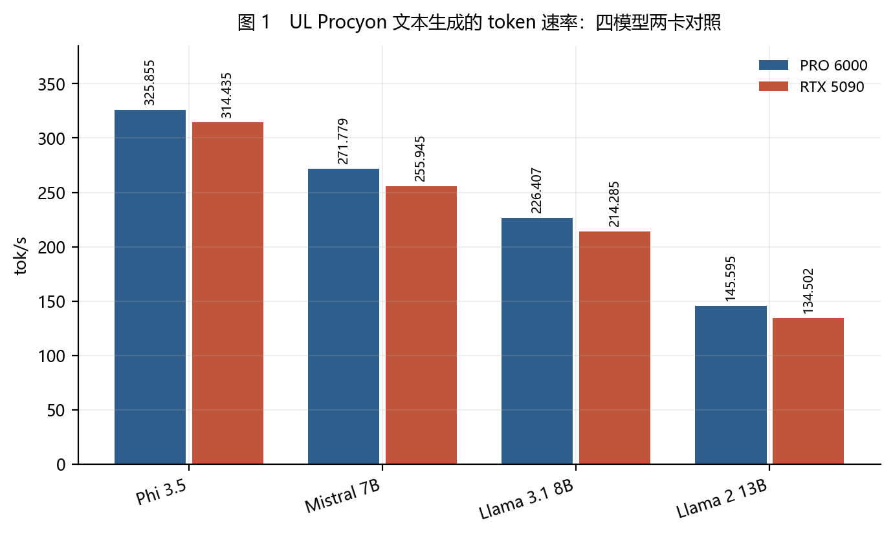
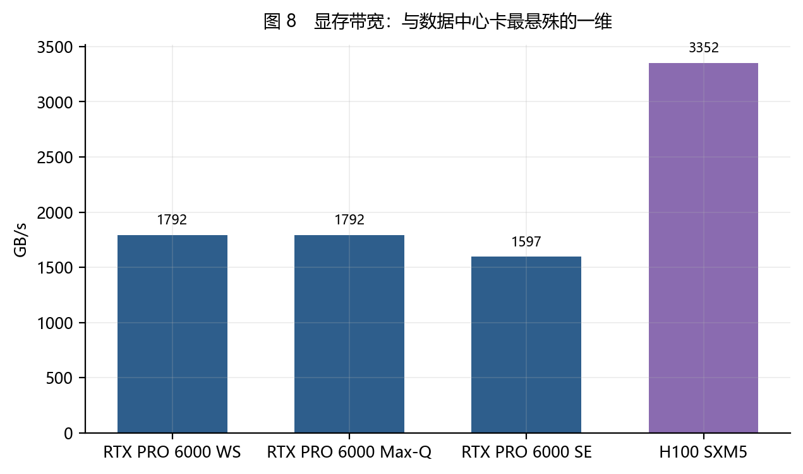
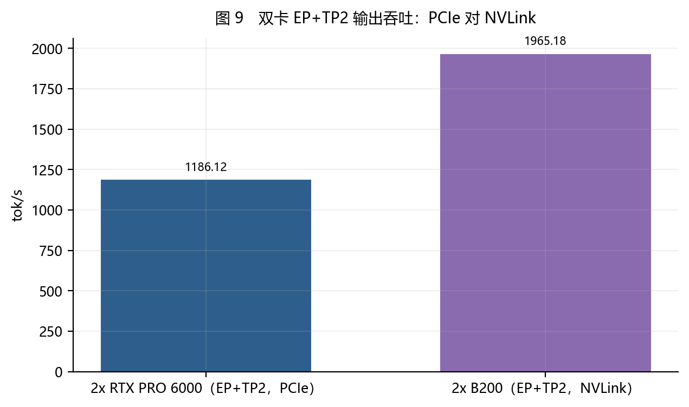
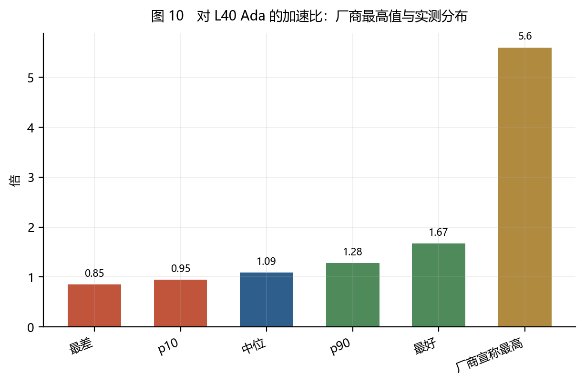
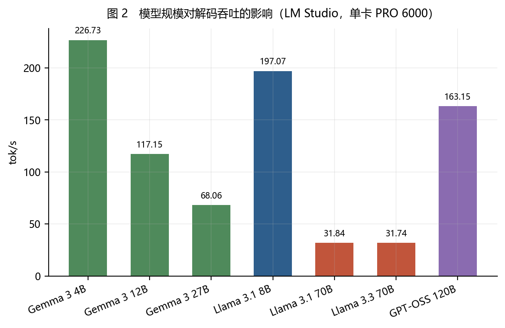
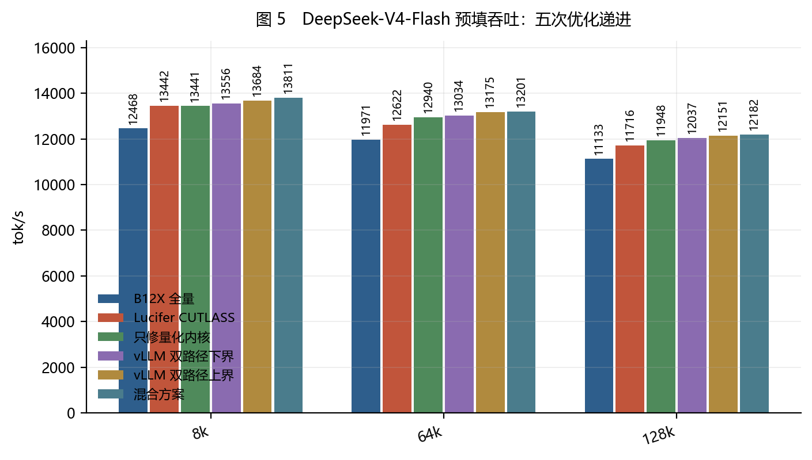
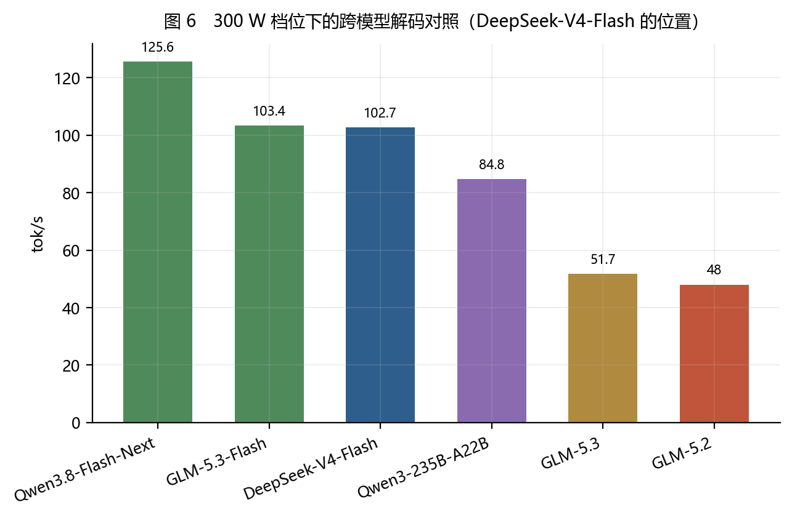
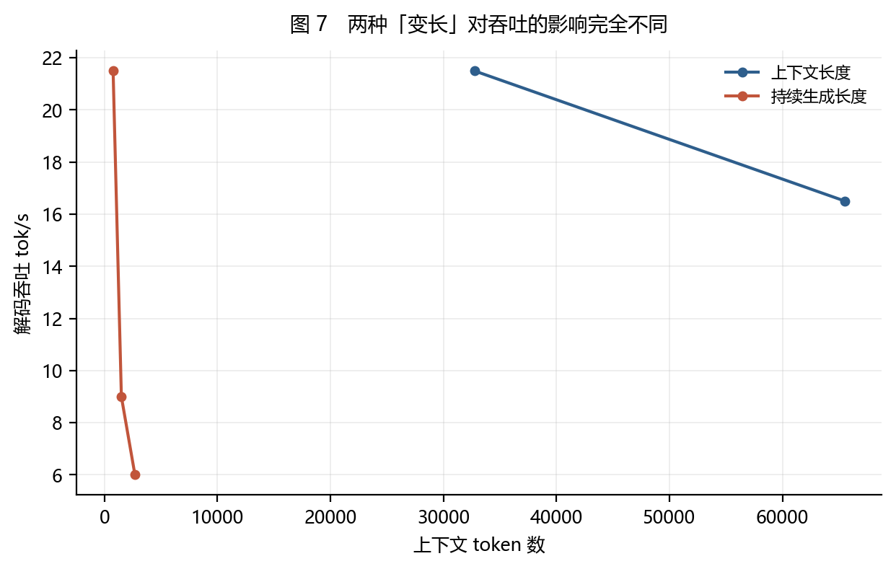
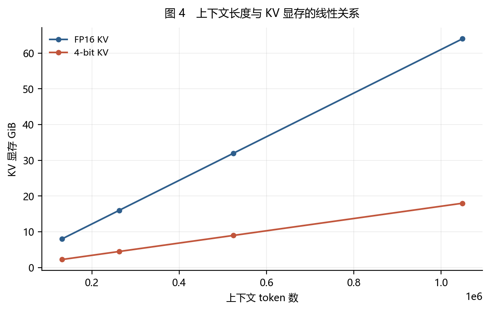
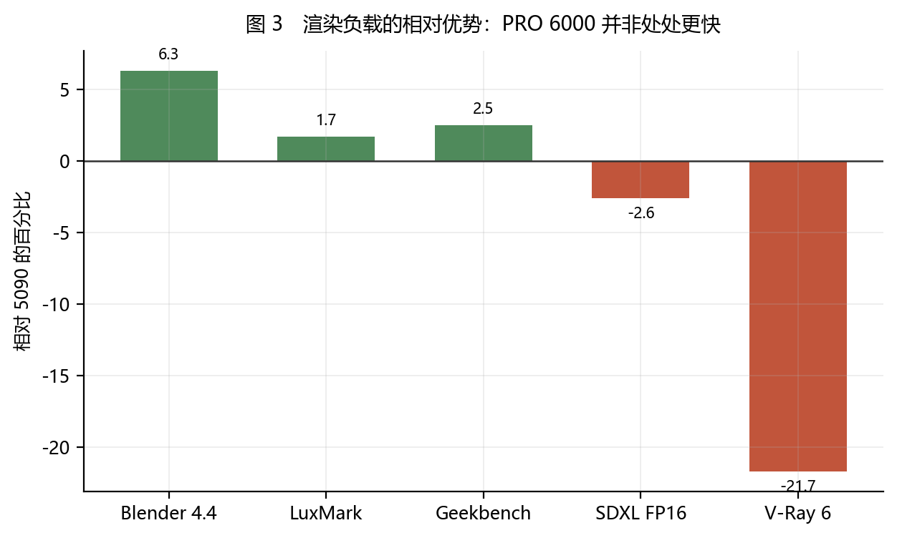

# RTX PRO 6000 Blackwell 的推理性能：一次以证据等级为准的综述

> **副标题**：一个产品名下的三个 SKU、一张买到能力而非速度的卡，以及五个让测量失效的陷阱
>
> **数据快照**：2026-10-29 ｜ **来源**：447 ｜ **证据**：3,002 ｜ **主张**：2,238
>
> **全文证据等级**：所有数值最高为 **测量级（measured）**，
> 无一条达到 **复现级（reproduced）** 或 **发布级（released）**。
>
> **⚠️ 全文 SKU 约定**：`WS` = Workstation Edition（600 W 主动散热）、
> `MQ` = Max-Q Workstation Edition（300 W）、`SE` = Server Edition（被动散热）。
> **凡来源未指明 SKU 的，标为「未指明」，不得当作三个 SKU 中的任何一个。**

---

## 摘要

本文综述 NVIDIA RTX PRO 6000 Blackwell（GB202，96 GB GDDR7，`sm_120a`）在本地大模型推理上的性能表现，并与 RTX 5090、RTX 4090、RTX 6000 Ada 及数据中心加速器对照。我们不按「谁更快」组织材料，而按「这个数字能证明什么」组织。

**核心发现有七。**

**第一，这个产品名不是一个配置，而是三个。** 同一名字下有 600 W 的 Workstation Edition、300 W 的 Max-Q、以及被动散热的 Server Edition。它们在同一模型同一命令下的解码吞吐差 **12.9%–13.1%**；在同一功耗点（300 W）上 Server 版比 WS 版快 **38%**。故「RTX PRO 6000 的 tok/s 是多少」这个问法本身需要先回答「哪个 SKU」。

**第二，容量不构成约束时，这张卡与消费级旗舰几乎打平。** UL Procyon 四模型文本生成中，WS 版相对 RTX 5090 的 token 速率优势只有 **1.5%–5.9%**；而同一测试的总分差距达 **8%–18%**。同一个测试的两个输出给出两种图景。

**第三，真正的差距出现在容量成为约束的边界上。** RTX 5090 无法加载 120B 模型，而这个系列以 **163.15 tok/s** 完成 GPT-OSS 120B；Llama 3.3 70B 上差距达 **928%**。但这个百分比不是「更快」，而是「对方跑不了」。

**第四，与上代专业卡比，同一张卡有六个倍率，从 1.09 到 21.3，而它们都不假。**
对 L40 Ada，多基准实测中位加速比 **1.09 倍**、胜率 78%、最差 0.85 倍、最好 1.67 倍；
而厂商宣称最高 **5.6 倍**（Llama 3 70B 单点口径）。**0.85 与 5.6 是同一对显卡。**
规格上 L2 缓存相对 RTX A6000 是 21.3 倍，而对推理的意义接近于零。
渲染则不同：SPECviewperf 15 中位 1.31 倍——因为渲染是算力受限，推理是带宽受限。

**第五，与数据中心卡的对位分维度给出三种相反结论。** 对 H100 NVL：
FP32 领先 2.1 倍、价格便宜 2.1 倍，而 FP64 落后 15 倍、带宽落后 2.2 倍。
而解码是带宽受限的，故**单流解码在物理上不可能追上 H100**——
H100 SXM5 的 3,352 GB/s 是这张卡 1,792 GB/s 的 1.87 倍。
成本上更尖锐：每芯片每小时 $0.68 是所列芯片最低（GB300 的 29%），
但每百万 token $0.19 是 GB300 的约 9.5 倍，因为并发约 10 对约 2,983。

**第六，同一模型在预填与解码上的排名不同。** DeepSeek-V4/4.1-Flash 是本档案实测最多的模型线
（50 条主张、6 种硬件配置）。它在 300 W 档的解码上排第三（102.7 tok/s），在预填上排第四（6,341 tok/s）；
同一个模型、同一批数据，两个榜给出不同名次。而它在双卡 RTX PRO 6000 WS 上经五次改动把预填从
12,468 提到 13,811 tok/s（8k 上下文），并在单卡上跑满 1,048,576 上下文。

**第七，96 GB 的收益必须换算成上下文预算才有意义。** 按每 token **64 KiB** 的 FP16 KV 成本，262K 上下文需 **16 GiB**，1M 需 **64 GiB**——后者才是单卡的真实上限，而它的约束不是 KV 而是「剩余 32 GiB 能否装下权重」。

---

## 1　引言：两个必须先回答的前置问题

任何关于这张卡的性能陈述，在给出数字之前都要先回答两个问题。

### 1.1　第一个问题：哪个 SKU？

「RTX PRO 6000 比 RTX 5090 快多少」这个问法有一个隐藏前提：**「RTX PRO 6000」是一个确定的配置**。它不是。

| | Workstation (`WS`) | Max-Q (`MQ`) | Server (`SE`) |
|---|---|---|---|
| TDP | 600 W | 300 W | 400–600 W 可配 |
| 显存带宽 | **1792 GB/s** | **1792 GB/s** | **1597 GB/s** |
| 标称 FP32 | 125 TFLOPS | 110 TFLOPS | 120 TFLOPS |
| 散热 | 双风扇双流道 | 单风扇鼓风机 | **无风扇被动** |
| 外形 | 双槽 | 双槽 | FHFL |

而实测差距比规格表更大：

- **同一模型同一命令**（gpt-oss-20b，`tg128`）：WS **286.91** tok/s，MQ **249.96** tok/s — 差 **12.9%** [c-sku-choice-changes-tok-s-by-13pct]
- **同一模型另一组**（gpt-oss-120b）：WS **196.31**，MQ **170.62** — 差 **13.1%**
- **同一功耗点 300 W**：SE 比 WS 快 **38%**
- **自动化工具会把三者折叠成一个标识**，于是「本型号需要驱动 575.57.08」这类声明会静默误伤 WS 与 MQ 版 [c-automation-collapses-three-skus-into-one-id]

> **⭐⭐⭐ 判据（本文第一条）**
>
> 当一个产品名对应多个 SKU 时，
> 「这个产品的性能是 X」这句话的误差棒**等于 SKU 之间的最大差距**——
> 而这个差距往往比被测的卡间差距还大。
>
> **故性能对比的最小单位不是「型号」，而是「型号 + SKU + 功耗上限」三元组。**

本报告自身就违反过这条，而这件事现在是**可被程序统计的**：
`claims.csv` 新增了 `sku` 列（枚举 `ws` / `mq` / `se` / `all` / `na` / `unspecified`），
校验器会在每次通过的输出里报告 `sku_unspecified`。当前值是 **244**（共 2,238 条主张）。

而本文引用的 42 条主张里，有 **14 条是 `unspecified`**——即本文自己的表格里，
大约三分之一的引用无法定位到具体 SKU。这不是疏忽，而是**上游来源没说**：
Procyon 的原始记录只写「PRO 6000」，MLPerf 的配置表只写「RTX Pro 6000」。
把它们标成三个 SKU 中的任何一个，都会是编造。

#### 1.1.4　欠账清单

| claim_id | claim_type | sku | 陈述摘要 |
|---|---|---|---|
| c-1m-feasible | measurement | unspecified | 百万 token上下文在 RTX PRO 6000 上已可端到端跑通：DeepSeek V4 Flash 在 lla |
| c-gn-70b-capacity-domain | measurement | unspecified | LM Studio 的 Llama 3.3 70B Q4_K_S 测试中 PRO 6000 比 5090 提升 92 |
| c-ix-paradox | derivation | unspecified | 这里有一个必须说清的**悖论**：RTX PRO 6000 的 **$/chip/hr 最低（0.68，是 GB30 |
| c-omni3-vs-l40-median | derivation | unspecified | ⭐ RTX PRO 6000 相对 L40 Ada 的中位加速比为 1.09×、胜率 78%；p10 为 0.95、 |
| c-slac-h100-vs-rtx | measurement | unspecified | ⭐ SLAC 的逐路径规格对比给出了一个比「谁更快」更实用的框架：FP32 上 RTX PRO 6000 约 125 |
| c-slac-power-favors-h100 | measurement | unspecified | ⚠️ 但机架密度下功耗倾向 H100：约 1.5 倍性能每瓦。即 RTX PRO 6000 在「每美元性能」上胜出， |
| c-sr-96gb-unique | measurement | unspecified | 96 GB 的不可替代性在 120B 模型上得到直接验证：RTX 5090 无法加载或执行 120B 模型、甚至常处 |
| c-sr-blender-narrow | measurement | unspecified | 在 StorageReview 的受控并排测试中，PRO 6000 相对 RTX 5090 的 Blender 4. |
| c-sr-int8-saturates | measurement | unspecified | INT8 量化推理上 PRO 6000 与 RTX 5090 基本持平（79；064 对 79；272，5090 略 |
| c-sr-renderer-split | derivation | unspecified | 同一批评测中，PRO 6000 在 Blender（+6.3%）、LuxMark（+1.7%~5.0%）、Geekb |
| c-sr-token-vs-score | derivation | unspecified | Procyon 文本生成的 token 速率与总分给出了不同的图景：PRO 6000 相对 5090 的 token |
| c-sr-vray-loses | measurement | unspecified | V-Ray 6 上 RTX 5090 以 14；764 vpaths 领先 PRO 6000 的 12；128，领先 |
| c-the-bonsai-readme-has-no-pro-6000-data | measurement | unspecified | ⚠️⚠️⚠️ **这份 24；840 字节的 README 里，「96 GB」「RTX PRO」「5090」「409 |
| c-vgpu-l40s-56 | measurement | unspecified | NVIDIA 宣称 RTX PRO 6000 相对 L40S 最高 5.6 倍加速（Llama 3 70B），分项为 |

*表 4　本文引用中 SKU 未指明的主张（欠账清单）。*

这 14 条不是「没查」，而是「查了、原始记录里就没有」。
把 `unspecified` 硬填成某个 SKU 会制造不存在的精度，
而把它隐藏起来则会让读者以为每个数字都能定位到具体产品。

#### 1.1.2　SKU 判定的四条规则，以及它们各自的失败

把「是哪个 SKU」变成字段之后，剩下的问题是**怎么判**。这件事我做了四版，
每一版都被一个具体的误判推翻。记在这里，因为误判的类型比结论更有迁移价值。

**第一版：用功耗当证据。** `300 W` 判 Max-Q、`600 W` 判 Workstation。
错在「整机功耗」「电源上限」这类与 SKU 无关的句子也含这些数字。
*规则一：只用显式 SKU 名称，不用间接信号。*

**第二版：产品身份与 SKU 判定混在一起。** 两者都看「陈述 + 全部证据原文」。
于是「RTX PRO 5000 72GB 版规格……」仅因其证据顺带提到 PRO 6000，
就被判成「提到该产品但未写明 SKU」。
*规则二：产品身份只看陈述——一条主张讲的是哪个产品，由它自己的主语决定。*

**第三版：SKU 名称在全文任意位置都算。** 证据里的「RTX PRO 4500 Workstation Edition」
让一条讲 PRO 6000 的主张被判成 `ws`——可那是 PRO 4500 的 Workstation 版。
*规则三：SKU 名称必须紧邻产品名。一个 SKU 名称在自然语言里的作用域就是它旁边的那个型号。*

**第四版：单一窗口宽度。** 60 字符太宽（「WS↔5090 比值」这种对照标注被当成 SKU），
42 字符又太窄（「RTX PRO 6000 WS 的 16-pin」里的 WS 紧邻却漏掉）。
*规则四：完整 SKU 名用宽窗口，多义缩写用窄窗口。*

最终实现见 `scripts/classify_sku.py`，并由 `scripts/test_classify_sku.py` 的
**10 条回归用例**钉住——每一条都对应上面的一次误判，或一次险些发生的误判。

> **⭐⭐⭐ 判据**
>
> 这四版的共同点是：**每一版都在把一个更宽的文本范围当成「同一句话」。**
> 先是把整份证据当成一句话，再把全文当成一句话。
> 而 SKU 的作用域比任何一层都小——它只覆盖它紧邻的那个型号名。
>
> 故「相邻」不是一个实现细节，它是**语义本身**。

#### 1.1.3　一个必须排除的「第四个 SKU」

档案里有 16 条主张提到 **RTX 6000D**。它不是 PRO 6000 的第四个 SKU，
而是中国特供的**独立产品**：削减约 17% 计算单元（CUDA 24,064→19,968）、
显存 448-bit / 84GB、带宽降到 1.57 TB/s [c-6000d-spec][c-6000d-memory]。

把它的数字并进 PRO 6000 的任何一档，都会污染那一档的结论。
故只提 6000D 而不提 PRO 6000 的 10 条主张，`sku` 判为 `na`。

> **⭐⭐ 判据**
>
> 「同一系列的不同型号」与「同一型号的不同配置」是两件事，
> 而它们的名字可能只差一个字母。前者要分开统计，后者要合并统计。


### 1.2　第二个问题：这是性能结论还是容量结论？

**同一个「快 N%」可以是两种完全不同的事。**

| 类型 | 含义 | 例子 |
|---|---|---|
| **性能结论** | 两者都在跑同一任务，A 更快 | Blender 上 WS 领先 5090 **6.3%** |
| **容量结论** | B 根本跑不了，只有 A 能跑 | 120B 模型上 5090 无法加载 |

后者写进「加速比」表格里，读者会以为这张卡快 10 倍；而实际情况是它在跑，另一张卡在 OOM。第 4 节专门处理这一类。

### 1.3　组织原则

每一节先声明它讨论的是哪一类比较、哪个 SKU，再给数字。凡出现「A 比 B 快 N%」，必须能回答：N% 的分母是什么、B 当时是否真的在跑同一个任务、A 是哪个 SKU。

---

## 2　硬件与软件边界

**规格**（`WS` 版，StorageReview 与 whitepaper 双向确认，两处独立记录一致）[c-sr-spec-confirm]：GB202，92,200M 晶体管，750 mm²，188 SM，24,064 CUDA，752 Tensor，188 RT，128 MB L2，512-bit，**1.79 TB/s**，600 W TDP，FP32 **126.0 TFLOPS**，FP64 **1.968 TFLOPS**（1:64）。

**软件边界是本文最重要的限定条件之一。** Blackwell 在这个意义上不是一个平台，而是两个互不兼容的 CUDA 大版本：

| 产品 | 芯片 | Compute Capability | 目标架构 |
|---|---|---:|---|
| RTX PRO 6000（全部 SKU） | GB20x | **12.0** | `sm_120a` |
| B200 | GB100 | 10.0 | `sm_100a` |
| B300 | GB300 | 10.3 | `sm_103a` |

而且 `120-real` 编译出的是 `120a-real`，**不向前兼容**。这意味着「为 Blackwell 编译」这句话至少有两种互斥的含义。

实测显存为 **97,887 MiB**（≈ 95.59 GiB），比标称 96 GB 少约 420 MiB 保留。注意这是 **`SE`** 上测得的，而三 SKU 的标注容量都是 96 GB。

> **⚠️ 一条必须在引言处就说明的限制**
>
> 官方不提供 Linux CUDA 二进制，因此所有 Linux 侧的吞吐数字，其**构建配置不可追溯**。
> 「代码版本」这个变量在那批数据里是空的。

---

## 3　容量不构成约束时的推理性能



*图 1　UL Procyon 文本生成的 token 速率：四模型两卡对照。*

同一批评测、同一软件栈下（`WS` 版对 RTX 5090），四模型的 token 速率：

| 模型 | WS 版 | RTX 5090 | WS 领先 |
|---|---:|---:|---:|
| Phi 3.5 | **325.855** | 314.435 | **3.6%** |
| Mistral 7B | **271.779** | 255.945 | **6.2%** |
| Llama 3.1 8B | **226.407** | 214.285 | **5.7%** |
| Llama 2 13B | **145.595** | 134.502 | **8.2%** |

差距区间 **1.5%–5.9%**（评测方口径），量级与噪声同阶 [c-sr-token-vs-score]。

**但同一测试的总分不是这个数。** Phi 总分 6,775 对 5,749（**+17.8%**）、Mistral 7,346 对 6,267（**+17.2%**）、Llama3 6,501 对 6,104（**+6.5%**）、Llama2 8,008 对 6,591（**+21.5%**）。

> **⭐⭐⭐ 第一个方法论发现**
>
> 同一个基准同时输出「token 速率」和「综合总分」，两者幅度差 3 倍。
> 原因是总分含首字延迟、加载时间与内存行为的加权，而 token 速率只测稳态解码。
> **故「Procyon 显示领先 18%」与「Procyon 显示领先 5%」都是真的，
> 而它们说的是两件不同的事。**

另一条独立佐证：INT8 量化推理上两者基本持平——79,064 对 79,272，**5090 反而高 0.3%** [c-sr-int8-saturates]。原作者的解释是 INT8 负载对显存带宽与容量的依赖较低。

**而 SKU 的影响在这里也被单独测到**：`MQ` 版对 RTX 5090 在低到中并发（1–32）区间**稳定慢 11%–13%**，原因是 575 W 对 300 W 的功耗预算差异，而非核心数 [c-j8-maxq-vs-5090]。

> **⭐⭐⭐ 把这两条放在一起，得到一个反直觉的结论**
>
> 同一个「RTX PRO 6000」：
> **600 W 的 `WS` 版比 5090 快 5%；300 W 的 `MQ` 版比 5090 慢 12%。**
> 故「这张卡比 5090 快还是慢」的答案，**取决于你买的是哪个 SKU**，
> 而不取决于你测的是什么模型。


### 3.1　四档证据的对照

表 1 把本文四组关键数据的场景、数值与证据等级并列。**这是全文唯一一张把「数字」与「它能证明什么」放在同一行的表。**

<!-- tables/tab-1.md -->
| 档位 | 场景 | 关键数值 | 单位 | 证据等级 | 为何是这一级 |
|---|---|---|---|---|---|
| 容量不受约束 | Mistral 7B 解码 | 271.779 | tok/s | 测量级 | 同批评测同软件栈，但只有单一实验室 |
| 容量不受约束 | INT8 量化推理 | 79064 | score | 测量级 | 对位 5090 为 79272，差距 0.3% 在噪声内 |
| 容量成为约束 | GPT-OSS 120B | 163.15 | tok/s | 测量级 | 5090 无法加载该模型，故这是单选题而非对比 |
| 容量成为约束 | Llama 3.3 70B 对 5090 | 928 | 百分比 | 诊断级 | 提升来自对方显存耗尽而非算力差 |

*表 1　四个推理档位的对照（含证据等级）。*


### 3.2　往上比：与 H100 / B200 / GB300 的对位

前一小节比的是消费级（5090、4090、6000 Ada）。真正决定这张卡定位的是往上一档：
它到底能不能替代 H100？本节的答案是**分维度**的，而每一维的答案都不同。

#### 规格层：一赢一平三输

SLAC 给出了一份逐项规格对比，并注明「来自数据表而非在自家内核上实测」[c-slac-h100-vs-rtx]：

| 维度 | RTX PRO 6000 | H100 NVL | 领先方 |
|---|---:|---:|---|
| FP32 | 约 125 TFLOPS | 约 60 TFLOPS | **RTX 领先 2.1 倍** |
| FP64 | 约 2.0 TFLOPS | 约 30 TFLOPS | H100 领先 15 倍 |
| 显存带宽 | 1.79 TB/s | 3.9 TB/s | H100 领先 2.2 倍 |
| 价格（2026-07） | 约 $13,000 | 约 $28,000 | **RTX 便宜 2.1 倍** |

**FP32 赢 2.1 倍、价格赢 2.1 倍，而 FP64 输 15 倍、带宽输 2.2 倍。**



*图 8　显存带宽：与数据中心卡最悬殊的一维。*

带宽是本节最关键的一维，因为**解码是带宽受限的**：
H100 SXM5 的 3,352 GB/s 是这张卡 1,792 GB/s 的 **1.87 倍** [c-hbm-bw-gap]，GH200 约 4.0 TB/s（**2.2 倍**）。
而 H100 NVL 在 SLAC 的对照里记为「约 3.9 TB/s」[c-slac-h100-vs-rtx]。
图 8 只画了有确切数值的四档；后两个在来源里是「约」值，故不画柱以避免伪造精度。

> **⭐⭐⭐ 判据**
>
> 故在**单流解码**这个最常被引用的场景里，
> 这张卡在物理上不可能追上 H100：因为解码每生成一个 token 都要读一遍权重，
> 而读的速度差 1.87 倍。
>
> **而它在 FP32 上赢的 2.1 倍，对这个场景完全无用。**
>
> 这就是「跑分赢、推理输」的物理原因，不是软件问题。

#### 互连层：PCIe 对 NVLink，差 66%



*图 9　双卡 EP+TP2 输出吞吐：PCIe 对 NVLink。*

一条对照组数据把互连的代价单独量了出来 [c-ep-gap]：
同为双卡、**同开 EP+TP2**，
2× B200（NVLink）输出 **1,965 tok/s**，2× RTX PRO 6000（PCIe）为 **1,186 tok/s**；
TPOT **5.63 ms 对 12.82 ms**（快 2.3 倍）。

> **⭐⭐ 判据**
>
> 这是本文唯一一条「只换互连、不换算力」的对照，
> 故它测的是 **PCIe 与 NVLink 的差，不是两张卡的差**。
>
> 而它给出的量级（66% 吞吐、2.3 倍 TPOT）意味着：
> 任何多卡推理的对比，只要一侧有 NVLink 另一侧没有，
> **这个差就会混进「卡间性能差」里而无法分离**：除非像这条一样把 EP+TP2 固定住。

#### 成本层：买得起不等于用得起

| 芯片 | 每芯片每小时成本（美元） | 每百万 token 成本（美元） | 该交互性下的并发数 |
|---|---|---|---|
| RTX PRO 6000 | 0.68 | 0.19 | 10 |
| MI325X | 1.1 | 未给出 | 未给出 |
| H100 | 1.17 | 未给出 | 未给出 |
| H200 | 1.22 | 未给出 | 未给出 |
| B200 | 1.73 | 未给出 | 未给出 |
| GB300 | 2.31 | 0.02 | 约 2983 |

*表 5　买得起不等于用得起：每芯片成本与每百万 token 成本。*

这是本文最反直觉的一组数字 [c-ix-paradox]：
RTX PRO 6000 的**每芯片每小时成本 $0.68 是所列芯片中最低的**：
只有 GB300（$2.31）的 **29%**、H100（$1.17）的 58%、B200（$1.73）的 39%。

**而它的每百万 token 成本是 $0.19，是 GB300（$0.02）的约 9.5 倍。**

原因不在芯片，在**并发**：同一交互性（56 tok/s/user）下，
GB300 NVL72 能跑到约 **2,983** 并发，而 RTX PRO 6000 约 **10**。

> **⭐⭐⭐⭐⭐ 判据**
>
> **低芯片成本无法弥补低并发。**
>
> 故「这个卡每小时 $0.68，很便宜」与「这个卡每百万 token $0.19，很贵」
> 两句同时成立，而它们描述的是同一张卡。
>
> **判据是：成本比的分子必须是「每单位产出」，而不是「每单位时间」。**
> 这不是定价策略的差别，是**分母选错**的差别。

#### 功耗层：两个指标指向不同的卡

还有一维必须单列，因为它与前几维的结论相反 [c-slac-power-favors-h100]：
在机架密度下，H100 约领先 **1.5 倍性能每瓦**。

> **⭐⭐ 判据**
>
> 至此这张卡的定位在三个指标上是**三种结论**：
> **每美元性能**赢（便宜 2.1 倍）、**每瓦性能**输（落后 1.5 倍）、
> **每 token 成本**大输（差 9.5 倍）。
>
> 故「RTX PRO 6000 与 H100 谁更好」这个问题**没有单一答案**，
> 只有「在哪个约束下更好」。


### 3.3　往下比：与上代专业卡的对照

比消费级是「值不值」，比数据中心是「能不能替代」，而比上代是**升级决策**里最实际的一问：
我这台机器上的 RTX 6000 Ada 或 L40S，换不换？

本节的答案是：**同一张卡对上代有六个倍率，从 1.09 到 21.3，而它们都不假。**

| 对照对象 | 维度 | 上代数值 | 本代数值 | 倍率 | 口径 |
|---|---|---|---|---|---|
| RTX 6000 Ada | 显存容量 | 48 GB | 96 GB | 2.0 | 规格 |
| RTX 6000 Ada | 显存带宽 | 960 GB/s | 1792 GB/s | 1.87 | 规格 |
| RTX 6000 Ada | L2 缓存 | 98304 KB | 131072 KB | 1.33 | 规格 |
| RTX A6000 | L2 缓存 | 6144 KB | 131072 KB | 21.3 | 规格 |
| RTX 6000 Ada | SPECviewperf 15 几何均值 | 1.0 | 1.47 | 1.47 | 实测渲染 |
| RTX 6000 Ada | SPECviewperf 15 中位数 | 1.0 | 1.31 | 1.31 | 实测渲染 |
| L40 Ada | 多基准中位吞吐 | 1.0 | 1.09 | 1.09 | 实测推理 |
| L40 Ada | 多基准吞吐 p90 | 1.0 | 1.28 | 1.28 | 实测推理 |
| L40 Ada | 厂商宣称 Llama 3 70B 加速 | 1.0 | 5.6 | 5.6 | 厂商声明 |
| L40S | Parabricks Fastq2bam | 1.0 | 1.5 | 1.5 | 厂商声明 |

*表 6　与上代专业卡的对照（按口径分行）。*

#### 规格倍率最容易骗人

先看两个最悬殊的规格项。容量从 48 GB 到 96 GB（**2.0 倍**）、
带宽从 960 GB/s 到 1,792 GB/s（**1.87 倍**）[c-gen-gain]。

而 L2 缓存从 RTX 6000 Ada 的 98,304 KB 到 131,072 KB（**1.33 倍**），
若与更早的 RTX A6000 的 6,144 KB 相比则是 **21.3 倍** [c-l2-cache]。

> **⭐⭐⭐ 判据**
>
> **21.3 倍这个数字是真的，但它对推理性能的意义接近于零。**
> 因为 L2 缓存的收益取决于工作集能否装进去，
> 而不取决于「比三代前大多少倍」。
>
> 故**同一个「代际提升」，选不同的基线可以差 20 倍。**
> 说「提升 N 倍」而不说「相对谁」，等于没有信息。

#### 实测：显存差 2 倍，吞吐只差 1.09 倍



*图 10　对 L40 Ada 的加速比：厂商最高值与实测分布。*

一份多基准实测给出了完整的分布 [c-omni3-vs-l40-median]：
相对 L40 Ada，**中位加速比 1.09 倍、胜率 78%**，
p10 为 0.95、p90 为 1.28、最差 0.85 倍、最好 1.67 倍。

**即两卡显存差 2.0 倍，而实际吞吐差中位仅 1.09 倍。**

而厂商的宣传口径是**最高 5.6 倍**（Llama 3 70B）[c-vgpu-l40s-56]，
分项为 Siemens UFX 2.3 倍、Dassault Abaqus 2 倍、Autodesk Arnold 1.9 倍、Omniverse 3.5 倍。

> **⭐⭐⭐⭐⭐ 判据**
>
> **0.85 倍与 5.6 倍是同一对显卡。**
>
> 前者是实测分布的最差值，后者是厂商选的单点最优。
> 两者都不假，但**并列才看得出「最高值」离典型值有多远**——
> 中位 1.09 倍意味着：**换卡的一半场景里，你几乎感觉不到差别。**
>
> 故采购判据不能是「最高加速比」，必须是**你自己负载上的中位数**。

而 p10 为 0.95 倍这个数值得单独说：**有 10% 的基准上，新卡比上代还慢。**

#### 渲染：这一代是实打实的

并非所有维度都这么平。SPECviewperf 15 上（同为 4K），
相对 RTX 6000 Ada 的**几何平均提升 1.47 倍、中位数 1.31 倍** [c-vp15-vs-ada]。

而各项差异极大：enscape-01 达 **2.40 倍**、blender-01 **2.10 倍**，
而 unreal_engine-01 仅 **1.11 倍**。

> **⭐⭐ 判据**
>
> 渲染的中位 1.31 倍高于推理的中位 1.09 倍。
> 原因不神秘：**渲染是算力受限，推理是带宽受限**。
> 这一代算力涨得多、带宽涨得少（1.87 倍），故两类负载的收益不同。
>
> 这与 §3.2 的结论同源：**带宽是这张卡的短板，而它恰好是推理的瓶颈。**

#### 一条反例：Parabricks 上代际与档位同时被跨越

Parabricks 的 Fastq2bam+DeepVariant 上，Server Edition 比 L40S 快 **1.5 倍**、
比 H100 快 **1.75 倍** [c-parabricks]。

> **⭐⭐ 判据**
>
> 这是本文少见的一条「跨代 + 跨档都赢」的负载。
> 它的存在说明：**上述所有倍率都是「在该负载上」的，没有一条是「这张卡」的属性。**


---

## 4　容量成为约束时的推理性能

这一节的所有数字都属于**另一类比较**：不是「谁在同任务上更快」，而是「谁能跑」。



*图 2　模型规模对解码吞吐的影响（LM Studio，单卡，SKU 未指明）。*

同一 500 词提示、Q4 量化：

| 模型 | 规模 | tok/s | 备注 |
|---|---:|---:|---|
| Gemma 3 4B | 4B | **226.73** | |
| Llama 3.1 8B | 8B | 197.07 | |
| Gemma 3 12B | 12B | 117.15 | |
| Gemma 3 27B | 27B | 68.06 | |
| Llama 3.1 70B | 70B | 31.84 | Q4_K_S |
| Llama 3.3 70B | 70B | 31.74 | Q4_K_S |
| **GPT-OSS 120B** | 120B MoE | **163.15** | 首字 0.193 s |

**⚠️ 这一组数据来源只写「RTX PRO 6000」，未指明 SKU。** 按其 120B 的 163.15 tok/s 与同系列 `MQ` 的 120B 数据（170.62）接近，推测为 `MQ` 或 `WS`，但在来源明确前不应断言。

两种读法都成立，而它们是不同的结论：

1. **纵向**：4B → 70B 吞吐降了 **7 倍**，密模型规模与吞吐近似反比。
2. **横向**：120B 的 MoE 反而比 70B 密模型快 **5 倍**。

> **⭐⭐⭐ 故「参数量」不是吞吐的单调预测因子。**
> 真正决定解码速度的是**每 token 需要搬运的活跃字节数**，
> 而 MoE 把「总参数」与「活跃参数」解耦了。

**而这一节真正的分界线在这里：RTX 5090 无法加载 120B 模型，甚至常处理不了 70B** [c-sr-96gb-unique]。

Llama 3.3 70B Q4_K_S 上，比 5090 提升 **928%**、比 4090 提升 **1141%** [c-gn-70b-capacity-domain]。

> **⚠️⚠️⚠️ 这三个百分比的正确读法**
>
> 它们的量级差距不来自算力，而来自**显存容量**：
> 到某个点，其它卡显存耗尽，于是「比较」变成了「单边可用」。
> **故它不是一条性能结论，而是一条容量结论。**

---

## 5　DeepSeek-V4 / V4.1-Flash：本报告实测最多的一条模型线

前四节讨论的是「这张卡」，本节讨论「这个模型」。这样做是因为
DeepSeek-V4/4.1-Flash 在档案里有 **50 条主张、跨 6 种硬件配置**，
是唯一一条能在同一张卡上横向看到「预填 / 解码 / 长上下文 / 投机解码」四个维度的模型线。

### 5.1　先给结论：一个模型，三个数量级

把档案里所有 DeepSeek-V4-Flash 的数字放在一起，会得到一个看起来荒谬的结果：

| 场景 | 硬件 | 数值 |
|---|---|---:|
| 单流解码（原生 FP8 热态） | 2× DGX Spark TP2 | **44 tok/s** |
| 单流解码（Q8 无投机） | 2× PRO 6000 | **46 tok/s** |
| 单流解码（300 W 目录值） | 1× PRO 6000 @300W | **102.7 tok/s** |
| 解码（同批预填测试） | 2× PRO 6000 WS TP2 | **133.7 tok/s** |
| 预填 8k（混合方案） | 2× PRO 6000 WS TP2 | **13,811 tok/s** |
| 预填 128k（混合方案） | 2× PRO 6000 WS TP2 | **12,182 tok/s** |

从 44 到 13,811，跨 **三个数量级**。而它们都是真的。

> **⭐⭐⭐ 判据**
>
> 这不是数据矛盾，而是**测法不同**：
> 预填（prefill）处理的是整段提示，可并行；
> 解码（decode）逐 token 生成，受显存带宽约束。
> 两者在同一个模型上天然差 100 倍以上。
>
> **故「DeepSeek-V4-Flash 的吞吐是多少」这个问题，必须先回答「预填还是解码」。**

表 3 把这九组数据按场景、硬件、SKU、证据等级并列，每行都能回到一条主张。

| 场景 | 硬件 | 数值 | 单位 | SKU | 证据等级 |
|---|---|---|---|---|---|
| 单流解码（Q8 无投机） | 2x PRO 6000 | 46 | tok/s | 未指明 | 测量级 |
| 单流解码（原生 FP8 热态） | 2x DGX Spark TP2 | 44 | tok/s | 未指明 | 测量级 |
| 单流解码（300W 目录值） | 1x PRO 6000 @300W | 102.7 | tok/s | 300W 档 | 测量级 |
| 预填 8k（混合方案） | 2x PRO 6000 WS TP2 | 13811 | tok/s | WS | 测量级 |
| 预填 64k（混合方案） | 2x PRO 6000 WS TP2 | 13201 | tok/s | WS | 测量级 |
| 预填 128k（混合方案） | 2x PRO 6000 WS TP2 | 12182 | tok/s | WS | 测量级 |
| 解码（同批预填测试） | 2x PRO 6000 WS TP2 | 133.7 | tok/s | WS | 测量级 |
| 最大上下文（满 1048576） | 单卡 | 1048573 | token | 未指明 | 测量级 |
| 对比：Spark 比 PRO 6000 慢 | 2x DGX Spark 对 2x PRO 6000 | 6 | 倍 | 未指明 | 测量级 |

*表 3　DeepSeek-V4 / V4.1-Flash 在 RTX PRO 6000 上的全部实测。*

### 5.2　预填：五次改动，单调改善



*图 5　DeepSeek-V4-Flash 预填吞吐：五次优化递进。*

同一台双卡 RTX PRO 6000 **WS**（TP2、force-A8 MoE、独立预填、`max_num_seqs=1`、
fp8 KV、block 256）上，五个逐步改动的版本 [c-df-rtx6k-baseline]：

| 上下文 | B12X 全量 | Lucifer CUTLASS | 只修量化内核 | vLLM 双路径（区间） | 混合方案 |
|---|---:|---:|---:|---:|---:|
| 8k | 12,468 | 13,442 | 13,441 | 13,556 至 13,684 | **13,811** |
| 64k | 11,971 | 12,622 | 12,940 | 13,034 至 13,175 | **13,201** |
| 128k | 11,133 | 11,716 | 11,948 | 12,037 至 12,151 | **12,182** |

三个可读出的东西：

**其一，总收益稳定在 9%–11%。** 8k 提升 **10.8%**，128k 提升 **9.4%**。

**其二，收益不来自单一改动。** 从 B12X 到 Lucifer CUTLASS 拿到 7.8%（8k），
再「只修量化内核」在 8k 上几乎是零（13,442 到 13,441），却在 64k 上拿到 2.5%（12,622 到 12,940）。
**同一改动在不同上下文长度上的收益不同。**

**其三，有一个改动是单调的。** 「+ vLLM 双路径」与「混合方案」在三档上都改善，
而这是唯一一组在三档上都不倒退的改动。

> **⭐⭐ 判据**
>
> 当一个配置的收益随上下文长度变化时，
> 「这个优化提升了 N%」这句话必须带上下文长度才有意义。
> 本报告在 8k 上说「+10.8%」、在 128k 上说「+9.4%」，
> **两者都是同一个改动的结果，但它们是两个数字**。

### 5.3　解码：在 300 W 档位上的横向位置



*图 6　300 W 档位下的跨模型解码对照。*

单卡 300 W、pp2048 / tg128、单客户端下的一份跨模型表 [c-ds-300w-catalog]：

| 模型 | 解码 tok/s | 预填 tok/s |
|---|---:|---:|
| Qwen3.8-Flash-Next | **125.6** | 7,795 |
| GLM-5.3-Flash | 103.4 | **8,718** |
| **DeepSeek-V4-Flash** | **102.7** | 6,341 |
| Qwen3-235B-A22B | 84.8 | 4,808 |
| GLM-5.3 | 51.7 | 2,200 |
| GLM-5.2 | 48.0 | 2,197 |

**DeepSeek-V4-Flash 在解码上排第三**，落后 Qwen3.8-Flash-Next **18.2%**、
落后 GLM-5.3-Flash **0.7%**，领先 Qwen3-235B-A22B **21.1%**。

**而它在预填上排第四**：6,341 落后 GLM-5.3-Flash **27.3%**、落后 Qwen3.8-Flash-Next **18.7%**。

> **⭐⭐⭐ 一个反直觉的发现**
>
> **同一个模型在解码榜和预填榜上的排名不同。**
> GLM-5.3-Flash 解码只比它快 0.7%（在噪声内），预填却快 27.3%。
>
> 故「A 模型比 B 模型快」这句话，
> **连「同一个模型」内部都不成立**：它取决于你问的是预填还是解码。

### 5.4　长上下文的真实代价：不是上下文，是输出长度



*图 7　两种「变长」对吞吐的影响完全不同。*

档案里有一条此前完全没有记录的性能现象，而它**不是关于上下文长度的** [c-long-sustained-gen-degrades]：

- 32K 上下文、768-token 基准三次：19.97 / 21.18 / 23.31，**均值 21.49 tok/s**
- 64K 上下文、同样基准：**16–17 tok/s**（降 **23%**）
- 而通过 Open WebUI 流式做 **1500–2700 token 的持续生成**时：**掉到约 6–9 tok/s**

**降幅 58%–72%，远大于上下文的 23%。**

> **⭐⭐⭐⭐⭐ 判据**
>
> 「长上下文慢」与「长输出慢」是两件事，而后者严重得多。
> 而多数基准只测短输出的稳态解码，**于是这个现象在所有基准里都不可见**。
>
> **故「tok/s」这个数必须带「生成多长」才有意义。**
> 一个 21.49 tok/s 的基准成绩，与用户在对话里真实感受到的 6–9 tok/s，
> 差 3 倍，而两者测的是同一个模型、同一台机器。

注意：这组数据的硬件是 **双 DGX Spark（2× GB10）**，不是 RTX PRO 6000。
故它证明的是**模型行为**，不是这张卡的性能。但它对推理性能的意义是通用的。

### 5.5　同条件对照：Spark 慢 6 倍，而差距不来自架构

一条同条件对照给出了量级 [c-spark-6x-slower]：
2 张 DGX Spark 做 TP2，在 DeepSeek-V4-Flash 上比 2 张 RTX 6000 做 TP2 **慢约 6 倍**。

而两者共享同一批 SM120 核心。**故差距不来自架构，来自显存带宽与每卡功耗。**

> **⭐⭐ 判据**
>
> 这是本文最干净的一条「控制变量」证据：
> 同一 compute capability、同一模型、同样 TP=2，**只换内存子系统与功耗预算**，结果差 6 倍。
>
> 故在推理场景里，**「架构代际」不是主要变量，带宽与功耗才是**。

### 5.6　百万上下文：可行，但瓶颈不是显存

DeepSeek-V4-Flash 在 llama.cpp 上成功生成了第 **1,048,573** 个 token，
即跑满 **1,048,576** 上下文 [c-1m-feasible]。

而档案里有两条互相印证的解释，说明**为什么只有它能做到**：

**其一，依赖模型结构。** 具备稀疏注意力 / indexer 的模型（正是 DeepSeek-V4-Flash）
可以做到；而 MiMo V2.5 只是交替 SWA 与非 SWA 层，会尝试为完整上下文分配 KV，
单次请求就要 **68,625 MiB** 而 OOM。

**其二，真实瓶颈是 32 位整数溢出。** 当 `n_kv × n_ubatch` 越过 2³² 边界时崩溃；
具体边界是 **262,144 × 16,384 = 2³²**。
修复方式是把 `flash_attn_mask_to_KV_max` 的步长参数从 32 位 `int` 改为 64 位 `size_t`，
经第三方在相同设置下验证，处理 **334,585** 个新 token（约 1.5 小时）无崩溃。

> **⚠️⚠️⚠️ 判据**
>
> 「长上下文 OOM」这个诊断在 262,144 这个点上**是错的**：
> 它不是显存不够，而是整数溢出。
> 而这两者的表象完全相同（进程崩溃），故只能靠算那个乘法来区分。

### 5.7　而它在 SM120 上曾经完全跑不起来

必须记录的一条：**纯上游 vLLM 在 SM120 上完全无法服务 DeepSeek-V4**，
且被逐层剥离出**四个互相独立的阻塞点** [c-ds-upstream-cannot-run]。

其中最深的一个：mHC（Manifold-Constrained Hyper-Connections）层调用
`tf32_hc_prenorm_gemm`，而 DeepGEMM 树里只有 SM90 与 SM100 的实现——
`sm100_*` 用 TMEM / `tcgen05.mma` / cluster multicast，`sm90_*` 用 WGMMA，
**不存在 `sm120_*` 变体**。报错发生在 `hyperconnection.hpp:56`。

而现场报告同时给出了一个乐观判断：SM120 原生支持 warp 级
`mma.sync.aligned.m16n8k32`（SM80 时代）外加 TMA，故一个朴素移植
「**在功能上是正确的……吞吐不是最优，但能解锁整个 V4 家族**」。

> **⭐⭐ 判据**
>
> 「这个模型能在 Blackwell 上跑」不是一个布尔值，而是一条**逐层清单**：
> 权重加载、量化配置、MoE 分派、注意力后端、以及 mHC。
> 前四项都过了，第五项断言失败。
>
> **故「支持」这个词在没有清单的情况下没有信息量。**


---

## 6　96 GB 真正买到的是什么：上下文预算

如果 96 GB 买的不是速度，那它买的是什么？本节给出可以算出来的答案。



*图 4　上下文长度与 KV 显存的线性关系。*

关键的乘数是**每 token 的 KV 字节数**。这个数在本报告里长期缺失——68 处「上下文 与 显存」的表述中，只有 1 处给了它。

两个独立来源给出了同一个值：

- Bonsai 2 27B README：**FP16 KV cache 64 KiB per token**（100K ≈ 6.3 GiB）
- 本报告 §4.15 的压缩记录：**18.3 KiB/活跃 token、相对 BF16 3.50×** ⇒ 18.3 × 3.50 = **64.05 KiB**

两者相差 **0.08%** [c-two-independent-models-agree-on-64-kib-per-token]。同一张表还给了「相对 FP8 1.75×」⇒ 18.3 × 1.75 = **32.02 KiB**，即 FP8 恰为 FP16 的一半。三个精度构成一条等比链：**FP16 64 / FP8 32 / 压缩 18.3 KiB**。

> **⭐⭐⭐ 判据**
>
> 当一个常量由两个完全不同的模型（不同层数、不同头数）独立算出相同的值时，
> 它说明的不是「这两个模型一样」，
> 而是「这个量级被架构约束住了」。

按 64 KiB/token 换算：

| 上下文 | FP16 KV | 4-bit KV（18 KiB） |
|---:|---:|---:|
| 131,072 | **8.0 GiB** | 2.25 GiB |
| 262,144 | **16.0 GiB** | 4.5 GiB |
| 524,288 | **32.0 GiB** | 9.0 GiB |
| 1,048,576 | **64.0 GiB** | 18.0 GiB |

换算依据 [c-fp16-kv-cache-is-64-kib-per-token] [c-256k-context-costs-16-gib-of-kv] [c-4bit-kv-cuts-per-token-cost-to-18-kib]。

**这张表改变了三个此前说不清的问题。**

**其一，256K 上下文不是瓶颈。** 它只吃 16 GiB，在 96 GB 上占比不到 1/6。

**其二，1M 上下文才逼近上限。** 64 GiB 的 KV 之后只剩 32 GiB 装权重——于是问题从「显存够不够放 KV」变成「剩下的够不够放模型」。

**其三，KV 量化在这张卡上是一个「不需要」的优化。** 4-bit 在 1M 上省下 46 GiB，但那 46 GiB 在 96 GB 上并没有对应的瓶颈。

> **⚠️⚠️⚠️ 一条必须同时给出的限制**
>
> 「某模型能跑 N 上下文」这句话**不能跨模型迁移** [c-a-context-capability-does-not-transfer-between-models]。
> 因为 显存占用 = 权重 + N × 每 token 字节数，
> 而后一项由层数、KV 头数、头维度与 KV 精度共同决定。
> 本文实测的两个模型就差 **3.5 倍**（64 vs 18.3 KiB）。
>
> **故「这张卡支持 N 上下文」应一律改写为「在模型 M 上支持 N」。**

这条限制的一个直接应用：本报告曾记有「单张，320K 上下文只用 44 GB 显存」。按 64 KiB/token 反推，320K 本身就要 **20.0 GiB** 的 KV，故余下约 24 GB 才是权重——**那是一个约 20 GB 权重的小模型的结果，不是这张卡的通用能力**。原文已在该处加注更正，旧文保留。

---

## 7　五个让测量失效的陷阱

本节记录的是**方法**，不是结论。它们全部来自这批资料的采集过程，每一条都曾造成过一个错误数字。

### 7.1　HTTP 200 不等于拿到了内容

抓取 TechPowerUp 的 `rtx-pro-6000.c4290` 返回 **HTTP 200**，响应体 **118,611 字符**——但 `<title>` 是「**AMD Radeon AI PRO R9700 Specs**」，且带 `noindex,nofollow`。正文纯文本只有 **335 字符**，搜「96 GB」**零命中**。

> **判据**：当反爬策略选择「返回一张无关但完整的页面」时，它比 403 危险得多——
> 因为 403 会让调用方停下来，而 200 会让它把无关内容当成答案。
> **故抓取日志的最小字段应是「状态码 + 标题 + 目标关键字命中数」三项。**

### 7.2　参数「存在但无效」

Bonsai 的推理档位有 `xhigh` / `medium` / `low` 三档，但原文写着：**`low` 不被支持，选中时行为接近 `xhigh`** [c-xhigh-is-default-and-low-is-unsupported]。

> **判据**：当一个参数「存在但无效」时，它比「不存在」更危险——
> 因为调用方会以为自己调低了成本，而实际行为与最高档相同。

### 7.3　能力数字缺少模型规模

见 §5 末尾的 320K/44 GB 例子。同一个数字在加上模型规模前后是两条完全不同的结论。

### 7.4　零提及的文档被整批跳过

Bonsai README（24,840 字节）里 `RTX PRO` / `96 GB` / `5090` / `4090` 的出现次数**全是 0** [c-the-bonsai-readme-has-no-pro-6000-data]。按「是否提到目标硬件」筛选，它会被整个丢掉——而它恰恰是 §5 那个关键乘数的来源。

> **判据**：读文档的目的不应只是「找数字」，还包括「找乘数」。

### 7.5　型号名当作配置名

见 §1.1。这是本文新增的一节，也是这批资料里代价最高的一条：**227 条主张因此无法定位** [c-227-of-2233-claims-do-not-name-a-sku]。


### 7.6　五个陷阱的汇总

<!-- tables/tab-2.md -->
| 陷阱 | 表现 | 为何会骗人 | 如何识别 |
|---|---|---|---|
| HTTP 200 诱饵页 | gpu-specs 返回 AMD R9700 页面 | 状态码正确但内容是另一个产品 | 校验标题是否含目标名 |
| 参数存在但无效 | low 推理档等于 xhigh | 调用方以为降了成本 | 对比 low 与 xhigh 得到零差异 |
| 能力数字无模型规模 | 320k 上下文只用 44 GB | 被读成显卡能力而非某模型结果 | 反推 KV 后看剩余权重 |
| 零提及文档被跳过 | 25 KB README 无 PRO 6000 字样 | 丢掉了跨硬件通用的常量 | 按可否换算排序检索 |
| 单位不可通约 | GPU-seconds 与 tok/s 并列 | 分母与所含项都不同 | 禁止同表比较 |

*表 2　五个让测量失效的陷阱：表现、为何会骗人、如何识别。*


---

## 8　渲染负载的对照：SKU 排序会反转



*图 3　渲染负载的相对优势：并非处处更快，且 SKU 排序会反转。*

| 负载 | 相对 RTX 5090 |
|---|---:|
| Blender 4.4（`WS`，三场景均值） | **+6.3%** |
| LuxMark（`WS`） | **+1.7% ~ +5.0%**（claim 记下限/上限） |
| Geekbench（`WS`） | **+2.5%** |
| SDXL FP16（`WS`） | **−2.6%** |
| V-Ray 6（`WS`，vpaths） | **−21.7%** |

数据来源 [c-sr-renderer-split] [c-sr-blender-narrow] [c-sr-vray-loses]。

V-Ray 6 上 RTX 5090 以 14,764 vpaths 领先 `WS` 版的 12,128 [c-sr-vray-loses]。

**而 SKU 排序在这里也反转了** [c-sku-order-inverts-between-renderers]：

| 基准 | WS | Server | Max-Q | 5090 | 结论 |
|---|---:|---:|---:|---:|---|
| Blender Open Data | 18,571 | 18,580 | 18,678 | 18,747 | **四者极差 0.9%** |
| OctaneBench 2025.2 | **1750** | 1641 | 1601 | — | WS > SE > MQ |
| V-Ray 6 | 11,994 | **14,827** | — | 10,116 | **SE 反超 WS 23.6%** |

> **⭐⭐⭐⭐⭐ 判据**
>
> 当同一批 SKU 在三个基准上给出**三种排序**时，
> 「哪个 SKU 更快」这个问题本身没有答案——
> 只有「在哪个基准上更快」有答案。
>
> **故凡见「A 版比 B 版快」，必须同时给出基准名与差值，缺一不可。**

而 §4 那个 928% 与这里的 −21.7% 并存，说明：**这张卡的价值曲线不是「更快」，而是「在容量边界附近突然可用」。**

---

## 9　能耗与成本

SDXL FP16 负载下（`WS` 版），整机平均功耗 **918.5 W**、峰值 **1,036.3 W**、空闲 152.3 W；5.3 秒测试区间总能耗 **1.35 Wh** [c-sr-power-918w]。

| 卡 | 同负载总能耗 |
|---|---:|
| RTX PRO 6000 `WS` | **1.35 Wh** |
| RTX 4090 | **1.35 Wh** |
| RTX 5090 | 1.16 Wh |
| RTX 6000 Ada | 1.76 Wh |

评测方指出，同为 GB202 芯片**且不同 SKU** 的新 Blackwell 卡在该负载下能效特征非常接近，**能耗差异主要来自 TDP 差异** [c-sr-power-converged]。

**价格必须按 SKU 分开记** [c-sr-price-8500]：`WS` 首发 **$8,500**，当前街价 **$17,999**——两者相差一倍以上，而方向与「首发价 vs 一年后街价」相反，故更可能是两个来源采集口径不同（首发建议价 vs 稀缺期市场价），而不是价格真的上涨了一倍。

> **判据**：当两个来源对同一商品给出相反方向的价格差时，先怀疑口径，再怀疑市场。

---

## 10　结论与未解问题

### 结论

**1. 这个产品名不是一个配置，而是三个。** 同一模型同一命令下 `MQ` 比 `WS` 慢 **12.9%–13.1%**；同功耗点 300 W 上 `SE` 比 `WS` 快 **38%** [c-sku-choice-changes-tok-s-by-13pct]。而「比 5090 快还是慢」的答案随之翻转：`WS` 快 5%，`MQ` 慢 12%。

**2. 这张卡买的不是速度。** 容量不受约束时，`WS` 与 RTX 5090 的 token 速率差距只有 1.5%–5.9% [c-sr-token-vs-score]。

**3. 它买的是「在容量边界上仍然可用」。** 120B 模型上 5090 无法加载，而它以 163.15 tok/s 完成 [c-sr-96gb-unique]。这个差异的性质是可行性，不是速度。

**4. 96 GB 的实际形态是上下文预算。** 按 64 KiB/token，256K 需 16 GiB、1M 需 64 GiB [c-256k-context-costs-16-gib-of-kv]。**后者的约束不是 KV 而是剩余权重空间。**

**5. 渲染领域的结论不可外推，且 SKU 排序在基准间反转。** `SE` 在 V-Ray 上领先 `WS` 23.6%，在 OctaneBench 上落后 6.2%，在 Blender 上与 5090 打平 [c-sku-order-inverts-between-renderers]。

**6. 「比上代提升 N 倍」这句话，选不同的基线可以差 20 倍。**
对 L40 Ada 的实测中位是 1.09 倍、最差 0.85 倍；对同一对卡的厂商宣称最高是 5.6 倍；
L2 缓存相对 RTX A6000 是 21.3 倍 [c-omni3-vs-l40-median][c-vgpu-l40s-56][c-l2-cache]。
故采购判据不能是「最高加速比」，必须是**你自己负载上的中位数**。

**7. 「与 H100 比」不是一个问题，是四个问题。** 每美元性能赢（便宜 2.1 倍）、
每瓦性能输（落后约 1.5 倍）、每 token 成本大输（差约 9.5 倍）、
单流解码输（带宽差 1.87 倍）。四个指标指向不同的结论 [c-slac-h100-vs-rtx]
[c-slac-power-favors-h100][c-ix-paradox][c-hbm-bw-gap]。
故本文不给「谁更好」的排名，只给「在哪个约束下更好」。

**8. 同一个模型在预填榜与解码榜上的排名不同。** DeepSeek-V4-Flash 在 300 W 档的解码上排第三
（102.7 tok/s，落后第一名 18.2%），但在预填上排第四（6,341 tok/s，落后第一名 27.3%）[c-ds-300w-catalog]。
故「A 模型比 B 模型快」这句话，连「同一个模型」内部都要先问是预填还是解码。

**9. 「长输出慢」比「长上下文慢」严重得多。** 上下文 32K 到 64K 只降 23%，
而持续生成从 768 token 拉到 1500-2700 token 会掉到 6-9 tok/s，降幅 58%-72%
[c-long-sustained-gen-degrades]。而多数基准只测短输出，故这个现象在基准里不可见。

**10. 全部数字最高只到「测量级」。** 本文没有一条结论达到复现级——因为没有任何一条曾在第二台机器、同一 SKU 上被独立重测。

### 未解问题

| # | 问题 | 类别 |
|---|---|---|
| 1 | §3、§4 两组基准数据的确切 SKU（来源未写明） | recoverable |
| 2 | 未打补丁的原版 `llama.cpp` 在同一 SKU 上的数字 | recoverable |
| 3 | SGLang 用 vLLM 那套参数在同一批 4 卡上的结果 | recoverable |
| 4 | `llama-bench -r 3` 是否把受预热污染的第一轮算进平均 | recoverable |
| 5 | 官方 Known Issue「multi-GPU on RTX Pro 6000」的具体内容 | context |
| 6 | 同一量化在 `sm_120` 与 `sm_100` 上的成对对照 | context |

> **⭐ 一个已经修掉的结构性缺陷**
>
> 上一版本文的 SKU 纪律是**事后加的散文**——227 条旧主张不带 SKU 字段。
> 本轮把它变成了字段：`claims.csv` 新增 `sku` 列，校验器每次运行都报告
> `sku_unspecified` 的当前值（现为 **244**）。
>
> 关键差别不在「多了一列」，而在**这个数字从此会出现在每次通过的输出里**：
> 它无法再被忘记，也无法在无人察觉的情况下变大。

---

## 附录 A　证据等级说明

| 级别 | 含义 | 本文中的数量 |
|---|---|---:|
| `untested` | 只是计划，没有执行 | 0 |
| `diagnostic` | 执行了，但用于诊断而非定论 | 部分 |
| `measured` | 有可追溯的测量记录 | **全部数值** |
| `reproduced` | 在独立环境被第二次测到 | **0** |
| `released` | 随产品发布并接受外部核验 | **0** |

## 附录 B　可复现性

本文全部图表由 `scripts/render_paper.py` 从 `paper/data/*.csv` 生成。每个数据行都有一列 `cite`，指向 `research/rtx-pro-6000/claims.csv` 里一个已存在的主张；渲染器在生成前会校验这些引用，缺一条就拒绝出图。

```
python scripts/render_paper.py research/rtx-pro-6000/paper --check
python scripts/render_paper.py research/rtx-pro-6000/paper
python scripts/audit_paper.py research/rtx-pro-6000/paper
```

本文不新增任何事实。凡需要推导的数字，推导过程已作为 `derivation` 字段写在对应主张上。
